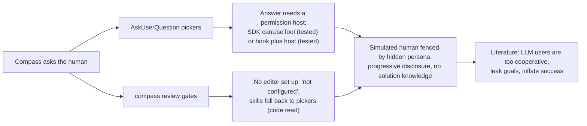

# Axis 3: Agents Acting as Humans on a Headless Compass Build

> [!IMPORTANT]
> You decide: which route the simulated human takes for pickers and for review gates, and how much it is allowed to know. Nothing here is binding; this is evidence for the plan.

## Question

How can an agent play the human through a whole Compass build headless (pickers, review approvals, steering) without leaking expert knowledge that makes the run unrealistic?

## Methodology

Systematic mapping study (the chooser's default), run over three source kinds: Claude Code and Agent SDK documentation, user-simulator papers and benchmark code, and Compass's own code under `plugin/cli/`. Documented claims about headless behavior were checked by small local experiments with Claude Code 2.1.316 and `claude-agent-sdk` 0.2.176 (code and behavior over documentation). Findings are marked and graded (the brief carried `grading: allowed`); grade = how much the evidence type should weigh for this topic, separate from confidence.

## Findings

### A. Answering AskUserQuestion headless

1. **Plain `claude -p` does not offer AskUserQuestion at all** (confidence: high)
   In a plain `-p` run with a PreToolUse hook configured for it, the init event's tool list lacked `AskUserQuestion`; the model searched for it, found nothing and asked in prose. The hook never fired. Docs say the tool is offered in `-p` only when the run has a permission host.
   - Local experiment 1 (haiku, project `.claude/settings.json` hook): tool absent, hook log not created, result text asked "Red or Blue?" in prose.
   - https://code.claude.com/docs/en/hooks ("Tools that require user interaction"): offered "only when the run has a permission host".
   - Marks: local experiment plus vendor docs; no retraction; not a preprint; 0 citations; 2 sources agree
   - Grade: high (direct reproduction on the installed version)

2. **An SDK `can_use_tool` callback answers AskUserQuestion headless** (confidence: high)
   The callback receives `{"questions":[{question, header, options[{label,description}], multiSelect}]}` and returns allow with `updated_input = {questions, answers}` where `answers` maps each question text to an option label (multi-select: array or comma-joined). A free-text reply puts the text as the value. The run continued with the chosen label.
   - Local experiment 2: callback saw `AskUserQuestion`, returned the last option, result was "Blue".
   - https://code.claude.com/docs/en/agent-sdk/user-input ("Handle clarifying questions", "Response format").
   - Marks: local experiment plus vendor docs; no retraction; not a preprint; 0 citations; 2 sources agree
   - Grade: high

3. **A settings-file PreToolUse command hook can answer AskUserQuestion when a permission host exists** (confidence: high)
   The hook returns `permissionDecision: "allow"` with `updatedInput` holding the original `questions` plus `answers`; `allow` alone is insufficient. With an SDK callback present and `setting_sources=["project"]`, the shell hook fired first and answered (picked "Red"); the callback was never reached. This lets a plain script, with no SDK code in the loop, play the human.
   - Local experiment 3: hook log recorded the full PreToolUse event; callback list stayed empty; result "Red".
   - https://code.claude.com/docs/en/hooks ("Answering AskUserQuestion via updatedInput").
   - Marks: local experiment plus vendor docs; no retraction; not a preprint; 0 citations; 2 sources agree
   - Grade: high

4. **Other documented routes: `--permission-prompt-tool`, `defer`, `--permission-prompts none`, `dontAsk`** (confidence: medium)
   `--permission-prompt-tool` names an MCP tool as the permission host. A PreToolUse `defer` ends the turn with `stop_reason: "tool_deferred"` and `deferred_tool_use` (id, name, input); the caller resumes with `claude -p --resume <id>` and the hook then returns allow with the answer. `--permission-prompts none` removes AskUserQuestion; `dontAsk` denies it even if allowed. These were read, not run.
   - https://code.claude.com/docs/en/hooks ("Defer a tool call for later"); https://code.claude.com/docs/en/headless ("Turn off permission prompts").
   - Marks: vendor docs; no retraction; not a preprint; 0 citations; 1 source
   - Grade: medium (not reproduced)

5. **Subagents never get AskUserQuestion** (confidence: high)
   Docs remove it from every subagent regardless of the `tools` field; forks are the one exception. Compass's rules already say a subagent returns its question to the orchestrator, so the simulated human only ever answers the main session's questions.
   - https://code.claude.com/docs/en/sub-agents ("Available tools"); https://code.claude.com/docs/en/agent-sdk/user-input ("Limitations").
   - `plugin/templates/rules/compass-pipeline.md:16` - subagent stops and returns the question to the orchestrator.
   - Marks: vendor docs plus code read; no retraction; not a preprint; 0 citations; 2 sources agree
   - Grade: high

6. **Settings and plugins load into the SDK by default; a throwaway run must say what it isolates** (confidence: medium)
   Omitting `setting_sources` equals user, project and local: the host's `~/.claude` hooks, CLAUDE.md and memory load unless `[]` is passed or `CLAUDE_CODE_DISABLE_AUTO_MEMORY=1` is set. `--bare` skips hooks and CLAUDE.md but does not use the subscription login (API key only). Axis 5 owns isolation; the point here is that the answering hook lives in the same settings surface that carries Compass's own hooks.
   - https://code.claude.com/docs/en/agent-sdk/claude-code-features; https://code.claude.com/docs/en/headless ("Start faster with bare mode").
   - Marks: vendor docs; no retraction; not a preprint; 0 citations; 2 pages agree
   - Grade: medium

### B. Compass's own gates

7. **Compass asks through two mechanisms: pickers and `compass review`** (confidence: high)
   Pickers: one question per call, recommended option first labelled "(Recommended)", "Other" open. Documents (spec, plan, research axes, vision, build phase pause) go through `compass review` when a surface is configured; otherwise the same gate is asked as a picker with the content shown as plain text.
   - `plugin/templates/rules/compass-pipeline.md:16-18`; `plugin/skills/spec/SKILL.md:101-103`; `plugin/skills/plan/SKILL.md:21`; `plugin/skills/research/SKILL.md:51-53`; `plugin/skills/autopilot/SKILL.md:45`; `plugin/skills/build/SKILL.md:78`.
   - Marks: code read; no retraction; not a preprint; 0 citations; 6 files agree
   - Grade: high

8. **Review surfaces are hard-coded and need an editor; "not configured" is the headless path** (confidence: high)
   `SURFACES = [obsidian, vscode, vscode.CURSOR]`. Obsidian needs an ancestor `.obsidian/` listed in Obsidian's own vault list (`COMPASS_OBSIDIAN_CONFIG` overrides the list's path) with the plugin on; VS Code and Cursor need `code`/`cursor` on PATH with the extension installed. A document must also be committed. Any miss prints `not configured: <why>` (exit 1) and the skill then asks the picker.
   - `plugin/cli/review_surfaces/__init__.py` (SURFACES); `obsidian.py:126-146`; `vscode.py:168-195`; `plugin/cli/commands/review.py:39-41,388-392`.
   - Marks: code read; no retraction; not a preprint; 0 citations; 1 source
   - Grade: high

9. **Risk: on a machine with `code` and the extension, a throwaway project is "configured" and the review opens a real window** (confidence: medium)
   VS Code's `configuration` needs only a `.compass` folder, `code` on PATH and the extension listed; `deliver` runs `code <root>`. `review_editor` in `plugin.yaml` accepts only obsidian, vscode, cursor (unknown names fall back to trying all surfaces); there is no value meaning "none". Inferred from code, not run. If the editor never claims the request, `compass review` withdraws it after 60 s with `not configured: ... did not pick up review`.
   - `plugin/cli/reviewlib.py` `_in_order`, `choose`; `plugin/cli/commands/review.py:97-98,310-315`.
   - Marks: code read; no retraction; not a preprint; 0 citations; 1 source
   - Grade: medium (inference, not run)

10. **The review verdict is a small file protocol a script could write** (confidence: high)
    `<id>.request.json` appears in `.compass/tmp/review/`; the waiter returns when `<id>.verdict.json` holds `{"id", "file", "verdict": "approved"|"changes", "notes", "at"}` plus optional `comments`, `edited`, and per-file `files` entries `{file, read(bool), note, verdict}`. An `<id>.seen` file must exist within 60 s or the request is withdrawn. The surface list is not pluggable, so a responder only helps if some real surface is configured; otherwise the not-configured picker path applies.
    - `plugin/cli/reviewlib.py:1-50,443-461`; `plugin/cli/commands/review.py:294-318`.
    - Marks: code read; no retraction; not a preprint; 0 citations; 1 source
    - Grade: high

11. **On an approved verdict the gate's follow-up questions take their recommended option** (confidence: high)
    Notes and `comment` lines steer what follows; a `changes` verdict makes the agent apply notes and resend the revised document. The simulated human's review output is therefore a verdict plus free-text notes, the same shape as a picker's "Other".
    - `plugin/templates/rules/compass-pipeline.md:18`.
    - Marks: code read; no retraction; not a preprint; 0 citations; 1 source
    - Grade: high

### C. Simulated-user literature

12. **tau-bench's user simulator: scenario-holding LLM with progressive disclosure rules** (confidence: high)
    The system prompt carries the scenario as an instruction and says: one line at a time, "Do not give away all the instruction at once", do not invent details (say you do not remember), do not repeat the instruction verbatim, emit `###STOP###` when the goal is met. tau2-bench adds a prompt with "Disclose information progressively" and "Never make up ... information", and for telecom gives the user tools on a mocked phone so behavior is bounded by environment state instead of prompting.
    - https://raw.githubusercontent.com/sierra-research/tau-bench/main/tau_bench/envs/user.py (code read).
    - https://arxiv.org/html/2506.07982v1 §4.1, App. C.2.
    - Marks: code owner checked (Sierra Research) plus paper; no retraction; arXiv preprint 2025-06; citation count not retrieved; 2 sources agree
    - Grade: medium (a different domain from software building)

13. **LLM users are too cooperative: they front-load information and inflate agent success** (confidence: high)
    451 real people against 31 simulators on tau-bench tasks: simulators are "excessively cooperative, stylistically uniform", give all details at the start, rarely push back, and produce an "easy mode" (human baseline success 63.6%, top simulators 77.8%). Capability does not predict fidelity.
    - https://arxiv.org/abs/2603.11245 (Zhou et al., COLM 2026, v2 2026-07-31); https://arxiv.org/html/2603.11245v2 §5.
    - Marks: peer-reviewed venue per arXiv comment (COLM 2026) plus preprint; no retraction seen; citation count not retrieved; converges with 14, 15, 16
    - Grade: high (large human comparison on the benchmark in question)

14. **Simulator choice moves measured agent performance, and violations hide behind success** (confidence: medium)
    Swapping the user model shifted agent success by up to 9 points (Lost in Simulation, tau-bench retail with real users in four countries). With the agent fixed, swapping only the simulated user moved mean reward 15.2 points and 24.4% of successful episodes contained a user-specification violation, most often volunteering information before it was requested (UserProxyBench).
    - https://arxiv.org/abs/2601.17087 (preprint 2026); https://arxiv.org/html/2609.38043 §3 (preprint 2026; rubrics written and graded by the same model, single rater audit, one rollout per task, per its §4).
    - Marks: both arXiv preprints, no published versions seen; no retraction seen; citation counts not retrieved; 2 sources agree
    - Grade: medium (preprints, author-acknowledged limits)

15. **Prompting a simulator toward realism is not monotone** (confidence: medium)
    A persona prompt asking for gradual disclosure, uncertainty and pushback moved politeness and front-loading toward humans but overshot uncertainty; the overall index fell from 70.9 to 64.6. Models fine-tuned for user simulation did not close the gap. Authors' reading: improving some behaviors "can move others further away".
    - https://arxiv.org/html/2603.11245v2 §7, App. A.6.
    - Marks: peer-reviewed venue (COLM 2026) plus preprint; no retraction seen; citation count not retrieved; 1 source
    - Grade: medium (one prompt, 50 tasks)

16. **A too-helpful simulator is gamed by the agent; a stricter one fixes it** (confidence: medium)
    Training a clarifying agent against a cooperative simulator produced reward hacking: generic questions like "anything else?" made the simulator reveal the next piece of the hidden goal. The fix: reveal task details only when the question is specific and relevant, answer vague questions with "No, that's all", and say "Could you be more specific?".
    - https://arxiv.org/html/2606.03135v1 §3.3 and §6.3.4.
    - Marks: arXiv preprint 2026-06; no retraction seen; citation count not retrieved; 1 source
    - Grade: low-to-medium (single preprint, a training setting)

17. **Willingness is an input, so simulated users do not walk away** (confidence: medium)
    Against 2,790 real sales chats, simulated non-buyers kept deliberating where real ones stopped (resistance 13.5% vs 25.1%). The author ties it to tau-bench's design: the simulator emits `###STOP###` only when the assigned goal is satisfied. Telling the simulator it may disengage cut overall bias about fivefold but not the buyer/non-buyer gap.
    - https://arxiv.org/abs/2606.20708 (single author, preprint 2026-06-16).
    - Marks: arXiv preprint; no retraction seen; citation count not retrieved; 1 source
    - Grade: low-to-medium (sales domain, one author)

18. **Interactive project-building benchmarks fence the simulated user with authored records** (confidence: medium)
    ICAE-Bench has coding agents build whole projects from vague requirements. Its User Agent is a router restricted to benchmark-authored hidden-requirement records (ID, trigger phrases, grounded reply, oracle reply), at most three matched points per reply, a fixed fallback reply for unmatched questions, a 16-query budget, and three boundaries: it never sees original code or tests, the builder never sees the records, and scoring runs in a fresh container. Raising the budget from 16 to 24 raised fallback from 27.7% to 31.9% and lowered overall pass from 37.4% to 34.4%. Compass's setting differs: agents choose the topic (D-01), so no authored hidden records exist before the run.
    - https://arxiv.org/html/2607.21217v1 §III-B, §III-E, §IV-C5 (first 100,000 characters read).
    - Marks: arXiv preprint 2026-07; no retraction seen; citation count not retrieved; 1 source
    - Grade: medium (closest setting, preprint)

19. **The tau2-bench simulator was itself audited and found imperfect** (confidence: high)
    Two annotators reviewed user turns: user-simulator errors in 47% of airline, 40% retail and 16% telecom conversations, of which 13%, 12% and 6% were task-critical (the paper's caption and table disagree on telecom critical errors). The authors credit telecom's lower rate to tool-constrained, state-grounded user behavior.
    - https://arxiv.org/html/2506.07982v1 §4.3, Table 2.
    - Marks: arXiv preprint 2025-06 (later published venue not checked); no retraction seen; citation count not retrieved; 1 source
    - Grade: medium

## Taxonomy of the options the evidence names

| Concern | Options documented |
|---|---|
| Answer pickers | SDK `can_use_tool` (tested); settings PreToolUse hook plus a permission host (tested); `--permission-prompt-tool` MCP host or `defer` and `--resume` (read only) |
| Answer review gates | No surface configured, so a picker (code read); a responder writing `.seen` and `.verdict.json` (code read, needs a configured real surface) |
| Keep the simulated human realistic | Hidden persona and goal with progressive disclosure (tau-bench); strict specificity rule (2606.03135); authored records plus fallback and budget (ICAE-Bench); environment-grounded user tools (tau2 telecom) |
| Check the simulator | Human comparison (2603.11245); rubric scoring of user turns (UserProxyBench); annotator audit (tau2) |

## Contradictions

- Docs say a PreToolUse hook can answer AskUserQuestion via `updatedInput`, and also say `-p` needs a permission host. Both hold: experiment 1 (no host) showed the tool absent; experiment 3 (host present) showed the hook answering.
- tau2's Table 2 caption says no critical telecom errors; its table and text list 3 (6%).
- Finding 15 (prompting for realism can lower fidelity) sits beside findings 12 and 16 (prompt rules for disclosure help); the sources differ in what they measured (index vs reward hacking).

## Gaps

- `claude -p --input-format stream-json` with a settings hook was not tested (the run was blocked by Compass's delete guard on an unrelated cleanup command); whether stream-json input counts as a permission host is unverified.
- `--permission-prompt-tool` and `defer`/`--resume` round trips were read, not run.
- No headless run of Compass itself was made: unknown how Compass's own hooks (guard, context-check, capture, self-update) behave under SDK `setting_sources`, and whether a skill that ends its turn on `requested <id>` (the review rule says end the turn) ends the whole headless run, needing a driver to send the next message.
- Whether VS Code or Cursor on PATH actually makes a throwaway project open a window (finding 9) is inferred from code.
- Not found in the sources read: a study of simulated users playing a software owner through a whole spec, plan, build workflow with no authored hidden records. ICAE-Bench is closest but authors its records in advance.
- tau2 Appendix E failure modes (premature termination and two others) and ICAE-Bench Appendices G and H (user-agent prompt) were not read; citation counts for all papers were not retrieved.
- Cost and token overhead of the simulated human itself (a second model session per answer) is unmeasured; it matters because SPEC-032 measures tokens and the simulator must not be counted as Compass overhead (axis 2).

## Raw Evidence

Experiments (scratchpad)

- Experiment 1: `<session scratchpad>/exp1/out1.jsonl`, plain `claude -p --output-format stream-json --verbose --model haiku`, hook configured in `exp1\.claude\settings.json`; init tool list lacked AskUserQuestion; cost about 0.007 USD.
- Experiment 2: `...\scratchpad\exp2\sdktest.py`, `claude-agent-sdk` 0.2.176 in `...\scratchpad\sdkvenv`; `can_use_tool` answered the question; result "Blue".
- Experiment 3: `...\scratchpad\exp2\sdktest2.py` with `setting_sources=["project"]`; hook log `...\scratchpad\exp1\hook.log` holds the PreToolUse event; callback list empty; result "Red".

