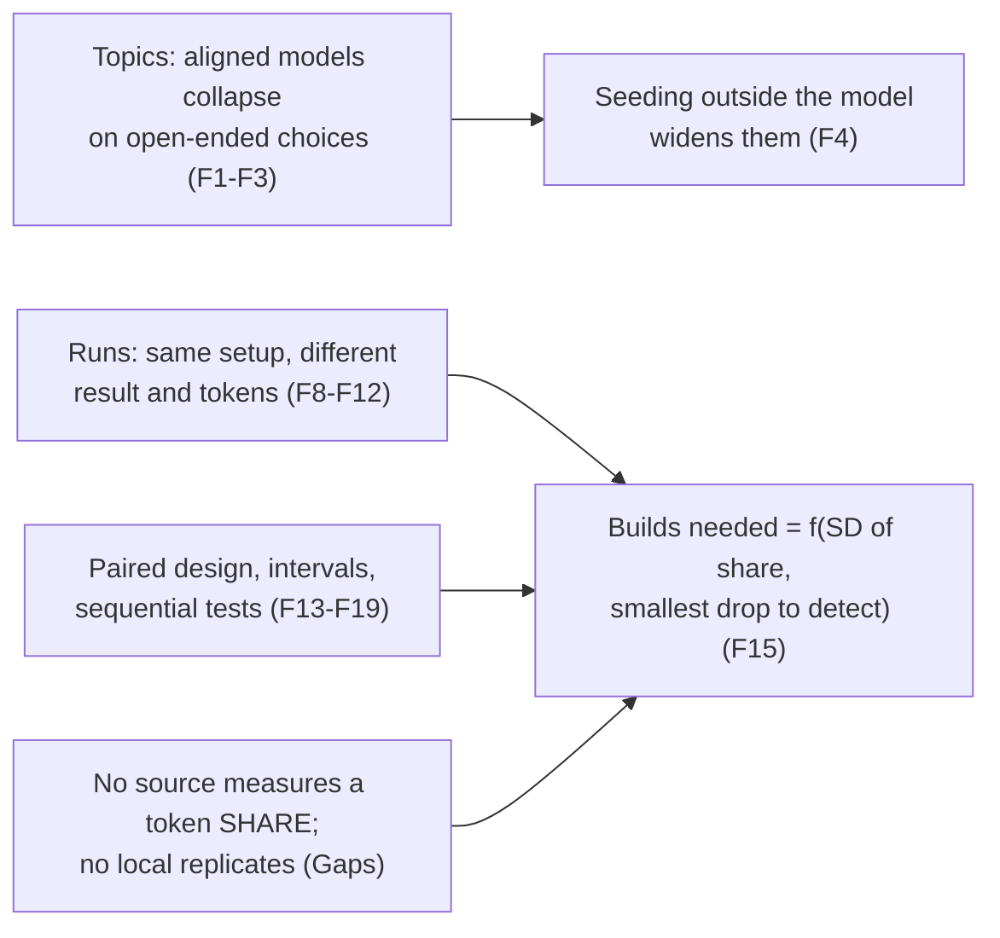

# Whole Overhead, Axis 4: Topics and How Many Builds

> [!IMPORTANT]
> You decide: whether the plan fixes the number of builds only after a pilot has measured how much the overhead share varies from build to build, and whether topics picked by agents are recorded and reused across before/after runs. Both change what D-01 ("agents pick the topic") means in practice. Neither is settled by the sources below.

This is axis 4 of [[RESEARCH-whole-overhead-axes]] for [[SPEC-032-whole-overhead-measured-on-real-projects]]. Grading: the axes document ticks grading, so each finding carries a GRADE-style certainty (high, moderate, low) for its evidence type, separate from the finding's confidence.

## Question

How do agents pick varied project topics without collapsing to a few, and how many builds make the Compass overhead share a stable number, including how to compare before and after a change?

## Scope

In: topic-diversity and mode-collapse literature, run-to-run variance of coding agents (pass rate and tokens), eval statistics (paired design, intervals, power, sequential tests), local `bench/` and loop records. Out: how tokens are split (axis 2), how agents act as humans (axis 3), success judgment (axis 6).

## Methodology

Systematic mapping study (the default; the question mixes "what exists" for topic diversity with "how does a system behave" for variance), plus repository mining of `F:\claude\plugins\compass\bench\` and the vault. Abbreviated like a rapid review: one reviewer, most web sources read through a fetch summarizer or search summary (flagged per finding), no registered protocol. Every finding carries marks. Citation counts came from Semantic Scholar where it answered (rate limited); otherwise "not retrieved".

## Findings

### Topic choice and diversity

1. **Aligned models repeat themselves and each other on open-ended prompts** (confidence: medium)
   Artificial Hivemind: 26K open-ended real queries (Infinity-Chat), 70+ models, 50 answers per question on 100 questions. Two effects: one model repeats itself, and different models land on similar ideas that differ mainly in wording. Judges and reward models also under-reward diverse answers.
   - Evidence: https://arxiv.org/abs/2510.22954 (via search summary; the similarity numbers were not read)
   - Marks: peer-reviewed (reported by secondary notes as NeurIPS 2025 best paper, venue not read from the source); not retracted; published; citations not retrieved; 3 sources agree on the effect (F2, F5, [Jiang et al. as cited by 2604.18005 summary])
   - Grade: moderate

2. **The stated cause is typicality bias in human preference data** (confidence: medium)
   Annotators picked the response the base model found more likely 51.6 to 60.8% of the time on HelpSteer; the fitted bias weight was 0.57 and 0.65. The paper argues this sharpens a model toward its mode even with a perfect reward model, most when many answers are equally good (a project topic is such a case).
   - Evidence: https://arxiv.org/html/2510.01171v4 (first 100K characters read)
   - Marks: preprint v4 dated 2026-07-15 (ICML keyword present, acceptance not stated); not retracted; citations not retrieved; 2 sources (with F1)
   - Grade: moderate

3. **Verbalized Sampling asks the model for K candidates with probabilities** (confidence: medium)
   Prompt-only: "generate 5 ... with their probabilities". Creative writing diversity rose 1.6 to 2.1x over direct prompting, human diversity ratings rose (joke 1.83 to 3.01), bigger models gained 1.5 to 2x more, it is described as independent of temperature. Costs the paper states: quality drops somewhat, more for small models, and with too many candidates per call. Tested on poems, stories, jokes, dialogue, open QA, not on project or software topics.
   - Evidence: https://arxiv.org/html/2510.01171v4 (Limitations appendix was cut off and not read)
   - Marks: preprint, as F2; authors' own benchmark and a Claude judge; not retracted; citations not retrieved; 1 source
   - Grade: low for transfer to project topics, moderate for creative writing

4. **Diversity can be injected from outside the model: sample attributes in code and put them in the prompt** (confidence: medium)
   Documented recipes: Persona Hub (1,015,863,523 personas, one persona per synthesis prompt; v3, still marked work in progress), TinyStories (one random verb, noun, adjective from a ~1,500-word vocabulary plus a random feature subset per story), attribute-conditioned generation columns in NVIDIA NeMo Data Designer. A practitioner write-up warns that independently sampled attributes yield implausible combinations (an 18 year-old physician).
   - Evidence: https://arxiv.org/abs/2406.20094; https://www.promptingguide.ai/applications/generating_textbooks; https://amitness.com/posts/diversity-evals/; https://www.skysight.inc/blog/synthetic-humans (all via search summary)
   - Marks: preprint plus 3 blogs, owners not checked; citations not retrieved; 4 sources agree on the technique, none tests project topics
   - Grade: low
   - Caveat: seeding makes the harness, not the agent, choose part of the topic; whether that still satisfies D-01 is a question for the planner (see Gaps).

5. **Agents that interact converge; independent generation before any exchange keeps diversity** (confidence: low)
   Across models, roles and system design, densely connected agents "accelerate premature convergence" and authority personas lower diversity; the authors advise keeping agents independent. Their mitigation (write ideas independently before discussing) is reported only through a search summary. The study is about agents talking to each other, not separate sessions that never share history.
   - Evidence: https://arxiv.org/abs/2604.18005 (abstract read; Vendi numbers and mitigation effect not read)
   - Marks: peer-reviewed (ACL 2026 Findings per the abstract page); not retracted; citations not retrieved; 1 source
   - Grade: moderate for the finding, low for relevance to separate headless builds

6. **Claude Code's choices concentrate, and context moves them more than randomness does** (confidence: medium)
   2,430 open-ended prompts to Claude Code (3 models, 4 repos, 20 categories, 3 independent runs each). On identical model, prompt and repo: all 3 runs picked the same tool 73%, two of three 25%, all different 2.5%. Rewording the prompt changed the top pick 24% of the time; the report attributes variation to "project context (which repo), not randomness". It studies tool choice (deployment, database), not whole-project topics. A smaller N=10 test disagreed on specific defaults.
   - Evidence: https://amplifying.ai/research/claude-code-picks/report (read via summarizer)
   - Marks: industry report, owner is the publisher Amplifying; extraction done by Claude itself, about 85% accurate on a 50-item check, intervals exclude that error; not peer reviewed; citations not retrieved; 1 source plus a conflicting smaller one
   - Grade: low

### Run-to-run variance of agents

7. **Same model, same scaffold: single-run pass@1 moves 2.2 to 6.0 points** (confidence: high)
   60,000 trajectories: 3 models x 2 scaffolds x 2 temperatures, 10 runs each, 500 SWE-bench Verified tasks. Standard deviation 0.7 (minimum), 1.5 (median), 1.8 (maximum) points; above 1.5 even at temperature 0 for several setups. Two runs first differ at a median token 5 at temperature 1.0 and token 56 at temperature 0. Shapiro-Wilk passed for 11 of 12 setups, so run scores are treated as roughly normal.
   - Evidence: https://arxiv.org/abs/2602.07150 (abstract); https://dev.to/devinios/same-model-same-scaffold-10-runs-agent-benchmark-scores-still-move-by-up-to-6-points-gmb (tables, a blog restating the paper)
   - Marks: preprint v3 2026-03-25; not retracted; citations not retrieved; 3 sources agree (this, F8, F9), no code or data linked per the blog
   - Grade: moderate

8. **Runs needed from that variance, and a check against the eval-statistics formula** (confidence: high)
   Paper: to detect a 2-point gain at p < 0.05 and 80% power, 2, 9 or 13 runs per setup at SD 0.7, 1.5, 1.8; a 1-point gain needs 8, 36 or 51; a 5-point gain 2 runs at the median SD. The recommendations: several runs per task, power analysis, and report pass@k (optimistic) and pass^k (pessimistic). Researcher check: n = 2(1.96+0.84)^2 (SD/gain)^2 reproduces 9, 13, 2, 36 to rounding.
   - Evidence: https://dev.to/devinios/same-model-same-scaffold-10-runs-agent-benchmark-scores-still-move-by-up-to-6-points-gmb; https://arxiv.org/abs/2602.07150
   - Marks: preprint as F7; arithmetic check done here; 2 sources agree
   - Grade: moderate

9. **A second study: identical runs varied more than the agents differed** (confidence: medium)
   584 runs of one ML task, six agent and model pairings run 52 times each. Identical runs of one pairing varied more than pairings differed; telling the observed differences apart would take "tens to more than a hundred runs of each". Two agents on one model differed in cost by more than 20x, mostly from prompt-cache behavior. One task only.
   - Evidence: https://arxiv.org/abs/2609.33812 (abstract page; data and code at github.com/earino/identical-runs-different-results, not opened)
   - Marks: preprint v1; not retracted; 2 citations; 2 sources agree on direction (F7)
   - Grade: moderate

10. **Token use itself varies a lot between runs of one task** (confidence: medium)
    8 models on SWE-bench Verified, 4 runs per task per model. Runs of one task differ by up to 30x in total tokens (a maximum, source task not shown); averaged over 500 instances the costliest run is about 2x the cheapest. Costlier problems also vary more. Input tokens drive cost. The paper is internally inconsistent on whether accuracy plateaus or falls at the highest cost.
    - Evidence: https://arxiv.org/html/2604.22750v3 (read via summarizer)
    - Marks: preprint cs.CL v3 2026-10-02; not retracted; 47 citations; 1 source, echoed by ACEM (arXiv:2608.02582, search summary only)
    - Grade: moderate

11. **Variance concentrates in a few tasks, and prompt or task changes dwarf reruns** (confidence: low)
    AgentLens (search summary only): 5 runs of one model, mean 67.28, SD 0.94; 15 tasks passed all five, 1 failed all five, 16 were flaky. Noise Floor Audit (abstract only): at temperature 0 reruns of function-calling tasks flipped 0.7 to 2.7% of tasks, while semantics-preserving prompt perturbations gave paired SDs 11 to 58x the rerun SD. Amplifying (F6) reports the same ordering for tool choice. Read together, changing the task moves results far more than rerunning it; no source tests this for a token share.
    - Evidence: https://arxiv.org/pdf/2607.06624; https://arxiv.org/abs/2608.22331
    - Marks: 2 preprints, citations not retrieved; 3 sources agree on direction (with F6), none on a token share
    - Grade: low

12. **Practice with few runs: report intervals and expect published numbers to fall outside them** (confidence: medium)
    AI Agents That Matter reports 95% intervals with Student's t over five runs per agent, and found many reported accuracies above the maximum of its five reproduction runs and baselines below the minimum.
    - Evidence: https://arxiv.org/pdf/2407.01502 (text read via pdftotext, lines 631-633 and 1044-1045)
    - Marks: preprint, venue not checked; citations not retrieved; 1 source
    - Grade: moderate

### Comparing before and after

13. **Paired differences cut variance when the two arms score the same items** (confidence: high)
    Var(paired) = (Var(A) + Var(B) - 2 Cov(A,B))/n against (Var(A) + Var(B))/n unpaired. Frontier-model question scores correlate between 0.3 and 0.7, which the paper calls a "free" reduction. Recommended report: mean difference, its standard error and interval, and the correlation.
    - Evidence: https://arxiv.org/pdf/2411.00640 (pdftotext lines 348-406); https://www.anthropic.com/research/statistical-approach-to-model-evals
    - Marks: preprint (stat.AP, no venue stated); not retracted; 191 citations; 2 sources agree (paper and its own announcement)
    - Grade: high for the statistics, low for the correlation of Compass builds (not measured)

14. **Resampling an item K times helps only until between-item variance dominates** (confidence: high)
    Worked binary case: K=2 cuts total variance by 1/3, K=4 by 1/2, K=6 by 5/9, limit 2/3. Once the within-item variance over K is much smaller than the variance across items, more resamples change little. Here the "item" is a topic and the "resample" is a repeat build of it.
    - Evidence: https://arxiv.org/pdf/2411.00640 (pdftotext lines 240-263)
    - Marks: as F13; 1 source
    - Grade: high

15. **Sample-size formula for a paired comparison, and what it gives when the spread is unknown** (confidence: medium)
    n = (z_a/2 + z_b)^2 (s_d^2 + s_A^2/K_A + s_B^2/K_B) / delta^2, with s_d^2 the variance of per-item mean differences and s^2/K the within-item noise (the extracted text lost the symbols; the worked example fixes the structure). Computed here with K=1, alpha 0.05, power 0.8, n = 15.7 x (SD/delta)^2 builds per arm unpaired, times (1 - r) when paired with correlation r:

    | SD of share / smallest drop worth seeing | unpaired, per arm | paired, r = 0.5 |
    |---|---|---|
    | 0.5 | 4 | 2 |
    | 1 | 16 | 8 |
    | 2 | 63 | 31 |
    | 3 | 141 | 71 |

    The SD of the overhead share across builds is not measured anywhere in the repo or in the sources.
    - Evidence: https://arxiv.org/pdf/2411.00640 (pdftotext lines 465-500); table is the researcher's arithmetic
    - Marks: as F13; arithmetic unverified by another source
    - Grade: high for the formula, low for the table (inputs unmeasured)

16. **Clustered standard errors can be over 3x the naive ones when items come in related groups** (confidence: medium)
    On DROP the clustered to naive ratio was 3.05. Builds that share a topic kind, stack, or parent session are such a group.
    - Evidence: https://arxiv.org/pdf/2411.00640 (Table 4 and section 2.2); https://www.anthropic.com/research/statistical-approach-to-model-evals
    - Marks: as F13; the application to builds is the researcher's reading
    - Grade: high for the statistic, low for the application

17. **A share is a ratio of two random sums, which has its own interval method** (confidence: low)
    The delta method (first-order Taylor expansion) gives the variance of a ratio metric, with a bias-corrected interval and handling for clustered data, presented as simpler than Fieller's method.
    - Evidence: https://dl.acm.org/doi/10.1145/3219819.3219919 (KDD 2018, via search summary only)
    - Marks: peer-reviewed; not retracted; citations not retrieved; 1 source
    - Grade: moderate

18. **Sequential tests allow stopping early; two documented forms** (confidence: medium)
    Mixture SPRT "always valid" p-values and intervals stay valid under continuous peeking but have less power than group-sequential tests at a fixed sample size. AgentAssay adapts Wald's SPRT to agents with PASS, FAIL or INCONCLUSIVE verdicts and reports 78% fewer trials (5 models, 3 scenarios, 7,605 trials; single-author technical report, claim not independently checked). Compass already holds this in [[RESEARCH-control-theory-for-loops]] (finding 101, line 355) at confidence low.
    - Evidence: https://arxiv.org/abs/1512.04922; https://arxiv.org/abs/2603.02601; `F:\claude\plugins\compass\.compass\research\pipeline\RESEARCH-control-theory-for-loops.md:355`
    - Marks: Operations Research 2022 (peer-reviewed, 103 citations) and a preprint with 7 citations; not retracted; 3 sources, different mechanisms
    - Grade: moderate for mSPRT, low for AgentAssay

19. **Paired tests on near-identical systems often cannot separate them, and non-rejection is not equivalence** (confidence: medium)
    On SWE-bench, exact paired McNemar tests separated none of 29 neighboring pairs in Verified's top 30. The authors state "non-rejection does not establish equivalence". Relevant to the KPI clause that agents still finish what they set out to build.
    - Evidence: https://arxiv.org/abs/2609.17394 (abstract page read)
    - Marks: peer-reviewed (ADMA 2026 special session, camera-ready); observational on published results, no new runs; 0 citations; 1 source
    - Grade: moderate

### Local evidence

20. **`bench/` holds three single runs and no replicates, so it gives no variance estimate** (confidence: high)
    The two smoke fixtures show +4.3% and +4.8% tokens (compass arm over baseline), the qutebrowser run +39%. Each is one run per arm; the qutebrowser summary calls itself "N=1 is anecdote, not data" and asks for 5 to 10 tasks. The arms run the same task, so the bench design is already paired by task. The smoke runs measured methodology-as-text, not the installed plugin.
    - Evidence: `F:\claude\plugins\compass\bench\runs\20260610T202237_binary-search-bug\summary.md`; `F:\claude\plugins\compass\bench\runs\20260610T202535_merge-sorted-lists\summary.md`; `F:\claude\plugins\compass\bench\runs\20260610T223212_swebp-qutebrowser-elf\summary.md`; `F:\claude\plugins\compass\bench\runs\summary-cross-runs.md`
    - Marks: local measurement, N=1 each; not applicable (retraction, preprint, citations); 3 runs, tasks differ so the 4% to 39% spread mixes task and noise
    - Grade: low

21. **The only repeated local record is the LOOP-003 ledger, and it is not an overhead share** (confidence: medium)
    42 recorded actuator runs, cost_usd mean 0.243, SD 0.115, min 0.0, max 0.380, each run on a different item. The loop's reading is shipped-text size, which is deterministic.
    - Evidence: `F:\claude\plugins\compass\.compass\loops\LOOP-003-session-context\ledger.jsonl` (computed with Python over rows of type "run")
    - Marks: local measurement; not applicable; 1 source
    - Grade: low for this axis

## Contradictions

- F7 says temperature 0 leaves SD above 1.5 points on multi-step SWE tasks; the Noise Floor Audit (F11) found temperature-0 reruns nearly identical on single-turn function calling. The task types differ (long agent trajectory vs one call); F7 itself notes variance at temperature 0 depends on inference software and hardware.
- F10 says the costliest run is about 2x the cheapest on average and up to 30x at the extreme; both appear in the same paper, one as typical and one as maximum.
- F6's Amplifying report and the smaller SitePoint test disagree on specific defaults (pnpm, Vercel, AWS); the larger study is the better sampled.

## Gaps

- No source measures run-to-run variance of a token share or of a plugin's overhead; all variance data is on pass rate or total tokens. Closing it takes a pilot: several builds, repeated, to get the SD of the share between builds and within one topic.
- No source studies coding agents choosing their own whole-project topics. Nearest: open-ended generation (F1 to F5) and tool choice (F6). A pilot that records topics from N headless sessions and clusters them would show the collapse directly.
- Sources pair at fixed items (questions, SWE instances). None addresses pairing when the items are chosen by the agent. Question for the planner: are topics recorded on first pick and replayed across before/after runs (paired, but the pool is then fixed), or does each run pick fresh (unpaired, wider intervals)?
- No source tested whether seeded constraints (kind, size, language) injected by the harness keep agent-chosen topics varied while staying "picked by the agent" under D-01.
- Not sourced: model-version drift between a baseline taken earlier and a re-measure later, and whether arms should be interleaved in time.
- Citation counts not retrieved for most sources (rate-limited API); several papers were read through search summaries or abstract pages only, flagged per finding.
