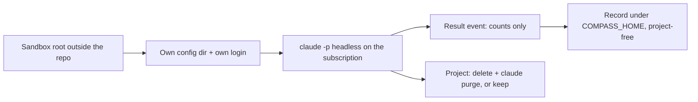

# Axis 5: Throwaway Projects, Kept Private

> [!IMPORTANT]
> You decide: is this evidence enough to plan the sandbox runner, given the gaps listed at the end (no full build measured, the sandbox login route untested)?

## Question

Where do throwaway build projects live, how does each headless run stay cut off from the user's real settings, memory, CLAUDE.md, MCP servers and plugins, what do runs on a subscription cost and how are they limited, and how does a measurement record leave the sandbox without project content?

## Scope

In: Claude Code 2.1.316 on Windows 11 (the installed version), the `bench/` harness, `plugin/cli/commands/loop.py` and the code it calls. Out: how tokens are attributed to Compass (axis 2), how agents play the human (axis 3), success judging (axis 6).

## Methodology

Technology landscape / comparative evaluation (DESMET-style case-study feature analysis): the axis asks which of several isolation mechanisms (config dir, flags, worktree, container, VM) fits a fixed set of needs, so each was checked against vendor documentation and, where cheap, a local trial. Code over documentation: `bench/` and `loop.py` were read as code. No `grading:` disclosure was needed beyond the brief's `grading: allowed`, so each finding carries a Grade line.

Local trials are my own throwaway headless runs from a scratch folder under the session scratchpad (about 8 calls, estimated $0.5 in total); each is N=1 and labelled as such.

## Findings

### A. What exists in Compass today

1. **`bench/agents/` does not exist.** The README and both arm configs name `agents/compass-agent.sh` and `agents/baseline-agent.sh`; the folder is absent on disk and `git log -- bench/agents` is empty. The only scripts in `bench/` are `scripts/setup.sh`, `analyze.py`, `fleet_update.py`. (confidence: high)
   - `bench/README.md` layout block - names the two wrappers
   - `bench/configs/arm-compass.yaml:7` - `wrapper: agents/compass-agent.sh`
   - `bench/runs/summary-cross-runs.md` - the recorded runs used the Agent tool; the bash-wrapper approach was "deprecated"
   - Marks: code read, owner checked (this repo); n/a retraction; not preprint; n/a citations; 3 files agree
   - Grade: high

2. **The two bench descriptions of the Compass arm disagree.** The README says the wrapper copies the plugin's templates and skills into the workspace `.claude/`; `arm-compass.yaml` says Claude Code loads the plugin via `--plugin-dir`. No script exists to settle which. (confidence: high)
   - `bench/README.md` Arms section vs `bench/configs/arm-compass.yaml:3-6`
   - Marks: code read, owner checked; n/a; n/a; n/a; 2 files, disagree
   - Grade: high

3. **`plugin/` has no top-level `agents/` folder; agents live in `plugin/templates/agents`.** `plugin/` holds `cli/ hooks/ obsidian/ skills/ templates/ vscode/` plus `.claude-plugin/plugin.json` (v0.34.5). The install path that places agents, rules, skills, CLI and hooks into a project's `.claude/` is `self_update._apply(SOURCE, project, apply_models=True)`, already called per project by `bench/scripts/fleet_update.py`. Whether `--plugin-dir plugin` alone gives a session the agents is untested. (confidence: medium)
   - `plugin/` listing; `plugin/.claude-plugin/plugin.json`
   - `bench/scripts/fleet_update.py:1-12, 67-70` - docstring and `refresh_install`
   - Marks: code read, owner checked; n/a; n/a; n/a; 2 sources
   - Grade: high (layout), the `--plugin-dir` consequence is untested

4. **Compass's own headless launches do not isolate from the user's configuration.** `looprunner.launch_session` runs `claude -p --output-format json --model --max-turns --max-budget-usd --strict-mcp-config [--allowedTools]` with the prompt on stdin and `COMPASS_WORKER_SESSION=1`. It sets no `--setting-sources`, no `CLAUDE_CONFIG_DIR`, no `--bare`. `capture_worker` and `clone` follow the same pattern (`clone` adds `--no-session-persistence`, `--tools`). The loop budget is per iteration: actuator cap plus judge runs times judge cap. (confidence: high)
   - `plugin/cli/looprunner.py:749-760`, `plugin/cli/commands/capture_worker.py:300-304`, `plugin/cli/commands/clone.py:~482-498`
   - `plugin/cli/looplib.py:390-396` - `run_budget`
   - Marks: code read, owner checked; n/a; n/a; n/a; 3 call sites agree
   - Grade: high

5. **Compass has two conventions a sandbox root can reuse, and no sandbox code.** `COMPASS_HOME` replaces `~/.compass` and `CLAUDE_CONFIG_DIR` replaces `~/.claude`, both honoured by `sessionslib`; kept session clones already live in `<COMPASS_HOME>/sessions/<project-key>/<run-id>/`, with `--discard` as the "throw away" switch. `~/.compass/` on this machine holds `meta/ private/ sessions/ tmp/ usage/`; `private/` holds a `denylist.txt` (21 lines, contents not read). A grep of `plugin/cli` for sandbox/throwaway/kept-project finds nothing relevant (the one `sandbox` hit in `hostlib.py:326` is about dsh hooks). (confidence: high)
   - `plugin/cli/sessionslib.py:12-14`; `plugin/cli/commands/clone.py:13-20`
   - Marks: code read, owner checked; n/a; n/a; n/a; 2 files
   - Grade: high

### B. How privacy is already kept (the precedent for the record)

6. **`usage-scan` keeps private data out by construction, in four ways.** (a) Allowlist output: keys are kept only when the file exists under the plugin tree, so transcript text cannot reach the file. (b) The file holds `machine` (12-hex hash of the host name), `scanned_at`, `days`, `sessions`, and `loads` counts. (c) `--out` inside the git work tree of the cwd or `CLAUDE_PROJECT_DIR` is refused with "usage data stays outside the repository". (d) Default output is `~/.compass/usage/<machine>.json`. Tests run with a temp HOME and assert that a project path, folder name or session id never reaches the file. (confidence: high)
   - `plugin/cli/commands/loop.py:48-56, 1286-1301`; `plugin/cli/sensorlib.py:606-609, 696-718, 745-754`
   - `plugin/cli/tests/test_usage_weighted_context.py:12, 315-326` - leak tests
   - Marks: code read, owner checked; n/a; n/a; n/a; code + tests + docstring agree
   - Grade: high

7. **The human's rule for transcript-derived data is written down.** Aggregates derived from his transcripts go under `~/.compass/`, hold only Compass source names and counts, and never name a project, path or content from his personal or work projects. (confidence: high)
   - `<Claude Code project memory>/usage-data-stays-private.md`
   - Marks: user's own memory file; n/a; n/a; n/a; 1 source
   - Grade: high (it is the constraint, not evidence about a system)

### C. Isolating a headless run from the user's configuration

8. **`--bare` is incompatible with the subscription.** Bare mode never reads OAuth or the keychain and never reads `CLAUDE_CODE_OAUTH_TOKEN`; Anthropic auth must be `ANTHROPIC_API_KEY` or `apiKeyHelper`. It also skips hooks, plugins sync, auto memory and CLAUDE.md discovery. The installed `claude --help` states the same. Docs say `--bare` will become the default for `-p` in a future release. (confidence: high)
   - https://code.claude.com/docs/en/headless (Start faster with bare mode); https://code.claude.com/docs/en/authentication (Generate a long-lived token)
   - local `claude --help` (2.1.316), `--bare` entry
   - Marks: vendor docs + installed CLI; n/a; n/a; n/a; 3 sources agree
   - Grade: high

9. **Authentication precedence puts API keys above the subscription, and `-p` always honours a present key.** Order: cloud-provider variables, `ANTHROPIC_AUTH_TOKEN`, `ANTHROPIC_API_KEY` ("In non-interactive mode (`-p`), the key is always used when present"), `apiKeyHelper`, `CLAUDE_CODE_OAUTH_TOKEN`, profiles, then subscription OAuth from `/login`. On this machine `ANTHROPIC_API_KEY` and `CLAUDE_CODE_OAUTH_TOKEN` are both unset. (confidence: high)
   - https://code.claude.com/docs/en/authentication (Authentication precedence); https://code.claude.com/docs/en/env-vars (`ANTHROPIC_API_KEY` row)
   - local `env` check
   - Marks: vendor docs + local check; n/a; n/a; n/a; 2 pages agree
   - Grade: high

10. **A fresh `CLAUDE_CONFIG_DIR` has no login.** Tested: `CLAUDE_CONFIG_DIR=<empty folder> claude -p "say ok" --output-format json` returned `is_error: true`, `result: "Not logged in · Please run /login"`, zero tokens, `terminal_reason: api_error`, and created `.claude.json`, `backups/ plugins/ projects/ sessions/` in the folder. Docs: credentials are `%USERPROFILE%\.claude\.credentials.json` on Windows and move to `CLAUDE_CONFIG_DIR` when set; on macOS the Keychain entry is keyed to the directory. (confidence: high)
    - local trial N=1; https://code.claude.com/docs/en/authentication (Credential management)
    - Marks: local trial + vendor docs; n/a; n/a; n/a; 2 sources agree
    - Grade: high

11. **Three documented ways to give a separate config dir the subscription login; none was run.** (a) `claude setup-token` makes a one-year token (needs Pro, Max, Ultra, Team or Enterprise), printed once and not saved; set it as `CLAUDE_CODE_OAUTH_TOKEN`; it can only make model requests, so claude.ai connectors and Remote Control are unavailable. (b) Set `CLAUDE_CONFIG_DIR` and run `claude` once to `/login`; the multi-account section describes exactly this ("Each directory has its own settings, session history, and claude.ai login"). (c) Copying `.credentials.json` into the new dir: not documented; whether refresh-token rotation would sign the original login out is unknown. Both (a) and (b) need a browser step by the human. (confidence: medium)
    - https://code.claude.com/docs/en/authentication (Log in with multiple accounts; Generate a long-lived token)
    - Marks: vendor docs; n/a; n/a; n/a; 1 source, not tested
    - Grade: medium (documented, untried here)

12. **`--setting-sources project,local --strict-mcp-config --disable-slash-commands` removes most of the user's loadout.** Same one-word prompt, same login, from a scratch folder, N=1 each: default loaded 89 tools, 7 MCP servers, 8 plugins, 86 skills, 10 agents, first-turn cache write 29,031 tokens (estimated $0.232). Isolated loaded 26 tools, 0 MCP, 3 plugins (all `@builtin`), 0 skills, 6 agents, cache write 11,887 tokens (estimated $0.095). User `settings.json` (hooks, enabledPlugins, env block) is not read under that flag set. (confidence: medium)
    - local trials via `--output-format stream-json --verbose`, `system/init` event fields `tools mcp_servers plugins skills agents`
    - https://code.claude.com/docs/en/cli-reference (`--setting-sources`, `--strict-mcp-config`, `--disable-slash-commands`)
    - Marks: local trial N=1 + vendor docs; n/a; n/a; n/a; 2 sources
    - Grade: medium (single trial each, effect is large)

13. **`--setting-sources` does not exclude the user-level CLAUDE.md.** With `--setting-sources project,local`, the model answered YES and named the heading "Global Rules" from `~/.claude/CLAUDE.md`. Adding `CLAUDE_CODE_DISABLE_CLAUDE_MDS=1` and `CLAUDE_CODE_DISABLE_AUTO_MEMORY=1` made it answer NO. The env-var row confirms: "prevent loading any CLAUDE.md memory files into context, including user, project, and auto memory files". (confidence: medium)
    - local trials N=1 each (model self-report); https://code.claude.com/docs/en/env-vars rows `CLAUDE_CODE_DISABLE_CLAUDE_MDS`, `CLAUDE_CODE_DISABLE_AUTO_MEMORY`
    - Marks: local trial + vendor docs; n/a; n/a; n/a; 2 sources agree
    - Grade: medium

14. **`CLAUDE_CODE_DISABLE_CLAUDE_MDS=1` also hides the project's `CLAUDE.md` and `.claude/rules/*.md`, which Compass installs.** Tested in a scratch project with `CLAUDE.md` ("HERON-3") and `.claude/rules/magic.md` ("PELICAN-7"): without the variable the model returned both words; with it, both NONE. So the variable cannot be used to drop only the user's CLAUDE.md in a build that must carry Compass's rules. (confidence: medium)
    - local trial N=1 per condition
    - Marks: local trial; n/a; n/a; n/a; 1 source
    - Grade: medium

15. **The user CLAUDE.md lives under the config dir, so a separate `CLAUDE_CONFIG_DIR` is the documented way to leave it behind.** The `.claude` directory page: if `CLAUDE_CONFIG_DIR` is set, "every `~/.claude` path on this page lives under that directory instead", and that includes `CLAUDE.md`, `settings.json`, `rules/`, `agents/`, `skills/`, `plugins/`, `projects/` and `.claude.json`. Not run, because a fresh dir needs its own login (finding 10). (confidence: medium)
    - https://code.claude.com/docs/en/claude-directory (opening paragraphs, file reference)
    - Marks: vendor docs; n/a; n/a; n/a; 1 source, not tested
    - Grade: medium

16. **Auto memory is keyed by working directory, and a run writes into the real `~/.claude` unless the config dir is separate.** `system/init` showed `memory_paths.auto` as `~/.claude/projects/<key of the scratch cwd>/memory/`, a folder keyed to the cwd, so the user's other projects' memory is not loaded in a different cwd. Transcripts of `-p` runs are written under `projects/<key>/` by default; `--no-session-persistence` (print mode only) or `CLAUDE_CODE_SKIP_PROMPT_HISTORY` suppress them. Transcripts are plaintext and hold the system prompt, tool definitions and loaded instruction files such as CLAUDE.md. `claude purge <path>` deletes a project's transcripts, auto memory, tasks, file history and its `~/.claude.json` entry (`--dry-run`, `--yes`); the scratchpad under the temp dir is not removed by it. (confidence: high)
    - local `system/init` output; https://code.claude.com/docs/en/sessions (Where transcripts are stored); https://code.claude.com/docs/en/claude-directory (Application data, Clear local data)
    - local `claude purge --help`
    - Marks: vendor docs + local trial + installed CLI; n/a; n/a; n/a; 3 sources agree
    - Grade: high

17. **Transcripts in the real `~/.claude/projects` are read by Compass's own scanners.** `usage-scan` defaults `--projects` to `~/.claude/projects` and counts every transcript modified in the window, so sandbox transcripts left there would join the user's real sessions in that count; a separate `CLAUDE_CONFIG_DIR` (or `--no-session-persistence`) keeps them out. `--no-session-persistence` also removes the per-subagent transcripts that axis 1 may need for attribution. (confidence: medium)
    - `plugin/cli/commands/loop.py:1275`; https://code.claude.com/docs/en/claude-directory (`projects/<project>/<session>/subagents/`)
    - Marks: code read + vendor docs; n/a; n/a; n/a; 2 sources
    - Grade: medium (the tension with axis 1 is inference)

18. **Other isolation flags exist and fit the need differently.** `--restricted` (for evaluation harnesses on shared machines) removes Bash and code-running tools, so a build cannot run. `--safe-mode` disables plugins, CLAUDE.md, skills, hooks, so Compass itself would not load. `--worktree` isolates file edits only: it shares the `.git` directory, project-scope plugins and permission approvals with the main checkout, is created under `<repo>/.claude/worktrees/`, and `-p` runs never clean theirs up. `--add-dir` grants file access, not configuration. (confidence: high)
    - https://code.claude.com/docs/en/cli-reference (`--restricted`, `--safe-mode`, `--add-dir`); https://code.claude.com/docs/en/worktrees (What worktrees share; Clean up worktrees)
    - local `claude --help`
    - Marks: vendor docs + installed CLI; n/a; n/a; n/a; 3 sources agree
    - Grade: high

19. **Container and VM isolation is documented, with a credential caveat and a Windows caveat.** Options: sandboxed Bash tool (not native Windows; use WSL2), sandbox runtime `srt` (Linux, macOS, WSL2), dev container, custom container, VM, cloud session. Inside a dev container, `--dangerously-skip-permissions` "do[es] not prevent a malicious project from exfiltrating anything accessible inside the container, including the Claude Code credentials stored in `~/.claude`"; persisting login uses a named volume at `~/.claude` plus `CLAUDE_CONFIG_DIR`. For native Windows the page's guidance is "A container or VM, or run the Bash sandbox inside WSL2". (confidence: high)
    - https://code.claude.com/docs/en/sandbox-environments (Compare, Choose an approach); https://code.claude.com/docs/en/devcontainer (warning; Persist authentication)
    - Marks: vendor docs; n/a; n/a; n/a; 2 pages agree
    - Grade: high

### D. Running headless on the subscription

20. **Headless permission behaviour constrains an unattended Compass build.** In `-p`, a tool call that needs approval is denied unless something approves it; since v2.1.302 a run with no mode set starts in Manual mode. Modes: `acceptEdits`, `auto`, `dontAsk`, `bypassPermissions`; Bash and network need `--allowedTools` entries under `acceptEdits`. `--permission-prompts none` removes `AskUserQuestion` from the run. Docs recommend bypass only inside a container, VM or sandbox runtime. (confidence: high)
    - https://code.claude.com/docs/en/headless (Auto-approve tools; Turn off permission prompts); https://code.claude.com/docs/en/sandbox-environments (How isolation relates to permission modes)
    - Marks: vendor docs; n/a; n/a; n/a; 2 pages agree
    - Grade: high

21. **Subscription limits are a five-hour window and a weekly window, shared with claude.ai.** Pro and Max: five-hour session limit plus weekly limit; "These limits are shared across Claude and Claude Code"; the window starts at the first message. Max is 5x Pro, Ultra 10x Pro weekly (the older Max 20x name now reads Ultra). The support page publishes no prompt or token counts per plan and says nothing specific about headless or parallel use. Usage credits, if on, bill past the plan; the page says to decline the API-credit option to stay on the plan. (confidence: medium)
    - https://support.claude.com/en/articles/11145838-use-claude-code-with-your-pro-or-max-plan; web search summary of articles 11647753, 11049741, 17728952
    - https://code.claude.com/docs/en/costs (When a developer asks about a limit)
    - Marks: vendor support docs; n/a; n/a; n/a; 3 sources agree
    - Grade: medium (limit sizes unpublished)

22. **What a run does at a limit is documented only through retry variables.** `CLAUDE_CODE_RETRY_WATCHDOG=1` makes unattended sessions retry 429 and 529 indefinitely; `CLAUDE_CODE_RETRY_WATCHDOG_MAX_WAIT_MS` caps each wait; `CLAUDE_CODE_RETRY_WATCHDOG_USAGE_LIMIT_RECHECK_MS` (60000 to 10800000) rechecks whether a usage limit lifted. A spend-limit 429 fails at once. A 529 does not count against quota. The exit code and result fields for a hit session limit were not read (the errors page is 590k characters and the section was past the fetched part). (confidence: medium)
    - https://code.claude.com/docs/en/errors (Tune retry behavior, Server errors), first 100k characters only
    - Marks: vendor docs; n/a; n/a; n/a; 1 source
    - Grade: medium

23. **Using the user's own subscription in his own scripts is documented as supported; offering subscription login to others is not.** `setup-token` is described for CI and scripts; GitHub Actions supports OAuth-token runs on the subscription. The Agent SDK overview says third-party developers may not offer claude.ai login or its rate limits in their products without approval. The consumer terms and usage policy on automated use were not read. (confidence: medium)
    - https://code.claude.com/docs/en/authentication; https://code.claude.com/docs/en/agent-sdk/overview (via search summary)
    - Marks: vendor docs, secondhand summary for the SDK quote; n/a; n/a; n/a; 2 pages
    - Grade: medium

### E. Cost and time of one build

24. **The result event carries the numbers a record needs, and a text field that must be dropped.** `--output-format json` returned: `total_cost_usd`, `usage` (`input_tokens`, `output_tokens`, `cache_read_input_tokens`, `cache_creation_input_tokens`, `cache_creation.ephemeral_{1h,5m}`, `iterations`, `server_tool_use`), `modelUsage`, `num_turns`, `duration_ms`, `duration_api_ms`, `session_id`, `stop_reason`, `terminal_reason`, `permission_denials`, `subagent_stats`, `is_error`, and `result` (the model's text). Cost is a client-side estimate at list price and "can differ from your actual bill"; on a subscription the dollar figure is not what is billed. `--max-budget-usd` and `--max-turns` are print-mode caps; budget can be passed, and subagent spend counts. (confidence: high)
    - local output of the trial in finding 10 and finding 12; https://code.claude.com/docs/en/headless (Get structured output); https://code.claude.com/docs/en/cli-reference (`--max-budget-usd`, `--max-turns`); https://code.claude.com/docs/en/costs (note on the Session block)
    - Marks: installed CLI output + vendor docs; n/a; n/a; n/a; 3 sources agree
    - Grade: high

25. **No full Compass build (setup through validate) has been measured; the nearest anchors are small.** Bench smoke runs (Agent tool, not headless): 21.7k vs 22.6k tokens and 24 vs 29 s for a one-function fix; SWE-bench Pro qutebrowser task: baseline 42,354 tokens, 17 tool uses, 172 s vs Compass 58,797 tokens, 35 tool uses, 515 s (+39% tokens, +200% wall), N=1. Bench arm configs cap a run at `budget_usd: 2.00` and `timeout_seconds: 3600`; `DEFAULT_RUN_TIMEOUT_S` in the loop runner is 1800. Vendor figure for scale: enterprise average about $13 per developer per active day, under $30 for 90% of users, at API list price. (confidence: medium for the anchors, none for a full build)
    - `bench/runs/20260610T202237_binary-search-bug/summary.md`, `bench/runs/20260610T223212_swebp-qutebrowser-elf/summary.md`, `bench/configs/arm-compass.yaml:12,22`, `plugin/cli/commands/loop.py:105`
    - https://code.claude.com/docs/en/costs (opening)
    - Marks: own run summaries (N=1) + vendor docs; n/a; n/a; n/a; sources measure different things
    - Grade: low (nothing measures the unit this spec cares about)

26. **A one-word headless reply costs 3 to 12 thousand input tokens on this machine, depending on loadout.** From the trials: first-turn cache write 29,031 (default), 11,887 (flag-isolated), 4,639 plus 7,302 read (isolated, with a short question), 3,712 plus 5,197 read (isolated, CLAUDE.md and memory off). Time per call was 2.3 to 2.8 s. This is the per-session fixed cost before any work, N=1 each. (confidence: medium)
    - local trials; `duration_ms`, `usage` fields of each result
    - Marks: local trial N=1; n/a; n/a; n/a; 1 source
    - Grade: medium

27. **Scale of ordinary sessions on this machine, project-free.** Over 124 transcripts of 5 or more requests for the Compass repo: median 12 requests, median about 53k fresh tokens (input plus cache write plus output), median about 527k cache-read, p90 about 70k fresh. The single largest session is far above that (hundreds of millions of cache-read tokens). Most are short worker or subagent sessions, so these are not build-shaped. (confidence: low)
    - local aggregate over `~/.claude/projects/<compass repo key>/*.jsonl`, deduplicated by message id, no content read
    - Marks: local measurement; n/a; n/a; n/a; 1 source
    - Grade: low (wrong unit for a build)

### F. Leaving the sandbox, and keeping a project

28. **A record can be built from the result event alone and carry no project content.** The fields in finding 24 other than `result` and `session_id` are counts, durations and enums. The `usage-scan` pattern (finding 6) is the documented-in-code way to enforce this: allowlist the keys written, hash the machine, refuse an output path inside a git work tree, and test with adversarial leak fixtures. The precedent writes under `~/.compass/usage/`; `COMPASS_HOME` lets a test point it elsewhere. (confidence: medium)
    - `plugin/cli/sensorlib.py:745-754`; `plugin/cli/commands/loop.py:1286-1301`; finding 24
    - Marks: code read + installed CLI output; n/a; n/a; n/a; 2 sources
    - Grade: medium (a design reading of two sources, not an existing feature)

29. **The agent-chosen topic can itself leak, and the repo is public.** The topic is chosen by the agent (D-01), so it is not the user's project data, but a sandbox record that includes a topic string, prompt text, file names or the `result` text is project content by this spec's own rule. The repo's `.gitignore` ignores `.compass/tmp/` and `.claude/`; it does not ignore anything else under `.compass/`. (confidence: medium)
    - `.gitignore` (repo root); [[SPEC-032-whole-overhead-measured-on-real-projects]] D-01, D-02
    - Marks: code read; n/a; n/a; n/a; 1 source
    - Grade: medium

30. **No promote-a-kept-project mechanism exists; the building blocks do.** `compass promote` is spec promotion, unrelated. Documented pieces: the project is an ordinary folder (copy or move it out of the sandbox root); a worktree branch can be kept (`git worktree` keeps work; removal is manual for `-p` runs); the installed `.claude/` and `.compass/` are generated from `plugin/` by `self_update._apply`, so a kept project carries them or not; `claude purge <path>` plus deleting the folder is the documented discard. Retention sweep removes transcripts after `cleanupPeriodDays` (default 30; this machine's settings define the key, value not read). (confidence: medium)
    - `plugin/cli/commands/self_update.py`; https://code.claude.com/docs/en/claude-directory (Cleaned up automatically, Clear local data); https://code.claude.com/docs/en/worktrees (Clean up worktrees)
    - Marks: code read + vendor docs; n/a; n/a; n/a; 2 sources
    - Grade: medium

## Where isolation options stand (comparison)

| Need | `--bare` | `--setting-sources project,local` + `--strict-mcp-config` | separate `CLAUDE_CONFIG_DIR` | `DISABLE_CLAUDE_MDS` | worktree | container / VM |
|---|---|---|---|---|---|---|
| Runs on subscription | no (API key only) | yes (tested) | yes after its own login (untested) | yes | yes | yes, login inside |
| Drops user settings, hooks, plugins, MCP | yes | partly (tested: 3 built-in plugins remain, MCP gone) | yes by location (untested) | no | no | by location |
| Drops user CLAUDE.md | yes | no (tested) | yes by location (untested) | yes, but also drops project CLAUDE.md and rules | no | by location |
| Keeps Compass's `.claude/rules` and hooks | no | yes | yes | rules no | yes | yes |
| Transcripts leave the real `~/.claude` | no sweep | no | yes | no | no | yes |
| Native Windows | yes | yes | yes | yes | yes | needs Docker / WSL2 / VM |

## Contradictions

- Finding 2: bench README and `arm-compass.yaml` describe different ways of loading Compass into a workspace; the script that would settle it is missing (finding 1).
- Finding 13 vs the flag's name: `--setting-sources` excludes `user` settings files but a user-level CLAUDE.md still loaded in the trial. The docs list CLAUDE.md under memory, not under setting sources, so this is consistent with them, but a reader of the flag name would not expect it.

## Gaps

- Sandbox login route untested: findings 11 and 15 rest on documentation. Closing it needs the human to run `claude setup-token` or `/login` under a fresh `CLAUDE_CONFIG_DIR` once, then one tiny headless call to confirm the subscription is billed (check `apiKeySource` in `system/init`).
- Whether copying `.credentials.json` is safe (refresh-token rotation) is unknown and was not tried, to avoid signing out the real login.
- The three built-in plugins (`cc-plugin-agents-md`, `cc-plugin-telemetry`, `cc-plugin-plugin-authoring`, all `@builtin`) still loaded under isolation; whether a flag or setting turns them off was not checked.
- Cost and time of a full unattended Compass build are unmeasured (finding 25). One instrumented pilot build under the chosen isolation would give the first figure, plus how many fit in one five-hour window.
- Exit code and result fields when a five-hour or weekly limit is hit in `-p` were not read (finding 22); the support pages publish no per-plan size for the windows (finding 21).
- Consumer terms and usage policy on automated subscription use were not read (finding 23).
- Whether `--plugin-dir plugin` gives a session Compass's agents without the `.claude/` install is untested (finding 3).
- `AskUserQuestion` is removed under `--permission-prompts none` (finding 20); how a headless build passes Compass's human gates belongs to axis 3.
- Contents of `~/.compass/private/denylist.txt` and `loop-redactions.md` were not read; whether a sandbox record should pass the same denylist is open.
- The value of `cleanupPeriodDays` on this machine was not read; the default is 30 days.

## Raw Evidence

Trial log (my own throwaway headless runs; scratch folders under the session scratchpad)

- T1 empty config dir: `is_error true`, "Not logged in", 0 tokens, 189 ms.
- T2 default loadout, prompt "Reply with the single word ok.": 89 tools, 7 MCP, 8 plugins, 86 skills, 10 agents, in 2, cache write 29,031, out 4, 2,779 ms, est $0.2323, model claude-opus-5-5.
- T3 `--setting-sources project,local --strict-mcp-config --disable-slash-commands`: 26 tools, 0 MCP, 3 builtin plugins, 0 skills, 6 agents, cache write 11,887, out 4, 2,294 ms, est $0.0952.
- T4 CLAUDE.md probe, flags of T3: YES "Global Rules", cache write 4,639, cache read 7,302, est $0.0389.
- T5 same plus `CLAUDE_CODE_DISABLE_CLAUDE_MDS=1 CLAUDE_CODE_DISABLE_AUTO_MEMORY=1`: NO, cache write 3,712, cache read 5,197, est $0.0335.
- T6 scratch project with `CLAUDE.md` and `.claude/rules/magic.md`, flags of T3: magic=PELICAN-7 project=HERON-3 (est $0.0571); with the two env vars: both NONE (est $0.0203).
- All used `--no-session-persistence`, `--max-budget-usd 0.5`, `< /dev/null`; the default-loadout run printed a stdin warning when stdin was not redirected.
- Total estimated spend of the trials, about $0.55 at list price, drawn from the subscription window.

Sources read

- https://code.claude.com/docs/en/headless, cli-reference, env-vars (first 100k chars plus targeted rows), authentication, settings, sessions, costs, claude-directory, worktrees, devcontainer, sandbox-environments, errors (first 100k chars)
- https://support.claude.com/en/articles/11145838-use-claude-code-with-your-pro-or-max-plan
- Web search summaries for subscription limits and Agent SDK subscription policy (secondhand)
- Code: `bench/README.md`, `bench/configs/*.yaml`, `bench/scripts/fleet_update.py`, `bench/runs/*/summary.md`, `plugin/cli/commands/loop.py`, `plugin/cli/sensorlib.py`, `plugin/cli/looprunner.py`, `plugin/cli/looplib.py`, `plugin/cli/sessionslib.py`, `plugin/cli/commands/clone.py`, `plugin/cli/commands/capture_worker.py`, `plugin/cli/tests/test_usage_weighted_context.py`

