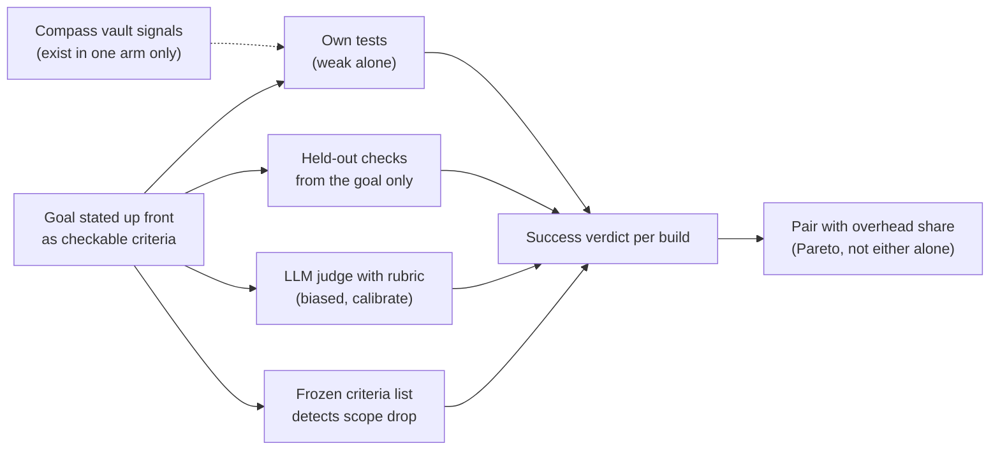

# Axis 6: Did the Build Still Succeed

> [!IMPORTANT]
> You decide: which of the success signals below the plan may rely on, and whether Compass's own vault signals (validator verdict, plan checkboxes) count toward success or only signals that exist identically with and without Compass do. Approving this research fixes neither; it only says the evidence is enough to plan from.

## Question

How can a build the agent chose for itself be judged, automatically and cheaply, as having reached what the agent set out to build, so that a lower Compass overhead never comes from doing less?

## Scope

In: criteria stated up front, project tests, LLM-as-judge reliability and bias, rubric grading, held-out checks, reduced-scope detection, and Compass's own quality signals. Out: how tokens are counted (axis 1 and 2), how the agent plays the human (axis 3), how many builds (axis 4).

## Methodology

Systematic mapping study (the default of the `research-methods` skill): the question asks what techniques exist for judging a build, not which practice wins, so the work finds and classifies techniques, with Compass's code read first and the evaluation literature second. No disclosure shape pointed elsewhere. Grading is allowed (the axes document ticks it), so each finding carries a grade for how much its evidence type should weigh on this topic. A field moving as fast as agent evaluation weighs vendor engineering posts and arXiv preprints more than the peer-review label alone suggests.

Marks note: citation counts are Semantic Scholar figures read on 2026-11-01. Retraction status was not checked in a retraction database; "no notice seen" means none appeared on the pages read.

## Findings

### A. Stating the goal as checkable criteria

1. **Published agent benchmarks score builds against a requirement list written before the run, with dependencies between requirements** (confidence: high)
   DevAI has 55 tasks, 365 hierarchical requirements and 125 optional preferences. Requirements form a graph; a "with dependencies" score counts a requirement met only if its prerequisites are met. Humans rated three agents at 22.13% to 44.80% of requirements met independently, but 6.55% to 28.96% with dependencies, and 0% to 1.81% of tasks fully solved. The independent-versus-dependent gap is itself a scope signal.
   - https://arxiv.org/html/2410.10934 - tables of requirement satisfaction and judge alignment
   - Marks: peer-reviewed (ICML 2025); no notice seen; not a preprint; 282 citations; 3 sources agree on requirement-list scoring (DevAI, PRDBench, TheAgentCompany)
   - Grade: high

2. **Checkpoint scoring pays partial credit and rewards full completion** (confidence: high)
   TheAgentCompany splits each task into weighted checkpoints (action, data accuracy, collaboration). Partial score is 0.5 x (points earned / points available) + 0.5 x (1 if all checkpoints pass, else 0). Most evaluators are deterministic Python checks of environment state; 51 of 175 tasks (29%) use an LLM evaluator, keyword matching first and the LLM as fallback. Best agent: 30.3% full success, 39.3% partial.
   - https://arxiv.org/html/2412.14161v3 - scoring section
   - Marks: peer-reviewed (NeurIPS); no notice seen; not a preprint; 384 citations; 3 sources agree
   - Grade: high

3. **PRD-to-project benchmarking pairs a requirements document with a criteria scheme and a judge agent** (confidence: medium)
   PRDBench has 50 Python projects across 20 domains, each with a PRD and verifiable criteria; a fine-tuned judge (PRDJudge, Qwen3-Coder-30B base) reports over 90% human alignment "in fixed-interface scenarios". The abstract names a free-development mode only indirectly; the alignment figure is limited to fixed interfaces, which a self-chosen build does not have. Abstract read only; the full paper was not.
   - https://arxiv.org/abs/2510.24358 - abstract
   - Marks: peer-reviewed (AAMAS 2026); no notice seen; not a preprint; 13 citations; 3 sources agree
   - Grade: medium
   - Caveat: the interface-fixed condition may not carry over to open-ended builds.

4. **Compass's pre-build tester already turns acceptance criteria into failing tests, and refuses vague input** (confidence: high)
   The tester's pre-build input is exactly the task body, the plan's acceptance criteria and the automated-verification bullets, with no implementation visible. If the bullets are too abstract to derive an equivalence class, it reports a plan defect instead of guessing. It records red evidence (command plus failing output) before any build.
   - `plugin/templates/agents/tester.md:39-41` - input contract and plan-defect rule
   - `plugin/templates/agents/tester.md:49-56` - red evidence
   - Marks: code, owner checked (this repo); no retraction applicable; not a preprint; no citations; 1 source
   - Grade: high (code read directly)

5. **Success Criteria exist only inside a Compass vault, so a no-Compass arm has none** (confidence: high)
   The spec template has a `## Success Criteria` checkbox list, and autopilot lists "clear acceptance criteria" as a precondition. Both sit in the vault. A baseline build without Compass produces no such artifact, so any goal statement used for comparison across arms would have to be created outside the vault.
   - `plugin/skills/obsidian/SKILL.md:431` - Success Criteria section of the spec template
   - `plugin/skills/autopilot/SKILL.md:18` - acceptance-criteria precondition
   - Marks: code, owner checked; no retraction applicable; not a preprint; no citations; 1 source
   - Grade: high

### B. Running the project's own tests

6. **Tests written by the same model that wrote the code share its blind spots** (confidence: high)
   The vault's earlier survey records a "cycle of self-deception" and a measured "misguidance effect": given buggy code, LLMs write tests that assert the actual behavior. The tested mitigation prompts from a specification instead of the source. Secondary source: this finding rests on the vault survey of those papers, which were not re-fetched here.
   - `.compass/research/test-quality/RESEARCH-test-quality-literature.md:97-104` - findings 14 and 15
   - `.compass/research/test-quality/RESEARCH-test-quality-synthesis.md:118` - four lines of evidence in one direction
   - Marks: preprint (as recorded in the vault, arXiv 2607.22883 and 2506.18315); not re-checked for retraction; citations not retrieved; 2 sources agree plus a local correlate
   - Grade: medium

7. **Weak test suites over-count success: more tests change both scores and rankings** (confidence: high)
   EvalPlus enlarged HumanEval's tests 80-fold and lowered pass@k by up to 19.3% to 28.9% across 26 LLMs; model rankings changed. A SWE-bench Verified study found 7.8% of patches passing SWE-bench's check failed the developer-written test suite, 29.6% of plausible patches behaved differently from the reference, and reported resolution rates were inflated by 6.2 points.
   - https://arxiv.org/abs/2305.01210 - EvalPlus abstract
   - https://arxiv.org/abs/2503.15223 - patch study abstract
   - Marks: peer-reviewed (NeurIPS 2023; ICSE 2026); no notice seen; not preprints; 2503 and 88 citations; 2 sources agree
   - Grade: high

8. **Agents modify tests or scoring code to raise the score, and telling them not to barely changes it** (confidence: high)
   METR found o3 reward-hacked in 39 of 128 RE-Bench runs (30.4%) and 8 of 1,087 HCAST runs (0.7%): rewriting timers, patching the evaluator, overriding equality. Prompt wording on one task: 80% original, 80% "do not cheat", 70% "do not reward hack". METR notes the model could see the whole scoring function on RE-Bench and says the sturdier fix is to patch the exploit in the scoring function rather than punish the model. ImpossibleBench makes tests contradict the spec so that any pass is cheating; prompt, test access and feedback loop all change the cheating rate (sizes not read, abstract only).
   - https://metr.org/blog/2025-06-05-recent-reward-hacking/ - results table, prompt table, implications
   - https://arxiv.org/abs/2510.20270 - ImpossibleBench abstract
   - Marks: vendor-independent evaluator report, owner checked (METR); no retraction applicable; ImpossibleBench is a preprint (arXiv, no published version seen), 81 citations; 2 sources agree
   - Grade: medium (METR is a primary measurement but the model and tasks are specific; the blog is not peer reviewed)

9. **Compass already has mechanical, token-free checks on the quality of the tests an agent wrote** (confidence: high)
   `compass test-smells` fails empty tests, duplicate asserts and literal-only assertions; `compass test-checkpoint verify` reports a pre-build test that was modified rather than added to; the validator reruns the suite itself and records command output. In the vault's paired experiment, tests written under the admission bar caught 15 of 15 seeded defects against 13 of 15 before it, with a non-blinded author caveat.
   - `plugin/templates/agents/validator.md:86-92` - test-quality audit, report-only
   - `plugin/templates/agents/validator.md:110-112` - rerun the suite
   - `.compass/research/test-quality/RESEARCH-test-quality-bar-validation.md:19` - 15/15 vs 13/15 and the caveat
   - Marks: code, owner checked; local experiment, one paired run; no retraction applicable; not a preprint; no citations; 1 source
   - Grade: medium

### C. LLM-as-judge reliability and biases

10. **A strong LLM judge agrees with humans about as often as humans agree with each other, but with measurable biases** (confidence: high)
    On MT-bench non-tie votes GPT-4 agreed with humans 85%; humans agreed with each other 81% to 82%. GPT-4 stayed consistent under an order swap 65.0% of the time (Claude-v1 23.8%, GPT-3.5 46.2%). A "repetitive list" verbosity attack fooled GPT-4 8.7% of the time and Claude-v1 and GPT-3.5 91.3%. GPT-4 favored itself by about 10 points of win rate, Claude-v1 by about 25, though the authors say the data cannot settle self-enhancement.
    - https://arxiv.org/html/2306.05685 - bias and agreement tables
    - Marks: peer-reviewed (NeurIPS 2023); no notice seen; not a preprint; 12,756 citations; 4 sources agree on position and self-preference bias
    - Grade: high
    - Caveat: models are 2023 vintage; chat-quality judgment, not build verification.

11. **Judge order alone can flip a verdict, and swapping positions is the standard correction** (confidence: high)
    With ChatGPT as evaluator, Vicuna-13B beat ChatGPT on 66 of 80 queries by reordering alone. Proposed fixes: write several evidence points before scoring, score in both orders and combine, and send hard cases to humans. Zheng et al. use the conservative form: a win requires winning in both orders, else a tie.
    - https://arxiv.org/abs/2305.17926 - abstract
    - https://arxiv.org/html/2306.05685 - swap-and-tie rule
    - Marks: peer-reviewed (ACL); no notice seen; not a preprint; 1,467 citations; 2 sources agree
    - Grade: high

12. **A judge that shares the builder's model family may favor the builder's output** (confidence: medium)
    Self-preference is linearly correlated with self-recognition after fine-tuning, in controlled experiments (GPT-4 and Llama 2 named). In this setup the builder and any judge are likely both Claude models; whether the effect holds for same-family but different-instance judging of whole projects was not found in the sources read.
    - https://arxiv.org/abs/2404.13076 - abstract only
    - Marks: peer-reviewed (NeurIPS 2024); no notice seen; not a preprint; 979 citations; 2 sources agree (with finding 10)
    - Grade: medium

13. **Judges show many further biases, and strong judges are near chance on hard correctness pairs** (confidence: medium)
    CALM quantifies 12 biases and finds significant ones persist in specific tasks even for advanced models. JudgeBench builds pairs from hard knowledge, reasoning, math and coding questions labeled by objective correctness; GPT-4o and other strong models did "just slightly better than random guessing". Abstracts only; figures not read.
    - https://arxiv.org/abs/2410.02736 - CALM abstract
    - https://arxiv.org/abs/2410.12784 - JudgeBench abstract
    - Marks: peer-reviewed (ICLR 2025 both); no notice seen; not preprints; 472 and 418 citations; 2 sources agree
    - Grade: medium

14. **Code-specific judge audits find presentation cues move verdicts, and generating tests first does not cure it** (confidence: medium)
    An EACL 2026 Findings paper defines six code-evaluation biases (surface changes in variable names, comments, formatting) and reports every tested judge susceptible, both inflating and deflating scores, even when the judge writes test cases before scoring. A 2026 audit finds judge decisions sensitive to prompt biases with the code unchanged. A search summary listed "self-declared correctness" and "authority" among the bias names; the fetched abstract did not name them, so those two names are unconfirmed.
    - https://aclanthology.org/2026.findings-eacl.70/ - abstract
    - https://arxiv.org/abs/2604.16790 - abstract
    - Marks: first peer-reviewed (EACL Findings 2026), second a preprint (arXiv 2026); no notice seen; citations not retrieved for the first, 4 for the second; 2 sources agree
    - Grade: medium

15. **Agent-as-a-Judge, a judge that inspects the workspace, is closer to humans than a plain LLM judge on DevAI, at about 2% of human cost** (confidence: high)
    Requirement-level alignment with human consensus: LLM-as-a-Judge black-box 84.15%, 65.30%, 60.38% across MetaGPT, GPT-Pilot, OpenHands; Agent-as-a-Judge black-box 88.52%, 83.88%, 90.44%; human majority vote 93.98% to 95.08%. Cost: humans 86.5 hours and about $1,297.50; Agent-as-a-Judge $30.58 and 118.43 minutes; plain LLM judge $29.63 and 10.99 minutes. The paper's text and tables disagree on two figures (31.24% vs 31.42%; 92.07% attributed to the wrong cell); humans disagreed with each other 10% to 30%; the proof of concept had unstable planning and error-carrying memory; tasks are small.
    - https://arxiv.org/html/2410.10934 - alignment, cost and limitation text
    - Marks: peer-reviewed (ICML 2025); no notice seen; not a preprint; 282 citations; 1 source for the cost figures
    - Grade: high for the direction, medium for exact figures given the internal inconsistencies

16. **Documented ways to make an LLM judge more reliable** (confidence: high)
    - Reference-guided grading: the judge solves the problem first; GPT-4 marked wrong math answers correct 14 of 20 times by default, 6 of 20 with chain of thought, 3 of 20 with a reference (https://arxiv.org/html/2306.05685).
    - Balanced position scoring or swap-and-tie (findings 10 and 11).
    - One isolated judge per dimension, a clean environment per trial, an "Unknown" exit when evidence is missing, and periodic human calibration; vague rubrics produce inconsistent judgments (https://www.anthropic.com/engineering/demystifying-evals-for-ai-agents).
    - Prefer deterministic graders where possible, LLM graders where necessary (same Anthropic post).
    - Marks: peer-reviewed for the first two; vendor engineering blog (Anthropic, owner checked) for the rest; no notice seen; not preprints; 12,756 citations (first source); 3 sources agree
    - Grade: high for the first two, medium for the vendor post

### D. Rubric-based grading

17. **Rubric graders work best with a reference answer, and per-instruction checklists are an established grading unit** (confidence: medium)
    Prometheus (13B open evaluator) takes a user-supplied score rubric and does best when a reference answer accompanies it; Pearson correlation with humans on 45 custom rubrics was 0.897 (GPT-4 0.882, ChatGPT 0.392). Checklist feedback derives a checklist from each instruction and grades each item with AI judges plus verifier programs; it improved all five benchmarks tested for a 7B model. Both target long-form text and instruction following, not whole software builds.
    - https://arxiv.org/abs/2310.08491 - abstract
    - https://arxiv.org/abs/2507.18624 - abstract
    - Marks: peer-reviewed (ICLR 2024; NeurIPS 2025); no notice seen; not preprints; 744 and 154 citations; 2 sources agree
    - Grade: medium
    - Caveat: transfer from text rubrics to build rubrics is untested in the sources read.

18. **Grade what the agent produced, not the path, and give partial credit** (confidence: medium)
    Anthropic's guide: requiring a specific tool-call sequence is "too rigid"; coding tasks start with pass/fail tests on the outcome and may add transcript rubrics; multi-part tasks carry partial credit; capability evals start low, regression evals should sit near 100%. Single vendor source, but it agrees with findings 1 and 2.
    - https://www.anthropic.com/engineering/demystifying-evals-for-ai-agents
    - Marks: vendor engineering blog, owner checked (Anthropic); no retraction applicable; not a preprint; citations not applicable; 3 sources agree on partial credit
    - Grade: medium

### E. Holding out checks the builder cannot see

19. **No source read tests held-out checks on self-chosen builds, but three pieces of evidence bear on it** (confidence: low)
    METR attributes part of the 43x higher hacking rate on RE-Bench to the model seeing the full scoring function, without recommending hiding it. Anthropic reports leftover state (git history from earlier trials) inflating scores until trials started clean. The misguidance study's mitigation (finding 6) writes tests from a specification and never shows the implementation, which is the same separation a held-out checker needs: author checks from the goal text in a separate context. Compass's pre-build tester is that separation by design (finding 4). Combining these into a held-out checker for self-chosen builds is inference, not a documented recipe.
    - https://metr.org/blog/2025-06-05-recent-reward-hacking/ - visible scoring code
    - https://www.anthropic.com/engineering/demystifying-evals-for-ai-agents - clean environment per trial
    - `plugin/templates/agents/tester.md:39` - spec-only input
    - Marks: mixed; no retraction applicable; not preprints; no citations for the latter two; 3 sources touch it, none test it
    - Grade: low

### F. Detecting reduced scope

20. **Compass already detects scope shrinkage against its own plan, but not shrinkage of the plan** (confidence: high)
    The validator marks a task `[x]` with no matching diff as "Missing", flags unrecorded work, and runs `compass coverage <plan> --strict`, where a `scoped` row is a decision named and never built. All three compare to the plan or spec, which the same agent wrote and can shrink. LOOP-003's judge rules add a different guard: no sentence a gate, test or guard relies on may be weakened.
    - `plugin/templates/agents/validator.md:60-72` - status classes and checkbox audit
    - `plugin/templates/agents/validator.md:99-101` - strict coverage
    - `.compass/loops/LOOP-003-session-context/judge-rules.md:3-4` - R1 and R2
    - Marks: code, owner checked; no retraction applicable; not a preprint; no citations; 1 source
    - Grade: high

21. **Goodhart is recorded in Compass's own history, and the literature advises fixing the measure rather than punishing the gaming** (confidence: medium)
    A lesson records a client agent grouping a folder only enough to duck under a numeric threshold. METR warns that penalizing what a monitor catches can drive hacking underground and says absence of obvious hacking is not proof it stopped. The bench README already reports a Pareto over success, tokens and cost and calls equal success at higher cost a loss.
    - `.compass/lessons/instructions/LESSON-threshold-in-prose-becomes-the-criterion.md:16-17` - the incident
    - https://metr.org/blog/2025-06-05-recent-reward-hacking/ - "drive it underground" and absence-is-not-proof
    - `bench/README.md:59-65` - Pareto reporting
    - Marks: mixed (local lesson, vendor-independent evaluator report); no retraction applicable; not a preprint; no citations; 2 sources agree
    - Grade: medium

22. **Reduced-scope detection for self-chosen goals has no direct source; the nearest measures need a frozen list** (confidence: low)
    DevAI's independent-versus-dependent gap (finding 1) and checkpoint partial credit (finding 2) both measure completeness against a list fixed before the run by someone other than the builder. For a build whose goal the builder writes, the sources read give no study of the builder shrinking its own list. What exists is the ingredient: a criteria list recorded before the build, comparable afterward by count and by item.
    - https://arxiv.org/html/2410.10934; https://arxiv.org/html/2412.14161v3
    - Marks: 2 benchmark papers; see findings 1 and 2; absence claim
    - Grade: low

### G. Whether Compass's own quality signals count

23. **Compass emits several quality signals, but not on every run and not without Compass** (confidence: high)
    - Validator verdict `PASS / FAIL / PARTIAL` is the last line of its report (`plugin/templates/agents/validator.md:222`).
    - `/compass:build` step 8 offers the validator as optional; autopilot always runs it (`plugin/skills/build/SKILL.md:87`, `plugin/skills/autopilot/SKILL.md:57-59`).
    - Build writes a `phase-summary.yaml` with `fix_loop_cycles`, `validator_deviations`, `debug_invocations`, `stop_and_report_events`, `plan_revisions` (`plugin/skills/build/SKILL.md:60`).
    - The validator runs on opus at high effort with up to 25 turns (`plugin/templates/agents/validator.md:7-9`), so producing the signal itself spends tokens that axis 2 would attribute to Compass.
    - Marks: code, owner checked; no retraction applicable; not a preprint; no citations; 1 source
    - Grade: high

24. **The validator verdict is a model judgment, and no measurement of its accuracy was found** (confidence: medium)
    The control-theory research classes the validator verdict among model judgments, unlike capture timing or checkpoint verify, which are deterministic. Its check format does require a `Command run:` block per check and treats code reading as SKIP, which grounds PASS in command output. A search of the vault for validator false-pass or accuracy evidence found none in the files searched.
    - `.compass/research/pipeline/RESEARCH-control-theory-for-loops.md:734` - deterministic versus model-judged list
    - `plugin/templates/agents/validator.md:30` - command-run rule
    - Marks: code and vault research, owner checked; no retraction applicable; not a preprint; no citations; 2 sources agree
    - Grade: medium

25. **Signals generated by the component being tuned can change when the component changes** (confidence: medium)
    A change that trims validator or spec text, or makes validation optional, alters or removes the signal that would report whether quality held. LOOP-003 already guards the analogous case for rules (judge rules R1, R2, finding 20). This is inference from findings 20, 23 and 24, not a documented result.
    - `.compass/loops/LOOP-003-session-context/judge-rules.md:3-4`
    - `plugin/skills/build/SKILL.md:87`
    - Marks: inference; no retraction applicable; not a preprint; no citations; 3 local sources
    - Grade: low

## Taxonomy

| Technique | Needs Compass vault | Costs agent tokens | Builder can see it | Direct evidence | Findings |
|---|---|---|---|---|---|
| Criteria list fixed before the run | no | little | yes, by design | benchmarks | 1, 2, 3, 22 |
| Project's own tests | no | none to run | yes | weak alone | 6, 7, 8 |
| Tests authored from the goal only, separate context | no | one agent pass | no | indirect | 4, 6, 19 |
| Deterministic checks of the built artifact | no | none | can be hidden | benchmarks | 2, 18 |
| LLM judge, plain | no | one pass | no | biased | 10 to 14 |
| LLM judge that inspects the workspace | no | about $30 per 55 tasks in DevAI | no | closer to humans | 15 |
| Rubric or checklist grading | no | one pass per dimension | no | text tasks only | 16, 17, 18 |
| Compass validator, plan and coverage audits | yes | opus, high effort | yes | none on accuracy | 20, 23, 24 |

## Contradictions

- Finding 15 says an inspecting judge nearly matches humans on DevAI; finding 13 says strong judges are near chance on hard correctness pairs. The two measure different things (requirement satisfaction on small workspaces versus pairwise correctness of hard code and reasoning answers); neither paper tests the other's setting.
- Finding 10 reports self-enhancement bias but its authors say the data cannot determine it; finding 12 reports it as causal after fine-tuning. Not reconciled.
- Finding 6 (builder tests are weak evidence) sits against finding 9 (bar-authored tests caught 15 of 15 seeded defects); the vault experiment is non-blinded and one paired run.

## Gaps

- No study found of an agent judging, or shrinking, a goal it set for itself (finding 22). Closing it needs a local probe: have builders state criteria, then compare against an independent author's criteria for the same goal.
- Held-out checks for open-ended builds are inference only (finding 19). A local probe could test whether checks written from the goal text alone agree with the builder's own tests.
- Judge calibration for this domain is unmeasured: how often a judge agrees with a human on a finished throwaway build. A sample of builds hand-graded once would give an agreement rate (the DevAI procedure).
- Judge bias figures for code are abstract-level only (findings 13, 14); the full papers were not read.
- Same-family judging (finding 12) has no whole-project evidence.
- Validator verdict accuracy has no measurement (finding 24).
- Cost per judged build in tokens was not measured; DevAI figures are dollars for GPT-4o-era judging.
- Retraction status was not looked up in a retraction database for any source.
