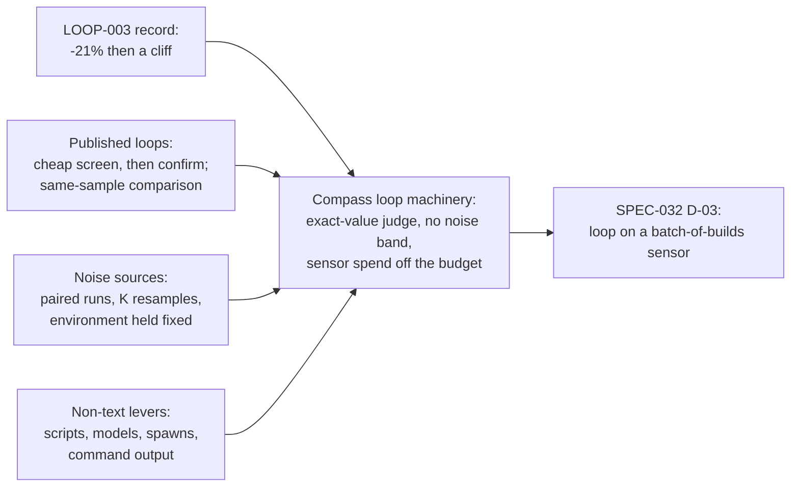

# Axis 7: Biggest Overhead Area First, as a Loop

> [!IMPORTANT]
> You decide: whether this evidence on the loop is enough to plan the biggest-area-first loop for [[SPEC-032-whole-overhead-measured-on-real-projects]], or whether a further pass is needed on the gaps listed at the end.

## Question

How does a control loop rank overhead areas, change the biggest one and verify its share dropped with quality held, when each measurement is a batch of expensive, noisy builds (SPEC-032 D-03)?

## Scope

Included: Compass's loop code and the LOOP-003 record, published automated prompt and agent optimization loops, agent cost levers that are not text moves, and noise control in agent evaluation. Excluded (other axes): what a session records, the split of tokens into Compass and work, simulated humans, topic choice, project isolation, build-success judging.

## Methodology

Systematic mapping study (the catalog's default): the question asks what exists and how it is arranged across a vault record and a published landscape, and the mapping study classifies without judging a source's quality. The local loop artifacts were read as code and ledger first (the repository-mining habit of reading the artifact, not its documentation); web sources were read from the paper or source file where reachable.

Grading: the brief carried `grading: allowed`, so each finding carries a Grade, weighing the evidence type for a fast-moving field (peer review counts for less in AI R&D; code and ledgers read directly count for more).

## Findings

### A. How Compass's loop machinery fits

1. **One run is: sense, gate, select, actuate, re-sense, judge, record.** (confidence: high)
   The runner senses before the actuator, gates on the summed budget and on unreviewed increments, selects an item, runs a fresh headless session, senses again, then classifies the change. State moves only through the declared transition table. The loop folder holds `loop.json`, `actuator.md`, `feedback.md`, `baseline.json`, `state.json`, `ledger.jsonl`.
   - `plugin/cli/looprunner.py:537` (sense before), `:575-611` (gate), `:613-628` (select), `:698` (sense after)
   - `plugin/cli/looplib.py:47` (TRANSITIONS); `.compass/plans/PLAN-021-control-loops.md` Design section
   - Marks: local code read; n/a retraction; n/a preprint; n/a citations; 2 sources agree (code and plan)
   - Grade: high

2. **"Biggest first" is implemented as the first line of a controller's ranked output.** (confidence: high)
   LOOP-003's `controller.py` prints up to ten `<tokens per session> <path>` lines, largest first, and `actuator.md` takes the first one `feedback.md` does not rule out. Controller `first` (no script) instead picks the first sorted sensor item not held by an unreviewed increment. The ranking script decides what an "area" is; the runner only passes its text to the actuator.
   - `.compass/loops/LOOP-003-session-context/controller.py:41-52`; `actuator.md:11`; `plugin/cli/looprunner.py:613-628`
   - Marks: local code read; n/a; n/a; n/a; 2 sources agree
   - Grade: high

3. **The change judge has no tolerance: any decrease is helpful, any increase or any new item is harmful.** (confidence: high)
   `judge()` compares two scalar readings by sign and compares item multisets; there is no noise band, repeat count or confidence in `loop.json`'s field list. Two consecutive harmful runs halt the loop (`max_harmful_runs` 2 in LOOP-003).
   - `plugin/cli/sensorlib.py:528-545`; `plugin/cli/looplib.py:110-129` (the complete field list); `.compass/loops/LOOP-003-session-context/loop.json`
   - Marks: local code read; n/a; n/a; n/a; 1 source
   - Grade: high

4. **The no-progress halt counts any helpful run as progress, so tiny gains reset it.** (confidence: high)
   `without_help` goes to 0 on any run whose outcome is `helpful`, and `judge()` calls a 1-token drop helpful. LOOP-003's last runs moved 23, 25, 1, 1 and 0 tokens; the five-run `max_runs_without_help` halt never fired. The batch ended through a rejected neutral run, a WIP throttle, and a human pause (`state.json` reads `paused`).
   - `plugin/cli/looplib.py:609`; `plugin/cli/looprunner.py:736-738`; ledger rows of `.compass/loops/LOOP-003-session-context/ledger.jsonl` (outcome and readings, last five verified runs)
   - Marks: local code and ledger read; n/a; n/a; n/a; 2 sources agree
   - Grade: high

5. **Sensor time and spend sit outside the budget the runner sums.** (confidence: high)
   A run row's `cost_usd` is the actuator's `total_cost_usd` plus the judge sessions; the sensor command contributes no cost. The sensor runs twice per iteration, bounded by `sensor_timeout_s` (120 in LOOP-003), and `wip_command` and `controller_command` use the same timeout. A sensor that runs builds would need a larger timeout and its spend would not reach the daily or lifetime sums.
   - `plugin/cli/looprunner.py:658`, `:715`, `:786-803` (cost terms), `:341`, `:597`, `:618` (timeout use)
   - Marks: local code read; n/a; n/a; n/a; 1 source
   - Grade: high

6. **Flow control is a WIP limit on unreviewed increments plus dollar caps; LOOP-003 ran a batch with automatic checks in place of per-run review.** (confidence: high)
   `wip_limit` 1 throttled 7 runs; 30 of 33 reviews were accepts. Two of the 3 rejects cited a full-suite failure caused by a test harness meant to fail until a task merged, and one cited "no move of 100+ tokens left". A reject reason is appended to `feedback.md`.
   - `.compass/loops/LOOP-003-session-context/index.md` (Step 6, Step 7, "unattended batch"); `ledger.jsonl` (counts via script); `plugin/cli/looprunner.py:594-610`
   - Marks: local ledger and live record read; n/a; n/a; n/a; 2 sources agree
   - Grade: high

7. **"Quality held" in LOOP-003 is tests, `compass validate`, unchanged protected sections and an advisory Haiku judge on reachability of moved text.** (confidence: high)
   `judge-rules.md` holds R1 (removed text is reachable) and R2 (no gate weakened); the judge found nothing in the runs logged. No measure of whether agents work as well with the smaller text appears in the record, and [[SPEC-027-compass-uses-fewer-tokens]]'s KPI is marked `[guess]`.
   - `.compass/loops/LOOP-003-session-context/judge-rules.md:3-4`; `index.md` Step 6 and run entries; `.compass/specs/tooling/SPEC-027-compass-uses-fewer-tokens/index.md:23`
   - Marks: local read; n/a; n/a; n/a; 3 sources agree
   - Grade: high

### B. What LOOP-003 learned

8. **Static text moves took the sensor from 11,969 to 9,479 tokens per average session (-21%) in 35 runs for $10.20 of a $12 cap.** (confidence: high)
   Ledger: 42 run rows, 32 helpful, 1 neutral, 2 failed (the judge-time file-change guard, fixed in the runner), 7 throttled. Mean actuator cost about $0.29 per run. The plateau figure of 9,479 is after a fresh `usage-scan` (1,540 sessions); the sensor read 9,493 before it.
   - `.compass/loops/LOOP-003-session-context/ledger.jsonl` (script counts); `index.md` "unattended batch"
   - Marks: local ledger read; n/a; n/a; n/a; 2 sources agree
   - Grade: high

9. **The yield per run did not fade smoothly; it fell off a cliff after about 30 runs.** (confidence: high)
   Token drop per ten verified runs: 1,101, then 840, then 800, then 2 over the last three. The final five runs moved 23, 25, 1, 1, 0. Cost per run stayed flat near $0.29, so tokens saved per dollar went from about 380 to about 2.
   - `ledger.jsonl` `reading_before` and `reading_after` of each verified run, summed by script (runs 1 to 10: 1,101 tokens for $2.90; 11 to 20: 840 for $2.89; 21 to 30: 800 for $2.82; 31 to 33: 2 for $1.08)
   - Marks: local ledger read; n/a; n/a; n/a; 1 source
   - Grade: high

10. **The two largest sources supplied 78% of the reduction, and what the loop could not move defined the plateau.** (confidence: medium)
    From the controller output stored in the run rows: the pipeline rules went 3,056 to 2,390 and the `extract-lessons` skill 2,229 to 976 (1,919 of the 2,476 tokens that separate the first weighted reading from the end). The pipeline rules stayed first throughout. `feedback.md` bars sentences pinned by tests and the whole Data rule, and the final rejected run found no 100-token move left in the top sources.
    - `ledger.jsonl` `item` of the first and last verified runs; `.compass/loops/LOOP-003-session-context/feedback.md:6-11`; review reject reason in ledger
    - Marks: local ledger read; n/a; n/a; n/a; 2 sources agree
    - Grade: medium (cause of the plateau is read from feedback and one reject reason, not tested)

11. **The reading moved for reasons other than the actuator: a measure change and added text.** (confidence: high)
    The sensor changed from startup text (9,121) to usage-weighted text (11,969), a jump of 2,890 that no run caused. Four later gaps between one run's reading after and the next run's reading before sum to +345 tokens, text added by other work between runs. The loop's own record also says runs 7 and 8 showed -149 and -193 on the sensor and "about 0 in practice" until the next usage scan gave the side files weight.
    - `ledger.jsonl` (reading continuity across runs, by script); `index.md` runs 2, 7, 8
    - Marks: local ledger read; n/a; n/a; n/a; 2 sources agree
    - Grade: high

12. **The sensor read 9,117 tokens where a real session measured Compass adding 12,095, and no second calibration appears at the loop's stop.** (confidence: high for the first reading, medium for the absence)
    Calibration used `claude -p "hi"` in scratch projects: first-request input 29,140 without Compass and 41,235 with it. The plan asked for calibration "again at its stop"; the live record holds the 2026-10-30 calibration and no later one.
    - `.compass/loops/LOOP-003-session-context/index.md:48-51`; `.compass/plans/PLAN-021-control-loops.md` TASK-236 (calibration clause)
    - Marks: local read; n/a; n/a; n/a; 2 sources agree
    - Grade: high

### C. Changes that are not text moves

13. **Replacing an agent step with a script has a measured precedent in the vault.** (confidence: medium)
    Moving vault bookkeeping from an agent-type hook to a command hook cut the per-fire floor from 3,145 tokens (hook prompt 94, skill body 3,051) to about 6, a 99.8% reduction on the floor; one session fired the agent hook about 8 times. The document states its limits: chars/4 estimates, a structural floor, no live A/B.
    - `.compass/compass-cli/research/RESEARCH-cli-token-reduction-measurement.md` (token half and "Caveat retained")
    - Marks: local research, single author; n/a; n/a; n/a; 1 source
    - Grade: medium

14. **Claude Code's cost page names these levers: model choice, effort, subagent delegation, hook preprocessing, skills instead of CLAUDE.md, MCP deferral.** (confidence: high that the page says it; unmeasured as savings)
    Sonnet over Opus for most work; `model: haiku` for simple subagents; lower effort or `MAX_THINKING_TOKENS`; delegate verbose operations so output stays in the subagent's context while "the subagent's own requests still draw on your usage"; a PreToolUse hook that filters test output; instructions moved from CLAUDE.md to skills that load on demand. The only quantity is illustrative: a 10,000-line log reduced "from tens of thousands of tokens to hundreds".
    - https://code.claude.com/docs/en/costs ("Reduce token usage" sections)
    - Marks: vendor documentation, owner is Anthropic; n/a; n/a; n/a; 1 source
    - Grade: medium (primary for what the product supports, no measurement)

15. **The same page also lists `/usage` attribution: usage by skill, subagent, plugin and MCP server as percentages, with recommendation rows of 10% or more.** (confidence: high)
    It is computed from local session history on one machine, approximate, and shown for subscription plans. A recommendation row's share says how much of usage the row applies to, "not how much the change saves".
    - https://code.claude.com/docs/en/costs ("Plan usage breakdown")
    - Marks: vendor documentation; n/a; n/a; n/a; 1 source
    - Grade: medium

16. **Spawning more agents multiplies tokens, and Anthropic reports token use explains most of agent performance variance.** (confidence: medium)
    Anthropic's multi-agent research post: agents use about 4x the tokens of chat, multi-agent systems about 15x; on BrowseComp token use alone explained 80% of variance (95% with tool calls and model). Early versions spawned 50 subagents for simple queries; the fix was effort-scaling rules in the prompt. The post calls most coding tasks a poor fit for multi-agent work. The costs page gives about 7x for agent teams in plan mode. Compass's methodology spawns a tester at two stations around each code task, plus builder and validator.
    - https://www.anthropic.com/engineering/multi-agent-research-system; https://code.claude.com/docs/en/costs ("Manage agent team costs"); `.claude/skills/methodology/SKILL.md` "Task execution"
    - Marks: vendor engineering blog and docs, owner Anthropic; n/a; n/a; n/a; 3 sources agree
    - Grade: medium

17. **Model cascades and observation masking are published cost levers with large reported effects, both preprints.** (confidence: medium)
    FrugalGPT: an LLM cascade can match the best single model "with up to 98% cost reduction" on its benchmarks. Lindenbauer et al. on SWE-agent over SWE-bench Verified with five model configurations: masking old observations cuts cost to about half of the unmodified agent while matching, and sometimes slightly exceeding, LLM summarization's solve rate. Compass has a per-agent model policy table (`compass models`); `resolve-model` awaits a wiring verdict on its usage record.
    - arXiv:2305.05176 (abstract); arXiv:2508.21433 v3 (abstract); `.claude/skills/methodology/SKILL.md` ("Pattern discovery", "File organization")
    - Marks: FrugalGPT preprint 2023-05, not retracted, 62 citations (OpenAlex), 1 source; Lindenbauer preprint v3 2025-10 (DL4C workshop at NeurIPS 2025), not retracted, 0 citations, 1 source
    - Grade: medium for FrugalGPT, low for Lindenbauer

### D. Published optimization loops

18. **DSPy's MIPROv2 screens candidates on a small minibatch and confirms the best on the full set, replacing the incumbent only on a strictly higher full score.** (confidence: high)
    Source read: `minibatch_size=35`, `minibatch_full_eval_steps=5`, `seed=9`; trial 1 scores the unmodified program on the full set; every fifth trial fully evaluates the candidate with the best mean minibatch score; the best program changes only when `full_eval_score > best_score`. Auto presets are 6, 12, 18 candidates with validation sets of 100, 300, 1,000; `num_trials = int(max(2*num_vars*log2(n), 1.5*n))`. The code carries no explicit noise treatment (a TODO notes the baseline is not weighted by samples).
    - `stanfordnlp/dspy` `dspy/teleprompt/mipro_optimizer_v2.py` (main branch, read via fetch); arXiv:2406.11695 (EMNLP 2024)
    - Marks: code, owner checked (Stanford NLP); paper peer-reviewed (EMNLP 2024), not retracted, 4 citations (OpenAlex, arXiv record); 2 sources agree
    - Grade: high for the code behaviour

19. **GEPA accepts a change by comparing the sum of minibatch scores before and after on the same minibatch, and runs the full set only for accepted candidates.** (confidence: medium)
    Engine source: proposals arrive with `subsample_scores_before` and `subsample_scores_after`; default acceptance is a strict sum improvement; the full validation set is scored in one batched call for selected candidates only; budget is counted in cache-missing metric calls; stopping is `max_metric_calls` or a custom stopper, and the file has no no-improvement rule. The paper reports up to 35x fewer rollouts than GRPO, 6% above GRPO on average, over 10% above MIPROv2 across six tasks (ICLR 2026 Oral). The minibatch sampler lives in a file not read here.
    - `gepa-ai/gepa` `src/gepa/core/engine.py` (via fetch summary); arXiv:2507.19457 v2 (abstract page)
    - Marks: code, owner checked via paper authorship; paper accepted ICLR 2026 (oral per its page), not retracted, 6 citations (OpenAlex); 2 sources agree
    - Grade: medium (engine read through a fetch summary, sampler unread)

20. **TextGrad's optimizer step applies a model-written edit with no scoring or rollback; the accept-or-revert decision sits outside it.** (confidence: medium)
    `TextualGradientDescent.step` builds a prompt from the variable's textual gradients, calls the engine, and sets the parsed value; the only check is tag parsing. Constraints are natural-language lines in the prompt, not enforced checks. The method is published in Nature (639, 2025).
    - `zou-group/textgrad` `textgrad/optimizer/optimizer.py` (via fetch summary); https://www.nature.com/articles/s41586-025-08661-4
    - Marks: code, owner checked via paper authorship; peer-reviewed (Nature 2025-03), not retracted, 85 citations (OpenAlex); 2 sources agree
    - Grade: medium

21. **Karpathy's autoresearch fixes the budget per experiment, keeps a change only if the metric improves, and its noise is acknowledged by a fork.** (confidence: medium)
    `program.md`: the agent edits only `train.py`; each run has a fixed 5-minute training budget and is killed past 10; the first run is the unmodified baseline; a lower `val_bpb` keeps the commit, equal or worse resets git; a simplicity criterion weighs gains against added code; the loop never stops by itself (about 12 runs an hour). The MLX fork's README says re-running the same `train.py` moves `val_bpb` by about 0.03, that deciding on gains below that "just chases noise", and adds an optional multi-seed bootstrap decision (3 seeds default).
    - `karpathy/autoresearch` `program.md` (via fetch); https://github.com/trevin-creator/autoresearch-mlx (README, via fetch)
    - Marks: code, owner checked (Karpathy repo); fork is a third-party repo, owner not verified; not peer reviewed; 2 sources, the noise figure from the fork only
    - Grade: medium for the loop shape, low for the noise figure

22. **"AI Agents That Matter" argues cost belongs on the evaluation axis and shows cost and accuracy optimized together.** (confidence: medium)
    Each agent was run five times, mean accuracy and mean cost plotted; simple baselines (retry, warming, escalation) sit on the Pareto frontier beside complex agents on HumanEval at far lower cost. A DSPy-plus-Optuna search that jointly minimized few-shot token count and maximized accuracy on HotPotQA cut variable cost 53% (GPT-3.5) and 41% (Llama-3-70B) at similar accuracy; the optimization's fixed cost paid back after about 1,350 tasks. The authors call their search "a starting point".
    - arXiv:2407.01502 §2.2, §2.3, §3.1, §3.2 (paper PDF read); OpenAlex: 13 citations, not retracted
    - Marks: preprint 2024-07, not retracted, 13 citations; 1 source
    - Grade: medium

### E. Noise and avoiding it

23. **Miller (Anthropic) states that comparing on the same questions removes variance for free when scores are correlated, and that resampling has a ceiling.** (confidence: high)
    Paired variance equals unpaired variance minus 2 Cov(x_A, x_B)/n (Eq. 7 and text); with correlation 0.5 in his example, variance falls by one third. Resampling each question K times divides the conditional variance by K; in his uniform-difficulty example K=2 removes 1/3, K=4 removes 1/2, K=6 removes 5/9, with a ceiling of 2/3, and more resampling matters little once the conditional variance over K is much smaller than the variance of the conditional mean. He advises against lowering sampling temperature to cut variance.
    - arXiv:2411.00640 §3.1, §3.3, §4.2 (paper PDF read pages 5 to 8)
    - Marks: preprint 2024-11, single author at Anthropic, not retracted, 9 citations (OpenAlex); 1 source, formulas standard in experiment design
    - Grade: high (the mathematics holds independent of the field's pace)

24. **The same paper gives a sample-size formula and warns that clustered questions inflate error.** (confidence: high)
    n = (z_{alpha/2} + z_beta)^2 (omega^2 + sigma_A^2/K_A + sigma_B^2/K_B) / delta^2 for a paired design (Eq. 9); worked example n about 969 for delta 0.03; raising K from 1 to 10 cuts the minimum detectable effect from 13.2% to 7.5% at n=198. Clustered standard errors on real evals ran up to 3.05x the naive ones (DROP). Builds that share a topic or a project would form such clusters.
    - arXiv:2411.00640 §2.2 Table 4, §5 Eq. 9 and 10 (paper PDF read pages 4, 9, 10)
    - Marks: as finding 23
    - Grade: high

25. **Anthropic measured infrastructure alone moving agentic coding scores by up to 6 points.** (confidence: high)
    On Terminal-Bench 2.0 six resource configurations differed by 6 percentage points (p < 0.01) with model, harness and tasks fixed; moderate configurations differed by under 2 points; on SWE-bench (227 problems, 10 samples) 5x RAM added only 1.54. The post says gaps below 3 points deserve skepticism until the eval configuration is documented and matched, and that resource limits should be treated as an experimental variable.
    - https://www.anthropic.com/engineering/infrastructure-noise (read via fetch)
    - Marks: vendor engineering blog, owner Anthropic (author Gian Segato); not peer reviewed; n/a; n/a; 1 source, AI21's 200,000-run SWE-bench result named in a secondary summary agrees in direction
    - Grade: medium

26. **Replay tools record agent calls and re-run them, and a changed prompt breaks the match.** (confidence: low)
    AgentReplay (LangGraph) records every LLM call, tool response and clock value and replays; when a prompt changes the replay "can't find a matching recorded response" and produces a divergence report. A practitioner post puts the replay boundary at the tool layer and recommends a header with prompt hash, model and tool-schema hash. None of the results read reports paired variance reduction from replay.
    - https://github.com/hassanzafarr/AgentReplay; https://dev.to/mukundakatta/vcr-style-recordreplay-for-llm-tests-make-your-agent-tests-deterministic-and-free-3o6d (both via search summary, not opened)
    - Marks: community repo and blog, owners not checked; n/a; n/a; n/a; 2 sources, same mechanism
    - Grade: low

27. **The vault already holds noise-gate and pre-registration material for loops.** (confidence: medium)
    [[research/pipeline/RESEARCH-control-theory-for-loops]] finding 101: a noise-band gate (change must exceed sigma times the combined standard errors), EWMA on judge scores, and a sequential probability ratio test with a PASS, FAIL or INCONCLUSIVE verdict (arXiv:2603.02601, 78% fewer trials, via search summary); none is tested in a Compass loop. Finding 9: no source measures a coding-agent loop's settling time, oscillation or self-caused regressions. Finding 125: sessions in one study averaged $9.70, median $0.61, p99 $178. The lesson [[LESSON-score-the-do-nothing-baseline-before-running]] sets the rule to score the do-nothing baseline and fix the threshold before running.
    - `.compass/research/pipeline/RESEARCH-control-theory-for-loops.md:354-358` (101), `:195-198` (9), `:917-925` (125); `.compass/lessons/experiments/LESSON-score-the-do-nothing-baseline-before-running.md`
    - Marks: vault research with sources marked inside; mixed preprint and repo; 0 to few citations; 3 sources, different mechanisms
    - Grade: low for the gates (search-summary evidence), medium for the lesson

28. **A fixed environment and fixed work are what the repo's own earlier benchmark lacked.** (confidence: medium)
    The `bench/` smoke comparison ran one task per fixture, one run per arm: the baseline arm used 4% and 5% fewer tokens than the Compass arm (21,696 and 22,495 total in the two fixtures), with ties on quality. No variance across repeated runs is recorded. The summary's own next-step list names installed-plugin comparison, discriminating fixtures and long-horizon tasks.
    - `bench/runs/summary-cross-runs.md:6-14`, `:36-40`
    - Marks: local run summary read; n/a; n/a; n/a; 1 source
    - Grade: medium

### F. Ranking, diminishing returns and stopping

29. **A share bounds what any one area can give back.** (confidence: medium)
    Amdahl's law: with a fraction p of the whole improved by factor s, overall speedup is 1 / (1 - p + p/s), bounded by 1 / (1 - p); the article's examples include 10% improved 10,000-fold giving about 1.11x. Applied to a token share, an area that is a fraction p of the overhead can lower the overhead by at most p of it, however fully it is cut. The application is arithmetic on the formula; the source treats run time.
    - https://en.wikipedia.org/wiki/Amdahl%27s_law (via fetch)
    - Marks: tertiary reference; n/a; n/a; n/a; the formula is standard
    - Grade: medium (math is exact, the transfer to token share is inference)

30. **The loops read here stop in different ways, and none uses a stopping rule built for a noisy ratio.** (confidence: medium)
    | Loop | Stop |
    |---|---|
    | LOOP-003 | five verified runs without a helpful one (never fired), $12 total, 2 harmful, 3 actuator failures; sign-only helpful test |
    | MIPROv2 | fixed `num_trials` from a formula; incumbent changes only on a strictly higher full-set score |
    | GEPA | `max_metric_calls` or a custom stopper; no built-in no-improvement rule |
    | autoresearch | none by design (human stops it); per-run kill at 10 minutes |
    | AgentAssay (vault finding 101) | sequential test with an INCONCLUSIVE band |
    - Files and sources of findings 4, 18, 19, 21, 27
    - Marks: synthesis over cited findings; mixed; n/a; n/a; 5 sources
    - Grade: medium

## Contradictions

- Finding 14 (docs: delegate verbose work to subagents to save main-context tokens) and finding 16 (Anthropic: each added agent multiplies total tokens) both stand; the costs page itself says the subagent's requests "still draw on your usage". Net effect on a Compass build is not measured in either source.
- LOOP-003's live record calls the batch's last accepted runs 1 or 2 tokens each; the ledger's last verified runs are 23, 25, 1, 1 and 0 (finding 4, 9). The cliff is the same; the count of tiny runs differs by two.
- The LOOP-003 record counts batch-local runs ("runs 1 to 15 accepted"); the ledger counts 42 run rows across the whole loop. Both are used above with their own denominators.

## Gaps

- No measured cost or time of one real build with Compass installed; axes 1 and 5 own it. Finding 5 depends on it (sensor spend off the budget) and finding 27 gives only per-session figures from one preprint.
- No repeated-identical-build variance of the overhead share exists in the vault or `bench/`; the first baseline will have to measure it (finding 28). Miller's formulas assume means and paired differences; a share of two noisy sums (Compass tokens over all tokens) is not covered by any source read.
- No source ties Pareto ranking of overhead areas to a measured sequence of changes beyond LOOP-003's own record.
- No evidence on whether LOOP-003's text moves changed real session behaviour or real session tokens: no second calibration (finding 12), no outcome measure (finding 7).
- The plateau cause (finding 10) is read from `feedback.md` and one reject reason; a counterfactual (the loop with the protected rules unlocked) was not run.
- GEPA's minibatch sampler and TextGrad's example training loops were not read; finding 19 and 20 rest on the engine and optimizer files only.
- Record/replay (finding 26) is known from two search summaries; a source that tests replay for paired prompt comparison was not found.
- Citation counts above come from OpenAlex at the time of the run; arXiv-only records show low counts for 2024 to 2026 papers.

## Questions for the planner

- Is the loop's sensor value the share of all tokens, or the absolute tokens of the area being changed, with the share computed from a held-fixed denominator? SPEC-032's KPI is a share; the existing judge compares one scalar by sign.
- Does an area mean a source type (rules, skills, agents, hooks, command output, vault reads) or an action type (spawns, reads, writes)? The controller script, not the runner, would decide.
- Should the loop's sensor be a batch of builds, or a replay of fixed recorded prompts, or both at different cadences? The runner calls the sensor twice per iteration.
