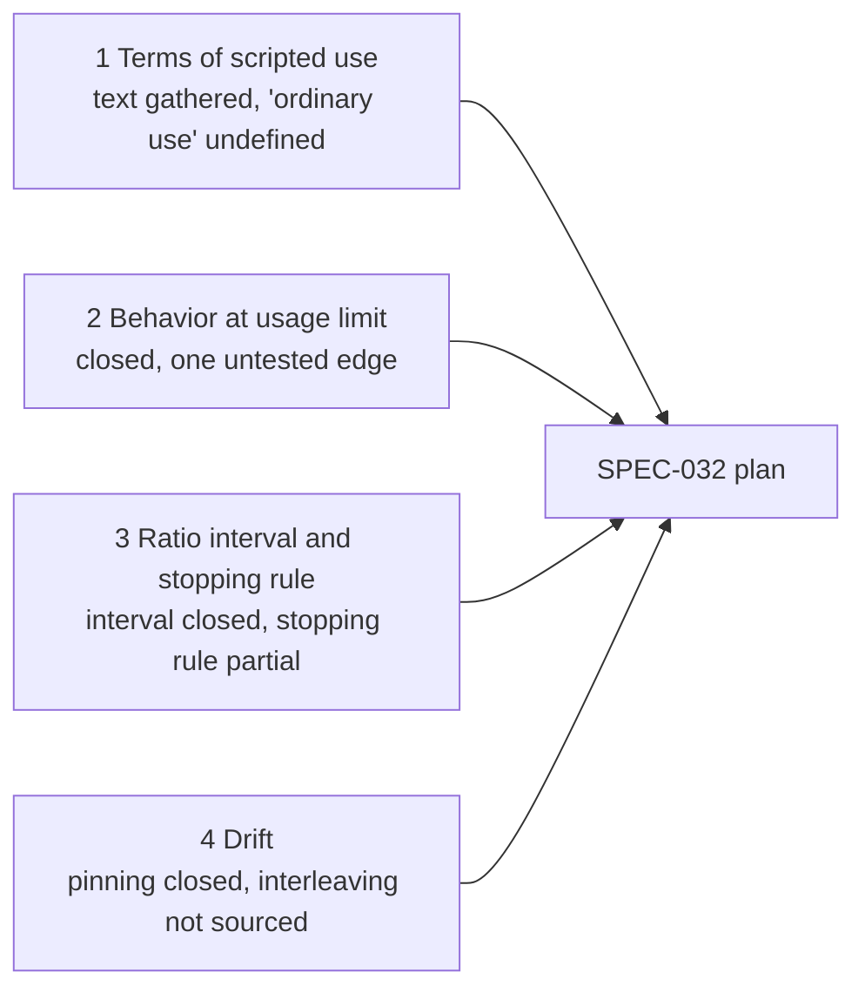

# Research: Gap Pass for Measuring Compass's Whole Overhead

> [!IMPORTANT]
> You decide: are these four answers enough to plan from, knowing gap 1 leaves a judgment only Anthropic can settle, gap 3 has no proven stopping rule for a ratio, and gap 4 has no source for running a baseline alongside? Approving makes the findings below binding on the plan, and puts the three residues in the pilot build's checklist.

## Question

Four questions left open by the [[research/whole-overhead/REVIEW-whole-overhead|review]]: what Anthropic's terms say about unattended `claude -p` on a Pro or Max subscription, what `-p` does when the usage limit is hit, how to put an interval and a stopping rule on a ratio of two noisy sums over paired builds, and how evaluation practice handles model or CLI drift between a baseline and a later re-measure.

## Methodology

Rapid review (what exists, time short), a documented abbreviation of the systematic review: one reviewer, one screening pass, no second-reviewer check, a budget of 25 tool calls. Vendor documents and GitHub issues are handled as grey literature, each source's owner stated in its marks. Grading is allowed for this run, so each finding carries a grade. Many pages were read through a summarizing fetch tool; where only a search summary was seen, the finding says so and its confidence is capped at low.

## Status of the four gaps

| Gap | Closed? | What remains |
|---|---|---|
| 1 Terms of scripted subscription use | Text gathered, not a ruling | "Ordinary, individual usage" has no definition or number; the Usage Policy was not read |
| 2 Behavior at the usage limit | Closed for the documented path | One long-session failure leaves no result on stdout; whether the retry watchdog waits out a session limit under `-p` was not run |
| 3 Interval and stopping rule for a ratio | Interval closed; stopping rule partial | No source proves an always-valid interval for a delta-method ratio |
| 4 Drift | Pinning closed; interleaving not sourced | No source found that re-runs a baseline alongside a later arm |

## Findings

### Gap 1: terms of automated subscription use

1. **The consumer terms ban automated access unless an API key is used or Anthropic explicitly permits it** (confidence: high)
   Section 3, item 7 bars using the Services "through automated or non-human means, whether through a bot, script, or otherwise", with the exception "when you are accessing our Services via an Anthropic API Key or where we otherwise explicitly permit it". The terms apply to Free, Pro, Max and Ultra users of Claude Code.
   - https://www.anthropic.com/legal/consumer-terms (Section 3, item 7; version effective Oct 8, 2025 per the fetch)
   - https://code.claude.com/docs/en/legal-and-compliance (License: Consumer Terms govern Pro, Max, Ultra)
   - Marks: vendor legal text, owner checked (Anthropic); n/a; n/a; n/a; 2 pages agree
   - Grade: high (primary legal text)
   - Caveat: read through a summarizing fetch that reported checking quotes against the original.

2. **Claude Code's docs frame the limits and OAuth as "ordinary, individual usage"** (confidence: high)
   "Advertised usage limits for Pro, Max, and Ultra plans assume ordinary, individual usage of Claude Code and the Agent SDK." OAuth is "designed to support ordinary use of Claude Code and other native Anthropic applications". Neither page defines "ordinary" or gives a count of builds, hours or tokens.
   - https://code.claude.com/docs/en/legal-and-compliance (Usage policy; Authentication and credential use)
   - Marks: vendor docs, owner checked; n/a; n/a; n/a; 1 page
   - Grade: high

3. **The docs name scripts and CI as a supported use of a subscription token** (confidence: medium)
   `claude setup-token` is described "for CI pipelines, scripts, or other environments where interactive browser login isn't available"; it yields a one-year token read as `CLAUDE_CODE_OAUTH_TOKEN`, which "authenticates with your Claude subscription". The authentication page lists `-p` as a non-interactive mode. No page links this to the consumer terms' "explicitly permit" clause; reading it as that permission is an inference.
   - https://code.claude.com/docs/en/authentication (Authentication precedence item 5; Generate a long-lived token)
   - Marks: vendor docs, owner checked; n/a; n/a; n/a; 1 page
   - Grade: medium (the link to the terms is inferred)

4. **Prohibitions that exist: third-party offering of subscription login, routing others' requests, credential sharing** (confidence: high)
   Anthropic "does not permit third-party developers to offer Claude.ai login into their own applications, or to route requests through Free, Pro, Max, or Ultra plan credentials on behalf of their users". Section 2 of the consumer terms bars sharing account login or credentials. The same page states the policy does not prevent "an end user from signing in to the unmodified Claude Code binary with their own Claude subscription".
   - https://code.claude.com/docs/en/legal-and-compliance; https://www.anthropic.com/legal/consumer-terms (Section 2)
   - Marks: vendor legal text and docs, owner checked; n/a; n/a; n/a; 2 pages agree
   - Grade: high

5. **Limits are a five-hour and a weekly window shared with claude.ai; no numbers are published in the terms; Anthropic may change or enforce without notice** (confidence: high)
   Pro and Max have "a five-hour session limit and a weekly limit"; verified Ultra has no five-hour limit; Max and Ultra add a separate weekly Fable limit. "All activity in both tools counts against the same limits", so interactive use shares the window with headless builds. The terms let Anthropic "increase or decrease capacity limits" and "suspend or terminate your access ... at any time without notice", no refund; the docs add that Anthropic "may [enforce] without prior notice". The help article does not cover headless or scripted use.
   - https://support.claude.com/en/articles/11145838-using-claude-code-with-your-pro-or-max-plan
   - https://www.anthropic.com/legal/consumer-terms (Sections 6, 12)
   - Marks: vendor help center and legal text, owner checked; n/a; n/a; n/a; 3 pages agree
   - Grade: high

6. **An `ANTHROPIC_API_KEY` in the environment makes `-p` bill the API instead of the subscription; usage credits extend a subscription past its limit** (confidence: high)
   "In non-interactive mode (`-p`), the key is always used when present." Usage credits "keep using Claude" after a five-hour or weekly limit; monthly API credits included with Max and Ultra "can't be used in Claude Code".
   - https://code.claude.com/docs/en/authentication (Authentication precedence item 3); the help article above
   - Marks: vendor docs, owner checked; n/a; n/a; n/a; 2 pages agree
   - Grade: high

### Gap 2: `claude -p` at a usage limit

7. **The limit message names the window and a reset time** (confidence: high)
   Forms: `You've hit your session limit · resets 3:45pm`, `... weekly limit · resets Mon 12:00am`, `... Opus limit`, `... Sonnet limit`; a warning `You've used 85% session limit · resets 3:45pm` comes earlier. Session and weekly limits apply to all models; Opus and Sonnet limits apply to that family. A real run on 2.1.304 printed `You've hit your weekly limit · resets 11am (UTC)`.
   - https://code.claude.com/docs/en/errors (Usage limits); https://github.com/anthropics/claude-code/issues/103820
   - Marks: vendor docs plus an issue tracker report (owner check: community signals, reporter with repro, no maintainer reply); n/a; n/a; n/a; 2 sources agree
   - Grade: high for the text
   - Caveat: the docs table was compressed in the fetch, so word-level quotes come from the issue.

8. **In `--output-format json`/`stream-json` the limit arrives as a nonzero exit and a result with `is_error: true`** (confidence: medium)
   Reported shape: exit 1; result with `is_error:true`, `terminal_reason:"api_error"`, `api_error_status:429`, `api_error:"usage_limit_reached"`, and `subtype:"success"` at the same time. The docs do not state the exit code or the JSON fields for a usage limit.
   - https://github.com/anthropics/claude-code/issues/103807 (via search summary only, not opened)
   - https://github.com/anthropics/claude-code/issues/103820 (read; mock run on 2.1.304 shows a result with `api_error` and `terminal_reason`)
   - Marks: issue tracker, reporter claims, not maintainer confirmed; n/a; n/a; n/a; 2 reports agree
   - Grade: medium

9. **Detection signals, in the order the stream emits them** (confidence: medium)
   - `rate_limit_event` with `status:"rejected"`, `resetsAt` (unix time) and `rateLimitType` (for example `seven_day`).
   - An assistant message with `error:"rate_limit"` and `api_error:"usage_limit_reached"`.
   - A result with the message text above.
   - One downstream tool keys on the `rate_limit_event` because the CLI builds a rejected status only from the unified usage-limit headers of a 429, so a transient 429 does not trigger it; it treats the `api_error` string as internal.
   - Another project's advice is to key on `is_error`/`api_error`, never on `subtype`.
   - https://github.com/anthropics/claude-code/issues/103820; https://github.com/majorcontext/harness/pull/684 and https://github.com/abyssparanoia/varjo/issues/3 (both via search summary)
   - Marks: issue tracker and third-party repo, claims about CLI internals unverified; n/a; n/a; n/a; 3 sources, partly agree
   - Grade: medium

10. **Known failure: a long session can exit 1 on a weekly limit with no limit event or result on stdout** (confidence: medium)
    On 2.1.303 (`-p --output-format stream-json --verbose`, subscription login, opus), a session exited 1 after a 429 with `anthropic-ratelimit-unified-7d-status: rejected`; stdout held no rejected event, assistant error or result. The message existed only as an assistant entry with `isApiErrorMessage:true` in the session transcript. A mock server on 2.1.304 did not reproduce the missing events. With `ANTHROPIC_LOG=debug`, request dumps also land on stdout. The reporter's workaround checks five places on nonzero exit: result event, assistant message, transcript tail, last `rate_limit_event`, debug-log 429 headers. No maintainer reply at the time of reading.
    - https://github.com/anthropics/claude-code/issues/103820
    - Marks: issue tracker, single reporter with a repro script, labeled `has repro`; n/a; n/a; n/a; 1 source
    - Grade: medium (one report; the long-session cause is the reporter's theory)

11. **By default `-p` exits at the limit; waiting exists as an opt-in watchdog** (confidence: medium)
    The docs say Claude Code "blocks further requests until the reset time"; an interactive session can wait and continue (v2.1.234 and later, setting "Continue automatically at usage limit"). For unattended runs, `CLAUDE_CODE_RETRY_WATCHDOG=1` retries 429 and 529 indefinitely. `CLAUDE_CODE_RETRY_WATCHDOG_USAGE_LIMIT_RECHECK_MS` (v2.1.305+, 60000 to 10800000) makes a waiting request check whether the limit lifted; `CLAUDE_CODE_RETRY_WATCHDOG_MAX_WAIT_MS` (v2.1.295+) caps each wait, unlimited if unset. The watchdog "fails at once" on a 429 reporting a spend limit or exhausted usage credits. The docs carry an example `claude -p ... --output-format json` with both variables set.
    - https://code.claude.com/docs/en/errors (Usage limits; Automatic retries via the env-var passages seen)
    - Marks: vendor docs, owner checked; n/a; n/a; n/a; 1 page
    - Grade: medium
    - Caveat: not run; the retry passage was seen only in a compressed fetch, and the Automatic retries section itself was not read.

12. **Older CLIs printed a plain string** (confidence: low)
    Issues from 2025 (v1.0.x era) show `Claude AI usage limit reached|<unix time>` with exit 1, in text rather than JSON.
    - https://github.com/anthropics/claude-code/issues/6119 and /2087 (titles via search only)
    - Marks: issue tracker titles only; n/a; n/a; n/a; 3 titles agree
    - Grade: low

### Gap 3: interval and stopping rule for a ratio of sums

13. **A ratio of sums has a linearized (delta-method) variance built from per-build residuals** (confidence: medium)
    With $r=\sum y_i/\sum x_i$ over $n$ paired builds, the estimator is $\widehat{\mathrm{Var}}(r)=\frac{1}{n}\cdot\frac{1}{m_x^2}\cdot\frac{\sum_i (y_i-r x_i)^2}{n-1}$ (finite-population factor omitted for builds treated as an infinite population), where $m_x$ is the mean of $x$. A second-order form accurate to $O(n^{-2})$ is $\frac{1}{n}\left[\frac{s_y^2}{m_x^2}+\frac{m_y^2 s_x^2}{m_x^4}-\frac{2 m_y s_{xy}}{m_x^3}\right]$. Here $y$ would be Compass tokens and $x$ total tokens per build.
    - https://en.wikipedia.org/wiki/Ratio_estimator (Variance; Bias)
    - Marks: encyclopedic secondary source citing textbook sampling theory, textbook not opened; n/a; n/a; n/a; 1 source
    - Grade: medium (standard result, secondary citation)

14. **The ratio estimator is biased at $O(1/n)$ and skewed when the denominator is noisy; symmetric t intervals are called incorrect** (confidence: medium)
    Bias shrinks with $n$; non-normality grows with the denominator's coefficient of variation; the estimator suits $x$ and $y$ "highly correlated through the origin". The source gives no numeric cutoff for $n$ or the coefficient of variation.
    - https://en.wikipedia.org/wiki/Ratio_estimator (When the estimator is reliable)
    - Marks: encyclopedic secondary; n/a; n/a; n/a; 1 source
    - Grade: medium

15. **Fieller's interval inverts a test and is exact for normal data, but is unbounded when the denominator is not distinguishable from zero** (confidence: medium)
    For relative lift $r=\bar X_T/\bar X_C$ with $g=z^2\,\mathrm{var}(X_C)/((n_C-1)\bar X_C^2)$, the interval is used only when $g<1$, otherwise it is unbounded; the vendor reports this in under 5% of its comparisons. It drops the covariance term because its arms are independent. For paired estimators the covariance returns: variance $\sigma_{11}-2\theta\sigma_{12}+\theta^2\sigma_{22}$.
    - https://www.statsig.com/blog/fieller-intervals-vs-delta-method (formulas read; no coverage evidence given)
    - https://arxiv.org/pdf/2407.21387 (paired design, via search summary)
    - Marks: vendor blog (owner: Statsig, experimentation vendor) plus a preprint seen by summary; n/a; preprint, version not checked; citations not retrieved; 2 sources agree on the form
    - Grade: medium for the formula, low for the coverage claims (none given)

16. **Delta and Fieller intervals often agree but can diverge; delta intervals are symmetric and can have uneven tail error** (confidence: low)
    A search summary of Hirschberg's Stata/R notes and a penalized-Fieller paper says delta coverage can be inaccurate at moderate $n$, Fieller keeps coverage but can be very long or infinite, and a ratio of normals has a Cauchy-type tail with no finite moments.
    - https://www.stata.com/meeting/oceania17/slides/oceania17_Hirschberg.pdf; https://pmc.ncbi.nlm.nih.gov/articles/PMC7914261/ (search summary only)
    - Marks: conference slides and a peer-reviewed article seen by summary; not retracted (not checked); n/a; citations not retrieved; 2 sources agree
    - Grade: low

17. **Bootstrap of ratios resamples the independent unit and recomputes the ratio of sums** (confidence: low)
    Sources found compare bootstrap with delta and Fieller in simulation (one reports a bootstrap type I error of about 0.057 to 0.067 at a nominal 0.05, willingness-to-pay data) and give a geometric treatment of Fieller, generalizations and bootstrap. Clustered data is the open point: the KDD 2018 delta-method paper handles clusters (carried from [[research/whole-overhead/RESEARCH-axis-4-topics-and-sample-size|axis 4]], finding 17, itself via summary), and axis 4 records grouped items inflating error up to 3x. Which unit to resample (build or topic) is therefore a design choice the sources do not settle.
    - https://www.york.ac.uk/media/che/documents/papers/researchpapers/rp8_comparison_of_approaches_to_estimating_confidence_intervals_for_WTP.pdf; https://arxiv.org/pdf/0711.0198 (titles and summaries only)
    - Marks: working paper and preprint seen by summary; n/a; preprint, version not checked; citations not retrieved; 2 sources, different aims
    - Grade: low

18. **Time-uniform intervals exist for means: mixture SPRT and asymptotic confidence sequences** (confidence: medium)
    The mSPRT stops when the mixture likelihood ratio $\Lambda_n\ge 1/\alpha$, keeps its error rate under continuous peeking, has power one, and gives always-valid intervals; it has less power than group-sequential tests at a fixed sample size (carried from axis 4, finding 18). Asymptotic confidence sequences (Waudby-Smith, Arbour, Sinha, Kennedy, Ramdas) are valid "at arbitrary stopping times", trade exact finite-sample validity for asymptotic validity, and are built for sample averages and treatment effects; the abstract page does not mention ratios or the moment conditions. A large-platform paper (Adobe, arXiv 2302.10108, search summary) stops when the sequence excludes the null.
    - https://arxiv.org/abs/2103.06476 (read the abstract page: v9, 14 Mar 2024, math.ST)
    - https://arxiv.org/abs/1512.04922; https://arxiv.org/pdf/2302.10108 (summaries)
    - Marks: preprint (arXiv v9, venue not shown on the page) plus a peer-reviewed article (Operations Research 2022, 103 citations per axis 4); not retracted (not checked); preprint 2021, v9 2024; citations not retrieved for 2103.06476; 3 sources agree on the mechanism
    - Grade: medium (statistical theory ages slowly; the ratio case is not covered)

19. **Practitioner tools linearize a ratio then apply mSPRT; no source found proves the guarantee for that combination** (confidence: low)
    A blog guide and a GitHub A/B analyzer apply delta-method linearization before a normal-mixture mSPRT. A multinomial-count paper cautions that the Gaussian mSPRT rests on normal approximations that may not hold at low sample size. Compass builds are expensive, so $n$ in the loop stays small.
    - https://hackernoon.com/stop-ab-tests-early-the-complete-guide-to-sequential-testing-msprt-in-python; https://github.com/Kruthik481/significant; https://arxiv.org/pdf/2011.03567 (all via search summary)
    - Marks: blog and unreviewed repo (owner check: community signals not examined) plus a preprint by summary; n/a; preprint, version not checked; citations not retrieved; 3 sources, no proof
    - Grade: low

### Gap 4: drift between a baseline and a re-measure

20. **Model aliases move; a full model id or the `ANTHROPIC_DEFAULT_*_MODEL` variables pin** (confidence: high)
    "Aliases point to the recommended version for your provider and update over time"; `default` has changed across versions. Pin with the full name (for example `claude-opus-5-5`) or `ANTHROPIC_DEFAULT_OPUS_MODEL` and siblings. The `model` setting "is an initial selection, not enforcement", so a user picking Default gets the runtime default. Precedence: `/model`, `--model`, `ANTHROPIC_MODEL`, `model` setting, `ANTHROPIC_DEFAULT_MODEL`.
    - https://code.claude.com/docs/en/model-config (How to pin a version; first 100,000 of 129,824 characters read)
    - Marks: vendor docs, owner checked; n/a; n/a; n/a; 1 page
    - Grade: high

21. **A pinned id can still be remapped on retirement, and `-p` JSON hides the warning; read the real model from `modelUsage`** (confidence: high)
    "When the requested model has a scheduled retirement date or is automatically remapped to a newer version, Claude Code shows a warning." In `-p` text mode it goes to stderr (v2.1.182+); with JSON output it is suppressed, and the page says to read the actual model from `modelUsage`. A resumed session on an alias moves to the newer model.
    - https://code.claude.com/docs/en/model-config (Retirement and remapping)
    - Marks: vendor docs, owner checked; n/a; n/a; n/a; 1 page
    - Grade: high

22. **The CLI version can be fixed at install, by update controls, or by a managed range** (confidence: high)
    - Install a version: `curl -fsSL https://claude.ai/install.sh | bash -s 2.1.89`; `claude --version` prints it.
    - `DISABLE_AUTOUPDATER=1` in settings `env` stops only the background check; `claude update` and `claude install` still work. `DISABLE_UPDATES` blocks all update paths.
    - `minimumVersion` is a floor for updates only; `requiredMinimumVersion` and `requiredMaximumVersion` in managed settings make Claude Code refuse to start outside a range.
    - Release channels: `latest` (default) or `stable` (about a week old, skips major regressions). A newly launched model can need a version newer than `stable` serves.
    - https://code.claude.com/docs/en/setup (Install a specific version; Disable auto-updates; Pin a minimum version; Configure release channel)
    - Marks: vendor docs, owner checked; n/a; n/a; n/a; 1 page
    - Grade: high

23. **First-party eval guidance: record the configuration, repeat at different times and days, treat small gaps with suspicion** (confidence: medium)
    Anthropic reports informally that pass rates fluctuate with time of day, "likely because API latency varies", and says it has "not formally quantified this effect"; "running at multiple times and on multiple days would help average out the noise". Gaps under 3 points "deserve skepticism until the eval configuration is documented and matched"; infrastructure effects "stack on top of" statistical noise. The study's own subject is container resource limits on Terminal-Bench 2.0 (6 points between most and least resourced setups), not token shares.
    - https://www.anthropic.com/engineering/infrastructure-noise
    - Marks: first-party engineering blog, owner checked; n/a; n/a; n/a; 1 source
    - Grade: medium (applies to pass rates; transfer to a token share is an inference)

24. **One benchmark paper's pinning claim could not be confirmed** (confidence: low)
    A search summary said InfraBench pins and records the CLI version and the model checkpoint and excludes routers. The abstract page (v4, 18 Oct 2026; 18 agent-model configurations, three attempts per task) mentions none of this; only the full text could settle it.
    - https://arxiv.org/abs/2608.11234 (abstract page read)
    - Marks: preprint, four versions (v1 31 Jul 2026); not retracted (not checked); citations not retrieved; 1 source, claim unconfirmed
    - Grade: low

## Contradictions

- Finding 24: the search summary says InfraBench pins model and CLI; the fetched abstract page does not mention it. Unresolved until the full paper is read.
- Finding 8: a result reports `subtype:"success"` together with `is_error:true`. Both are in the same event, so detection that reads `subtype` alone treats a limit as success.
- Findings 2 and 3: the docs call subscription limits ordinary, individual usage and also document tokens for scripts; the gap between those two statements is not resolved by any page read.

## Gaps

- Gap 1: the Usage Policy (acceptable use) was not read, and the Pro/Max sales page was not read. Only Anthropic can say whether many unattended builds on one's own subscription count as "ordinary, individual usage"; asking support or sales (the legal page invites questions on permitted authentication) would settle it. No source gives a numeric cap.
- Gap 2: not run locally. A pilot build that hits a limit, or a mock server as in the issue, would show the exit code, the stdout events and whether `CLAUDE_CODE_RETRY_WATCHDOG` waits through a session limit under `-p` on the installed version. The docs' Automatic retries section was not read.
- Gap 3: no source found proving an always-valid interval for a delta-method ratio at small $n$. Unsourced and left to the planner: a fixed-width stopping rule (stop when the interval half-width falls below a target), and which unit to bootstrap. The Wikipedia formulas were not checked against a textbook.
- Gap 4: no source found for re-running a baseline arm alongside a later arm, or for interleaving arms in time, in agent evaluation. Also not found: whether a pinned model id can change behavior silently. Anthropic's "multiple times and days" advice is the nearest documented practice. Pairing arms on the same items (axis 4, carried) gives a variance argument for running arms close in time; the sources read do not state it for drift.
- Citation counts were not retrieved for most papers (rate-limited); several statistical sources were read through search summaries only, flagged per finding.
