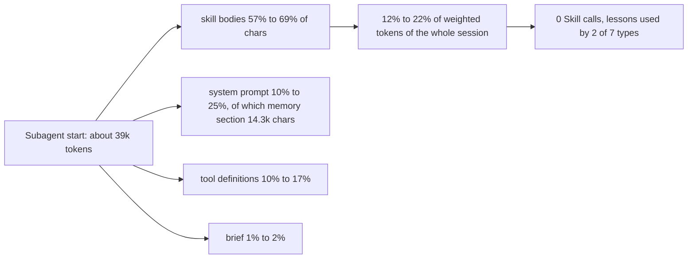

# What a Compass agent loads at start, and how much of it the agent uses

> [!IMPORTANT]
> You decide: whether the start-context sizes and unused-content evidence below are the baseline that [[SPEC-028-agent-memory-is-good-enough]] and [[SPEC-027-compass-uses-fewer-tokens]] cut against.

## Question

What enters the context of each Compass agent type at start, what share of its weighted tokens each source takes over a session, and what is loaded that the agent never acted on?

## Scope

Aggregates only. Compass agent types in `plugin/templates/agents`; 95 subagent sessions in the six Compass-arm builds of the first pilot run ([[RESEARCH-whole-overhead-pilot-run-1]], whose harness faults inflate the main session, not a subagent's own composition). Excluded: project names, paths, session ids, message text.

## Methodology

Repository mining: an empirical study of the artifact, here the agent definitions, skill files and the transcripts the pilot wrote. The profiler's own session-level code (`token_profile.profile_session`) was re-run per subagent session to get a session-kind by source table, which the saved profiles do not hold. No `grading:` disclosure reached this run, so the findings are marked and ungraded because nobody was asked.

Sources measured: the saved profile folder for run 1 (12 profiles); the folder for the no-web variant is empty, so no comparison with it exists. Weights: output 5.0, cache write 1.25, cache read per model (`bench/overhead/records.py:51-53`).

## Findings

### Static: what each agent definition declares

1. **Agent files range 2.5k to 12.4k chars; seven agents preload skills** (confidence: high)
   Characters of the file: validator 12385, planner 11965, researcher 11294, tester 8815, builder 6670, reviewer 5548, pr-describe 4191, debug 4148, vault-locator 4348, vault-analyzer 4010, codebase-analyzer 3204, pattern-finder 2979, codebase-locator 2516. The four read-only finders and analyzers declare no skills.
   - `plugin/templates/agents/*.md` frontmatter and `wc -c`
   - Marks: code, owner checked; not retracted; not preprint; 0 citations; 1 source

2. **Skills named in frontmatter: three skills for six agents, four for two** (confidence: high)
   `skills: obsidian, methodology, lessons` on builder, debug, planner, pr-describe, reviewer, validator; researcher adds `research-methods`; tester adds `test-design`.
   - `plugin/templates/agents/builder.md:5`, `planner.md:5`, `researcher.md:5`, `tester.md:5`, `validator.md:6`
   - Marks: code, owner checked; not retracted; not preprint; 0 citations; 1 source

3. **Skill sizes: obsidian 36.9k chars, methodology 20.9k, research-methods 19.0k, test-design 9.3k, lessons 7.8k** (confidence: high)
   `obsidian` also has two supporting files (4364 chars together) that preloading does not carry. Transcripts show the bodies as loaded: obsidian 36584, methodology 20395, lessons 7630, research-methods 18467, test-design 8745 chars.
   - `plugin/skills/*/SKILL.md` `wc -c`; subagent transcripts, first meta messages
   - Marks: code and transcript; not retracted; not preprint; 0 citations; 2 sources agree

4. **Preloaded skill chars per spawn: 64.6k (builder, planner, reviewer, validator), 73.4k (tester), 83.1k (researcher)** (confidence: high)
   Over the 95 profiled spawns this is about 6.5M chars, roughly 2.3M tokens loaded at start, before any cache re-read.
   - Sum of finding 3 sizes per agent; spawn counts from the profiled transcripts (builder 20, researcher 36, tester 13, planner 7, validator 6, reviewer 7, general-purpose 6)
   - Marks: transcript; not retracted; not preprint; 0 citations; 1 source; token figure is an estimate at 2.8 chars per token

5. **Seven agents add `memory: project`; the memory section is 14.3k chars of the system prompt** (confidence: high)
   builder, debug, planner, pr-describe, reviewer, tester, validator. The measured section ("Persistent Agent Memory" through its end) is 14300 to 14343 chars in builder, tester, validator, reviewer and planner, which is 55% (validator) to 74% (reviewer) of those agents' system prompts. Researcher has no memory field and no such section.
   - `plugin/templates/agents/builder.md:10`; system block of subagent first request (`token_profile.py:222`, `_shape_items`)
   - https://code.claude.com/docs/en/sub-agents says memory adds read/write instructions plus the first 200 lines or 25KB of `MEMORY.md`
   - Marks: code and vendor docs; not retracted; not preprint; 0 citations; 2 sources agree

6. **`initialPrompt` is declared on eight agents but does not run for a spawned subagent** (confidence: high)
   Declared on builder, debug, planner, pr-describe, researcher, reviewer, tester, validator. The docs say it is auto-submitted only when the agent is the main session agent, and "Ignored for plugin subagents". In all 95 spawned sessions the first user message is the orchestrator's brief (median 947 to 2027 chars); the hot-path reads it requests do not occur at start.
   - `plugin/templates/agents/builder.md:12`; https://code.claude.com/docs/en/sub-agents (frontmatter table)
   - Marks: vendor docs plus transcript; not retracted; not preprint; 0 citations; 2 sources agree

### Measured: start context per type

7. **Median first-request context is 37k to 43k tokens for the six Compass types; general-purpose starts at 25k** (confidence: high)
   First request tokens (input plus cache read plus cache write): researcher 42.9k, tester 42.2k, planner 40.8k, builder 39.3k, validator 38.5k, reviewer 36.7k, general-purpose 25.2k. Chars per token measured 2.74 to 2.84.
   - Profiled subagent transcripts, first assistant usage record
   - Marks: transcript; not retracted; not preprint; 0 citations; 1 source, 95 sessions

8. **Start context by source, median chars: skills 57% to 69%, system prompt 10% to 25%, tool definitions 10% to 17%, brief 1% to 2%, harness attachments about 2%** (confidence: medium)
   | Type | system | tools (count) | skills | brief | attachments |
   |---|---|---|---|---|---|
   | researcher | 12.0k | 20.4k (10) | 83.1k | 1.8k | about 2.3k |
   | tester | 22.5k | 17.9k (8) | 73.4k | 1.3k | about 2.3k |
   | planner | 25.8k | 17.9k (8) | 64.6k | 2.0k | about 2.3k |
   | builder | 20.5k | 17.9k (8) | 64.6k | 1.8k | about 2.3k |
   | validator | 26.1k | 10.4k (5) | 64.6k | 1.4k | about 2.3k |
   | reviewer | 19.4k | 13.8k (7) | 64.6k | 1.5k | about 2.3k |
   The attachment size is the rendered environment, model, session-context, date and remote-session items of a sample session. The shares are computed from medians; they are not a per-session distribution.
   - Subagent request shapes and first user/meta messages; `token_profile.py:280-283` (attachments counted from rendered text)
   - Marks: transcript; not retracted; not preprint; 0 citations; 1 source; computed from medians

9. **Project CLAUDE.md and the four rules files do not appear in a subagent's first request** (confidence: medium)
   The sandbox project holds a CLAUDE.md (886 chars) and four rules files (13.5k chars; the plugin templates total 12.6k). A regression of first-request tokens on the transcript-visible chars over 95 sessions gives 0.356 tokens per char plus a constant of 387 tokens. Rules of 13.5k chars would add about 4.8k tokens; none is present. The rules heading text also occurs in no subagent transcript.
   - `plugin/templates/rules/*.md` sizes (12633 chars); regression over the subagent transcripts
   - Marks: transcript, inferred; not retracted; not preprint; 0 citations; 1 source; slope and constant fitted across agent types, not tested per type

10. **The Agent tool and the agent listing reach every spawned type that holds the Agent tool** (confidence: high)
    The listing arrives as an `agent_listing_delta` attachment: 2.2% (researcher), 1.9% (builder), 1.8% (planner), 1.7% (tester), 1.5% (reviewer) of weighted tokens; validator, with no Agent tool, has none. The Agent tool definition adds 1.1% to 1.5% more. A per-turn budget attachment adds 0.65% to 0.75% in every type.
    - Source table of the re-profiled subagent sessions
    - Marks: transcript; not retracted; not preprint; 0 citations; 1 source, 95 sessions

### Measured: share of weighted tokens per subagent type

11. **Per type, preloaded skills take 12.8% to 22.1% of weighted tokens, output 36% to 46%, tool results 17% to 25%** (confidence: medium)
    Share of the type's weighted tokens, summed over the six Compass-arm builds.
    | Type (spawns) | system | tool defs | skill bodies | brief | attachments | startup reads | tool results | tool calls | output |
    |---|---|---|---|---|---|---|---|---|---|
    | researcher (36) | 3.2% | 5.4% | 22.1% | 0.5% | 3.7% | 0.1% | 20.8% | 8.0% | 36.0% |
    | builder (20) | 4.8% | 4.2% | 15.3% | 0.4% | 3.7% | 0.3% | 18.5% | 11.8% | 40.7% |
    | tester (13) | 4.6% | 3.7% | 15.0% | 0.3% | 3.1% | 0.1% | 16.6% | 10.2% | 46.4% |
    | planner (7) | 6.3% | 4.4% | 16.0% | 0.5% | 3.2% | 0.0% | 17.6% | 7.7% | 43.8% |
    | validator (6) | 8.1% | 3.2% | 20.2% | 0.4% | 1.5% | 0.1% | 21.8% | 7.8% | 36.5% |
    | reviewer (7) | 3.8% | 2.7% | 12.8% | 0.3% | 2.7% | 0.6% | 24.9% | 7.8% | 43.6% |
    | general-purpose (6) | 0.9% | 12.2% | 0.0% | 0.7% | 14.1% | 0.0% | 18.6% | 7.9% | 45.5% |
    Rows do not sum to 100%: assistant text and meta messages (under 1%) are omitted. "Startup reads" is the tool result of reading the vault index, active list and lessons index.
    - Re-profiled sessions with `token_profile.profile_session`; weights `bench/overhead/records.py:51-53`
    - Marks: transcript; not retracted; not preprint; 0 citations; 1 source; per-kind totals not cross-checked against the saved profiles

12. **Excluding output, skill bodies are 22.6% (reviewer) to 34.5% (researcher) of a subagent's input-side weighted tokens** (confidence: medium)
    builder 25.8%, tester 28.0%, planner 28.4%, validator 31.8%. Across all subagent sessions skill bodies come to about 4.7M of 47.5M weighted tokens in the Compass arm, about 10%.
    - Same source table; Compass-arm total is the 12-build total minus the six baseline builds
    - Marks: transcript; not retracted; not preprint; 0 citations; 1 source

13. **Within the preloaded bodies, obsidian takes about 44% to 57% of the skill tokens** (confidence: medium)
    The profiler labels these bodies `skill body:preloaded` with no name, and splits tokens by characters, so the per-skill split follows chars: obsidian 56.6% (3-skill agents), 44.0% (researcher), 49.9% (tester); methodology 31.6%, 24.5%, 27.8%; lessons 11.8%, 9.2%, 10.4%; research-methods 22.2% (researcher); test-design 11.9% (tester). Obsidian alone is then about 8.7% of builder weighted tokens, 9.7% of researcher, 11.4% of validator.
    - Finding 3 sizes times finding 11 shares
    - Marks: derived; not retracted; not preprint; 0 citations; 1 source; computed by proportion, not measured per skill

14. **Other session kinds, for scale: main build session 3.1% skill bodies, 16.3% attachments, 11.1% tool definitions; capture worker 21.5% tool definitions, 28.8% attachments, no skills** (confidence: medium)
    The build row mixes six Compass-arm and six baseline sessions. 65 capture-worker sessions are 5.7M of 52.1M weighted tokens in the 12 builds.
    - Same table
    - Marks: transcript; not retracted; not preprint; 0 citations; 1 source

### Loaded but not acted on

15. **No subagent called the Skill tool, and the one Agent call is the only delegation** (confidence: high)
    Tool calls over 95 spawned sessions: zero Skill calls; Agent calls: 1 (a builder). Agent definition plus listing cost 2.6% to 3.7% of weighted tokens in the five types that hold the tool.
    - Per-session tool-call counts from the re-profiled transcripts
    - Marks: transcript; not retracted; not preprint; 0 citations; 1 source, 95 sessions

16. **The lessons skill (7.6k chars, preloaded in six types) is followed by a `compass lessons` call in 2 of the 7 types** (confidence: medium)
    Sessions running `compass lessons`: planner 5 of 7, builder 4 of 20, general-purpose 1 of 6; tester 0 of 13, reviewer 0 of 7, validator 0 of 6, researcher 0 of 36 (command text starting `compass lessons`). Validators run `compass lesson-coverage` instead (6 of 6).
    - Bash command heads in the subagent transcripts
    - Marks: transcript; not retracted; not preprint; 0 citations; 1 source; detection by command text, so a lessons lookup done another way is missed

17. **Document-format content of obsidian shows up in the output of planner, researcher and reviewer, and not in builder, tester, validator** (confidence: medium)
    Sessions whose Write/Edit content or assistant text carried the pattern: frontmatter `type:` of a vault document: planner 7 of 7, researcher 20 of 36, reviewer 4 of 7, builder 0 of 20, tester 0 of 13, validator 0 of 6. Mermaid block: planner 7 of 7, reviewer 7 of 7, researcher 19 of 36, others 0. Callout: reviewer 7 of 7, planner 6 of 7, researcher 19 of 36, others 0 (validator and tester 0). Wikilinks: planner 7 of 7, researcher 28 of 36, reviewer 7 of 7, builder 7 of 20, validator 3 of 6, tester 0 of 13. Builder and tester load the same 36.6k chars (8.7% and about 7.5% of weighted tokens) with no vault-document output.
    - Pattern counts over Write/Edit inputs and assistant text in the re-profiled transcripts
    - Marks: transcript; not retracted; not preprint; 0 citations; 1 source; content written by a Bash heredoc is not scanned

18. **The research-methods skill is acted on: 30 of 36 researchers name a methodology, 26 of 36 write a Marks line** (confidence: medium)
    Researchers also called `compass sources` in 6 of 36 sessions. This skill's 19.0k chars (about 22% of the researcher's skill tokens) is the only preloaded skill with direct output evidence in the researcher type.
    - Text scan of researcher Write/Edit inputs and assistant text
    - Marks: transcript; not retracted; not preprint; 0 citations; 1 source

19. **test-design is acted on by the tester's tooling and partly by its text** (confidence: medium)
    `compass test-smells` ran in 13 of 13 tester sessions; "boundary" appears in 7 of 13, "mutat" in 3 of 13 (the methodology skill marks `compass mutate` as unbuilt). Validators ran `test-smells` in 5 of 6 and `test-checkpoint` in 4 of 6.
    - Bash command heads and text scan of the re-profiled transcripts
    - Marks: transcript; not retracted; not preprint; 0 citations; 1 source

20. **The hot-path files named in `initialPrompt` are read by few subagents** (confidence: medium)
    Sessions reading a path ending `index.md` (excluding the lessons index): researcher 12 of 36, reviewer 4 of 7, others 0. `active.md`: reviewer 4 of 7, builder 5 of 20, researcher 2 of 36, tester, validator, planner 1 each. Lessons index: researcher 5 of 36, reviewer 2 of 7, others 0. These reads cost 0.0% to 0.6% of weighted tokens per type.
    - Read tool inputs in the re-profiled transcripts
    - Marks: transcript; not retracted; not preprint; 0 citations; 1 source; a path ending `index.md` may be a folder index

## Contradictions

- Finding 9 versus the docs: https://code.claude.com/docs/en/sub-agents says subagents load the CLAUDE.md hierarchy and project rules by default, yet the first-request regression shows no room for the sandbox project's rules. The transcript does not store injected reminders, so the regression is the only evidence.
- Finding 6: eight agent files carry `initialPrompt`, written as if the hot-path read runs for each; the docs and the transcripts show it does not run for spawned subagents.

## Gaps

- Per-section use of the methodology skill (parallel execution, deep research, autopilot, handoffs, plan iteration, TODO priorities) was not measured; only whole-skill and pattern-level evidence exists. A fresh pass would scan assistant text and tool calls for each section's terms.
- Whether subagents read or wrote their `memory: project` store was not measured, though the 14.3k-char memory section loads in five types. Reading the agent-memory folders of the sandbox projects and counting memory file reads and writes would close it.
- Whether the main session loads the rules files is unmeasured; no first-request token total was regressed for the main session.
- The saved profile folder for the no-web variant is empty, so the effect of dropping web tools on researcher context is unmeasured.
- Per-kind totals from the re-run were not compared with the saved per-project `by_kind` values.
- Only one pilot run (harness faults named in [[RESEARCH-whole-overhead-pilot-run-1]]) and six Compass-arm builds on three topics; shares for planner, validator and reviewer rest on 6 to 7 sessions each.
- Detection in finding 17 reads Write/Edit inputs and assistant text, not Bash heredocs, so output evidence for builder and tester may be undercounted.
