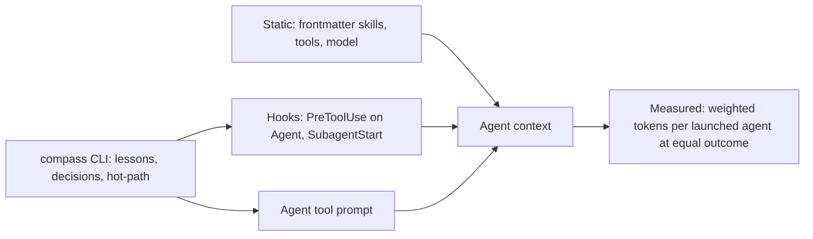

# Assembling each launched agent's context by script

> [!IMPORTANT]
> You decide: which launcher design (A, B or C below) goes into a plan for an experiment first. Nothing here is binding; every number marked as unknown needs the experiment named in Gaps.

## Question

What could a Compass launcher look like that assembles each launched agent's context by script, so the agent gets what its task needs and nothing more?

## Methodology

Repository mining of Compass (agents, skills, hooks, CLI, the token profiler's saved build profiles) plus Claude Code's own hooks and sub-agent documentation and the Hermes delegation code, as a technology landscape comparison of mechanisms. No `grading:` field reached this run, so findings are marked and ungraded because nobody was asked.

## Findings: what a launched agent receives today

1. **A launched non-fork agent starts from five inputs** (confidence: high)
   - Its own agent file body as system prompt, plus environment details.
   - The delegation prompt the orchestrator writes.
   - Every CLAUDE.md level and project rule the main session loads (skipped only by built-in Explore and Plan, or with `omitClaudeMd`).
   - A git status snapshot, and the full body of every skill in `skills:` (first 32 names).
   - It never gets the parent conversation, output style or the parent's auto memory.
   - https://code.claude.com/docs/en/sub-agents (frontmatter table, "What does a subagent inherit")
   - Marks: official docs, vendor; no retraction; not a preprint; 0 citations; 1 source (code not available)

2. **Compass agents preload 16K to 21K tokens of skill text each** (confidence: high)
   - Seven agents (builder, debug, planner, pr-describe, reviewer, validator, tester) list `obsidian, methodology, lessons`; the sum of those three SKILL.md files is 65,606 characters (about 16.4K tokens at 4 characters per token). Researcher adds `research-methods` (84,574 characters, about 21K); tester adds `test-design` (74,938, about 18.7K).
   - `obsidian` alone is 36,912 characters (about 9.2K tokens), the largest single preload.
   - Five agents (codebase-locator, codebase-analyzer, pattern-finder, vault-locator, vault-analyzer) preload nothing.
   - `plugin/templates/agents/builder.md:5`, `plugin/templates/agents/researcher.md:5`, `plugin/skills/obsidian/SKILL.md` (size), `plugin/skills/methodology/SKILL.md` (20,852 characters)
   - Marks: code, owner checked (this repo); no retraction; not a preprint; 0 citations; 1 source

3. **Preloaded skill text is 11% to 20% of a subagent's weighted tokens in saved builds** (confidence: medium)
   - Across 271 saved subagent sessions (private sandbox builds, aggregates only): preloaded skill bodies are 13.7% of tester, 20.3% of researcher, 14.1% of builder, 13.6% of planner, 11.1% of reviewer, 20.3% of validator weighted tokens.
   - The agent file as system prompt is 2.9% to 8.2%; CLAUDE.md-style instructions 1.2% to 1.8%; the agent listing 1.3% to 2.0%.
   - Output tokens are the largest block (33% to 48%) because output weighs 5.0 against 1.0 for input.
   - `bench/overhead/token_profile.py:profile_folder` (per-session sources); `bench/overhead/records.py:51-52` (OUTPUT_WEIGHT 5.0, CACHE_WRITE_WEIGHT 1.25)
   - Marks: code run on private data; no retraction; not a preprint; 0 citations; 1 source
   - Caveat: [[RESEARCH-whole-overhead-pilot-run-1]] records harness faults that inflate the Compass arm; treat shares as rough.

4. **Start-here file reads by subagents are near zero in the profiles** (confidence: medium)
   - In the top weighted sources of tester, researcher, builder, planner and validator sessions no read of index.md, active.md or lessons/index.md appears above about 0.2%; reviewer shows index.md at 0.4%, validator active.md at 0.1%.
   - Every agent file carries `initialPrompt: "Read these files now: .compass/index.md, .compass/active.md, .compass/lessons/index.md"`.
   - The sub-agent docs state `initialPrompt` auto-submits "only when the agent runs as the main session via --agent", and that plugin subagents ignore it.
   - `plugin/templates/agents/builder.md:12`, `plugin/templates/agents/validator.md:13`; https://code.claude.com/docs/en/sub-agents
   - Marks: code plus official docs; no retraction; not a preprint; 0 citations; 2 sources agree
   - Caveat: absence below a cutoff is indirect evidence; Gaps item 1 names the direct test.

5. **The start-here set is at its cap** (confidence: high)
   - `compass hot-path` prints 5112 of 5000 tokens for index.md, active.md and lessons/index.md (20,460 characters in total: 14,513, 3,185, 2,762); 5366 once the newest handoff is counted.
   - `compass tree` prints about 49.8K characters (about 12K tokens) and is a whole-vault view, not a launch input.
   - `plugin/cli/commands/hot_path.py` (command), run output in this session
   - Marks: code run; no retraction; not a preprint; 0 citations; 1 source

## Findings: mechanisms and what each can control

6. **Agent frontmatter is static per agent type** (confidence: high)
   - Controls: `tools`/`disallowedTools`, `model`, `effort`, `maxTurns`, `skills`, `omitClaudeMd`, `memory`, `mcpServers`, `hooks`, `permissionMode`, `isolation`. It cannot vary with the task.
   - Plugin subagents ignore `hooks`, `mcpServers`, `permissionMode` and `initialPrompt`; a locally installed project agent file is not a plugin agent, and whether the rule applies to Compass's `.claude/agents` install is untested.
   - `skills:` only picks what is preloaded; the agent can still call unlisted skills through the Skill tool unless `Skill` is removed from `tools`.
   - https://code.claude.com/docs/en/sub-agents; `plugin/templates/agents/*.md` lines 2-13
   - Marks: official docs plus code; no retraction; not a preprint; 0 citations; 2 sources agree

7. **`omitClaudeMd: true` drops the CLAUDE.md levels from a subagent** (confidence: medium)
   - Available from Claude Code v2.1.271; only managed policy files still load. Subdirectory CLAUDE.md files and path-scoped rules still load when the agent works there.
   - Instruction attachments are 1.2% to 1.8% of subagent weighted tokens; Compass's pipeline rules reach agents through those files.
   - https://code.claude.com/docs/en/sub-agents; `bench/overhead/token_profile.py` (attachment:instructions)
   - Marks: official docs plus code run; no retraction; not a preprint; 0 citations; 2 sources

8. **A hook can inject context into a subagent through `SubagentStart`** (confidence: high)
   - Matcher is the agent `name` (plugin agents `plugin:name`, anchored regex). Input holds `agent_id` and `agent_type` only, so the hook sees no task text.
   - Output `hookSpecificOutput.additionalContext` is "added to the subagent's context at the start of its conversation, before its first prompt". The hook cannot block creation.
   - On a repeated run the context is injected only if the earlier copy is absent, which keeps the prompt cache intact.
   - https://code.claude.com/docs/en/hooks (SubagentStart section)
   - Marks: official docs, vendor; no retraction; not a preprint; 0 citations; 1 source

9. **`PreToolUse` on the `Agent` tool sees the prompt and can replace it** (confidence: medium)
   - `tool_input` for Agent carries `prompt`, `description`, `subagent_type`, `model`. `updatedInput` "replaces the entire input object" for any tool; the docs list no exception for Agent.
   - In auto mode a changed Agent call without an explicit `permissionDecision` may be denied; the docs' list of tools a command hook may change without that denial omits Agent.
   - A `PreToolUse` `additionalContext` lands "next to the tool result", in the parent, not the subagent.
   - https://code.claude.com/docs/en/hooks (PreToolUse decision control); `updatedInput` on Agent is stated by inference from the general rule, not an Agent example
   - Marks: official docs, vendor; no retraction; not a preprint; 0 citations; 1 source

10. **Compass registers no hook on Agent or SubagentStart today** (confidence: high)
    - PreToolUse matches `Bash|Write|Edit|MultiEdit` only (the guard); SubagentStop runs `capture-signal` for nine named agents; SessionStart runs self-update and capture-check.
    - Every hook is a command, never an agent, so no hook costs agent turns. The guard exits before Python unless the event carries an agent id.
    - The `hostlib.py` event list for the other host already includes `SubagentStart`.
    - `plugin/hooks/hooks.json:4-6,65-67,112-114`; `plugin/cli/hostlib.py:51`
    - Marks: code, owner checked; no retraction; not a preprint; 0 citations; 1 source

11. **The Agent tool's prompt is the one channel the orchestrator fully controls** (confidence: high)
    - The build skill spawns builders with `isolation: "worktree"` (the parameter, not frontmatter, creates the worktree), spawns a tester pre- and post-build, and reuses the same builder by `SendMessage` in the fix loop instead of a fresh spawn.
    - Reuse avoids a second launch prefix; a fresh spawn would "know nothing of the first".
    - `plugin/skills/build/SKILL.md:39,42`
    - Marks: code, owner checked; no retraction; not a preprint; 0 citations; 1 source

12. **The CLI already holds the pieces of a context packet** (confidence: high)
    - `compass lessons --for <doc> --top N --context <caller>` ranks catalog rows (default 5), returns file names and summaries, and logs the query to `.compass/tmp/retrieval-log.jsonl`. The builder and planner files tell the agent to run it itself.
    - `compass decisions <doc>`, `compass coverage`, `compass graph impact`, `compass resolve-model`, `compass hot-path`, `compass touched` / `admit-check` (a 10-entry working-set marker, `touched.py:WORKING_SET_MAX`) and the tag index are mechanical readers of vault state.
    - `plugin/cli/commands/lessons.py:10-20`; `plugin/templates/agents/builder.md:31`; `plugin/templates/agents/planner.md:35`; `plugin/cli/commands/touched.py:1-12`
    - Marks: code, owner checked; no retraction; not a preprint; 0 citations; 1 source

13. **Skills split by progressive disclosure already in one case** (confidence: medium)
    - `obsidian` ships `writing-principles.md` and `path-qualified-links.md` beside SKILL.md, yet SKILL.md stays 36.9K characters because the templates and conventions sit inline. `research` ships `evidence-rules.md` the same way.
    - A preloaded skill injects the SKILL.md body only; sibling files load when an agent reads them.
    - `plugin/skills/obsidian/` and `plugin/skills/research/` listings; https://code.claude.com/docs/en/sub-agents
    - Marks: code plus official docs; no retraction; not a preprint; 0 citations; 2 sources agree

14. **Hermes hands a child agent only a goal and a context string** (confidence: high)
    - `delegate_task` builds the child with `skip_context_files=True`, `skip_memory=True`, an ephemeral system prompt built from the goal and context, and the parent's toolsets minus blocked ones.
    - This is a precedent for "child gets the task packet and nothing inherited"; see [[RESEARCH-hermes-memory-today]] for the parent memory side.
    - `bench/external/repos/hermes-agent/tools/delegate_tool.py:203-206,256-257,295-298`
    - Marks: code, owner checked; no retraction; not a preprint; 0 citations; 1 source

15. **Cache pricing makes static and per-task context cost differently** (confidence: medium)
    - The profiler weights input 1.0, output 5.0, cache write 1.25 and cache read by model. A preload identical across launches can be a cache read after the first write inside the cache lifetime; a per-task packet is a cache write each launch. Sub-agent frontmatter offers `experimental.cacheTtl` (`5m` or `1h`).
    - `bench/overhead/records.py:43-52,133`; https://code.claude.com/docs/en/sub-agents
    - Marks: code plus official docs; no retraction; not a preprint; 0 citations; 2 sources
    - Caveat: the saved profiles split cache tokens per item, so the real cache-read share of preloaded skills was not isolated in this pass.

## Candidate designs

Common judging number for all three: weighted tokens per launched agent (records.py weights), at equal task outcome (the judge's verdict and the test result of the same topic), per agent type, over at least the batch size [[RESEARCH-whole-overhead-pilot-run-1]] computes.

### A. Slim static agents (frontmatter and skill splitting only)

- **Assembled by:** editing nothing at launch. Each agent file lists only the skills its role uses (for example reviewer and pr-describe without `methodology`), `obsidian` is split so SKILL.md holds the linking rule and frontmatter, and templates move to sibling files read on demand; optional `omitClaudeMd`.
- **Agent receives:** its body, the trimmed preloads, CLAUDE.md levels (or none), the orchestrator's prompt.
- **Fetched on demand:** skill sibling files, the start-here files, lessons, spec and plan bodies, by the agent's own Reads.
- **Judged by:** the preloaded-skill share (11% to 20% today) and system prompt share, plus turns per agent, at equal outcome.
- **Needs no hook;** works on any host that reads agent frontmatter.

### B. Packet by CLI, passed in the Agent prompt

- **Assembled by:** a command (for example `compass launch <agent> --task TASK-NNN`) that reads the plan task line, its `files:`, its cited `decisions:`, the top 3 `compass lessons --for` rows with summaries, and a trimmed start-here excerpt, then writes a packet to `.compass/tmp/` and prints it; the build skill puts it in the Agent prompt (or passes the path).
- **Agent receives:** the packet as the first user turn; slim preloads as in A; `initialPrompt` reads removed from agent files.
- **Fetched on demand:** full spec and research bodies named in the packet, lesson bodies, source files.
- **Judged by:** packet bytes, count of vault Reads per agent, weighted tokens per agent at equal outcome; the orchestrator's added tokens for the call are counted too.

### C. Packet by hook, no orchestrator step

- **Assembled by:** a `PreToolUse` hook on `Agent` that parses the task id from `tool_input.prompt`, calls the same packet builder as B, and returns `updatedInput` with the packet prepended; or a `SubagentStart` hook that adds `additionalContext` keyed on `agent_type` (static per role, since it sees no task text).
- **Agent receives:** the packet before its first prompt (SubagentStart) or inside its prompt (PreToolUse).
- **Fetched on demand:** as in B.
- **Judged by:** the same weighted number plus orchestrator tokens saved against B; the failure rate of the hook path (prompts left unmodified) as a count.
- **Constraint:** hooks are commands only and must never exit 2 (`hooks.json` description); the auto-mode caveat in finding 9 applies.

A can be combined with B or C; B and C share one packet builder and differ in where it runs.

## Contradictions

- Finding 4 reads `initialPrompt` as unapplied to subagents; the Compass agent files and `compass hot-path` assume the start-here reads happen. Not resolved without the direct test.
- Finding 6 says plugin subagents ignore `hooks`, `mcpServers`, `permissionMode`, yet Compass agent files set `permissionMode: bypassPermissions`; whether the installed agents are treated as plugin agents is unconfirmed.

## Gaps

1. Does `initialPrompt` run for a Task-launched subagent in the installed Claude Code version? Test: launch a builder, read its first transcript turns for the three Reads.
2. Does `updatedInput` on `Agent` rewrite the prompt, in bypass and auto modes? Test: a logging PreToolUse hook that appends a marker, then read the subagent's first user turn.
3. Does a `SubagentStart` hook fire for locally installed agents, and does `additionalContext` appear in the transcript? Does the hook receive the task text through `transcript_path`?
4. Cache economics: the cache-read share of preloaded skills in saved profiles, and the write cost of a per-task packet; needs a profiler row per source split by cache kind.
5. Equal-outcome effect: whether agents with trimmed preloads still follow linking, frontmatter and lesson-write rules; needs paired builds with the judge, per [[SPEC-032-whole-overhead-measured-on-real-projects]].
6. Whether agents load an unlisted skill through the Skill tool when they need it (for example `obsidian` templates), and at what cost.
7. Whether `omitClaudeMd` loses rules the agent needs; the rules in `.claude/rules` reach subagents only through CLAUDE.md loading.
8. The profiles come from a sandbox harness with known inflation faults; absolute shares need a re-run after the fixes.
