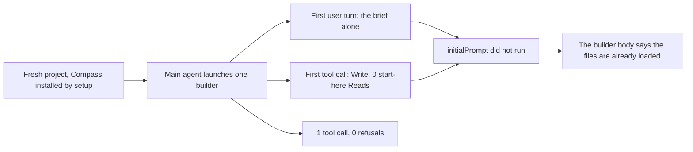

# Does initialPrompt run for a launched subagent

> [!IMPORTANT]
> You decide: whether this one-launch result settles check E1 of [[REVIEW-agent-context-2026-11]] (`initialPrompt` does not run for an installed subagent), so that the start-here files reach launched agents through the brief or a hook instead.

## Question

When the main agent launches an installed Compass subagent whose definition carries `initialPrompt: "Read these files now: .compass/index.md, .compass/active.md, .compass/lessons/index.md"`, do the subagent's first turns hold Reads of those three files? What is its first user turn, and do its tool calls run without permission refusals?

## Scope

One launch of the `builder` agent type, Claude Code 2.1.318 (the version recorded in the transcript), Compass installed by `/compass:setup` into a fresh git project. Aggregates only. Not covered: agents loaded through `--plugin-dir`, other agent types, an agent launched in a worktree, a project with a populated vault.

## Methodology

Controlled single-launch probe, the probe being `probe_initial_prompt.py` on the overhead harness (isolated Claude config, fence hook that allows fenced calls headless). A first session with `--plugin-dir` ran `/compass:setup`. A second session, without `--plugin-dir`, so that Compass loads once from the project's own install, asked the main agent to launch one `builder` with a two-line task that names no start-here file. The builder's subagent transcript was read for its Reads, its first user entry and its tool results. The harness injects `initialPrompt`, not the model, so one launch decides whether the feature runs; it says nothing about how often a model reads the files unprompted.

## Findings

1. **`initialPrompt` did not run for the launched builder** (confidence: medium)
   The transcript holds 1 tool call, a Write of the file the task asked for, and 0 Reads of any of the three start-here files. A text search of the subagent transcript and the main session's transcript finds the initial prompt's wording 0 times.
   - Evidence: the probe's reading of the transcript: `initial_prompt` is "did not run", start-here reads 0, first tool call `Write`; the text search read by hand.
   - Caveat: one launch of one agent type; the first user entry is the brief alone (finding 2), so no injected prompt sits ahead of it.

2. **The builder's first user turn is the brief alone** (confidence: high)
   The first non-meta user entry equals the 97-character brief verbatim and names no start-here file. Three meta user entries follow it, one per preloaded skill (`obsidian`, `methodology`, `lessons`), so the definition's `skills` field applied while its `initialPrompt` did not.
   - Evidence: the transcript's first four user entries, read by hand: the brief, then three skill preloads; the probe's `first_user_turn_is_brief` true, `first_user_turn_names_start_here` false.

3. **The builder that ran was the installed definition** (confidence: high)
   The project's installed `builder` file carries the `initialPrompt` line, the `skills` line and `permissionMode: bypassPermissions`, and the subagent's metadata names agent type `builder` with the foreground request shape. The installed copy is a project agent, the case the review's Conflicts section left open (whether locally installed copies count as plugin agents).
   - Evidence, read by hand: installed `builder` frontmatter lines (initialPrompt, skills, memory, permissionMode all present); subagent metadata `agentType: builder`.

4. **The one tool call ran without a refusal** (confidence: low for the `permissionMode` doubt)
   0 permission refusals and 0 hook refusals among the tool results; the Write succeeded and a PreToolUse hook success is recorded for it. The fence hook allows fenced Write, Edit and Bash calls explicitly, so this result does not show whether `permissionMode: bypassPermissions` itself applies to an installed subagent, and no Bash call was made.
   - Evidence: the probe's `permission_denials` 0, `hook_denials` 0, `tool_calls` 1; the hook success entry read by hand.
   - Caveat: a launch that made a Bash call and ran without the allowing hook would settle the `permissionMode` doubt.

5. **The builder body's first protocol step describes something that did not happen** (confidence: high)
   Step 1 of the builder agent template says the frontmatter `initialPrompt` already loaded the three files and tells the builder to skip ahead. With the prompt not running, a launched builder starts without them unless its brief or a hook delivers them.
   - Evidence: the builder template's `initialPrompt` line and its protocol step 1; findings 1 and 2.

## Contradictions

None. The result matches the review's two earlier pieces of evidence that the prompt does not run for spawned subagents ([[REVIEW-agent-context-2026-11]], Conflicts).

## Gaps

- Seven other agent types declare the same `initialPrompt`; each was assumed to behave like the builder.
- An agent loaded through `--plugin-dir` was not launched.
- `permissionMode` effect on an installed subagent without an allowing hook.
