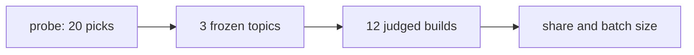

# Whole overhead pilot, first run

> [!NOTE]
> The second run of the same twelve builds, with the harness faults below fixed and every build profiled, is [[RESEARCH-whole-overhead-pilot]].

## Question

How much of a build's weighted tokens does Compass add, how much does that share vary between and within topics, and how many builds per arm does a 10% relative drop in it take to see at 95% confidence and 80% power? Related: [[SPEC-032-whole-overhead-measured-on-real-projects]].

## Findings

### The pilot

- Topic form chosen: seeded.
- Probe, seeded: 10 picks in 9 distinct kind and language classes.
- Probe, unseeded: 10 picks in 1 distinct kind and language classes.
- Builds closed: 12; refused: 0.
- Failed builds, left out of the shares: 2; finished builds without a judged verdict, also left out: 0.

### Overhead share

Share = (Compass-arm tokens minus without-Compass tokens, summed over builds) over Compass-arm tokens summed.

| Topic | Weighted share | Raw share |
|---|---|---|
| A | 93.4% | 95.9% |
| B | not computable (no finished pair of builds) | not computable (no finished pair of builds) |
| C | 89.0% | 94.0% |
| All | 91.4% | 95.1% |

- Bootstrap interval of the weighted share over topics (95%): 89.0% to 93.4%.
- Spread between topics (standard deviation of topic shares): 0.0316.
- Spread within a topic, between its runs (pooled standard deviation of pair shares, 2 degrees of freedom): 0.0367.

### Batch size

Builds per arm to see a 10% relative drop in the weighted share at 95% confidence and 80% power:

- From the point estimate of the within-topic spread: 3.
- From its upper 80% chi-square bound: 12.
- Windows of 5 hours for the point batch (both arms): 1.
- Windows of 5 hours for the upper batch (both arms): 4.

### Cost and time of one build

- Mean wall time: 2597 seconds; mean turns: 92.5.
- Builds that fit one 5-hour window: 6.
- Mean weighted tokens, compass arm: 6967451; mean raw tokens: 60970734.
- Mean weighted tokens, baseline arm: 770470; mean raw tokens: 4217596.

### Judge

- Goal items, compass arm: met 18, not met 28, partly met 16.
- Goal items, baseline arm: met 35, not met 10, partly met 17.

### Headless checks

Read from the session transcripts after the run; the pilot's run log does not hold them. Builds are named by topic (A, B, C) and run (1, 2): A1 is the first Compass-arm build of topic A.

- Compass's hooks under the flags ran in all six Compass-arm builds: the Stop hook's capture-check on every turn, `compass sync` on vault writes, and their state files under `.compass/tmp/` (high).
- No review gate ran: each build's one `compass review` call was `--install` during setup, which skipped all three surfaces. `AskUserQuestion` is not among the 16 tools of a headless session, so every gate was asked as numbered plain text and the simulated human typed the answer (high).
- Compass loaded twice in all six builds: the build session started with `--plugin-dir` lists the 34 `compass:*` skills and, after setup, the 35 project copies; every Stop ran two capture-check hooks and every vault write two syncs. Agents were not doubled, since the plugin ships none (high).
- No other plugin loaded: 14 built-in skills and the built-in agents only, no MCP tools. A2 listed one more skill set, from a third-party repository its research step cloned under `.compass/tmp/` (high).
- Self-update left `.claude/` unchanged: its check stamp exists in all six builds, with no update log and no `compass update` call. B1's main agent edited `.claude/settings.json` four times to add permissions (medium-high).
- Capture workers are not counted: the six builds started 3 to 19 extract-lessons sessions each, outside the build session, and their tokens add an estimated 4% to 17% to the Compass arm's weighted total (high).
- Frozen goal items the Compass arm's own specs left out: A1 1 (plus 1 contradicted), A2 2, B1 8 of 10, B2 9 of 10, C1 0, C2 0; B1 and B2 wrote 3 and 2 of their planned specs before the budget ran out (medium, judged against each spec's text).

### Validity of this run

Three faults in the harness inflate the Compass arm, so the shares above overstate Compass's overhead and are not a baseline for optimization:

- **The simulated human answered turns that asked nothing.** When a build ended its turn with background agents still running, the human was asked anyway, replied "Ok", and was asked again on the turn the finished agent started. Such turns: A1 105, A2 141, B1 114, B2 211, C1 20, C2 127. In A1 one such turn carried no text, and the human, reading nothing to answer, made up a different project, which the build then built.
- **Compass loaded twice** for the whole build (see above), where a user following the README restarts after setup.
- **The two topic B Compass builds ran out of the $25 budget per build** ($25.01 and $25.03), so topic B has no finished pair.

The capture workers' tokens, left out, push the other way (a 4% to 17% undercount). The judge's goal counts carry the same faults: A1's build of the wrong project and B's budget stops lower the Compass arm's counts.
