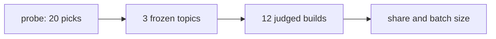

# Whole overhead pilot

> [!IMPORTANT]
> You decide: whether the batch size and the cost of one build below are a pace your subscription can carry.

## Question

How much of a build's weighted tokens does Compass add, how much does that share vary between and within topics, and how many builds per arm does a 10% relative drop in it take to see at 95% confidence and 80% power? Related: [[SPEC-032-whole-overhead-measured-on-real-projects]].

## Findings

### The pilot

- Topic form chosen: seeded.
- Probe, seeded: 10 picks in 9 distinct kind and language classes.
- Probe, unseeded: 10 picks in 1 distinct kind and language classes.
- Builds closed: 12; refused: 0.
- Failed builds, left out of the shares: 0; finished builds without a judged verdict, also left out: 0.
- Builds stopped by the wall-time or turn cap and counted up to it: 4 with Compass, 0 without; the shares below are lower bounds.

### Overhead share

Share = (Compass-arm tokens minus without-Compass tokens, summed over builds) over Compass-arm tokens summed.

| Topic | Weighted share | Raw share |
|---|---|---|
| A | 97.5% | 98.7% |
| B | 66.7% | 32.3% |
| C | 51.2% | 8.2% |
| All | 77.2% | 58.8% |

- Bootstrap interval of the weighted share over topics (95%): 51.2% to 97.5%.
- Spread between topics (standard deviation of topic shares): 0.2354.
- Spread within a topic, between its runs (pooled standard deviation of pair shares, 3 degrees of freedom): 1.7199.

### Batch size

Builds per arm to see a 10% relative drop in the weighted share at 95% confidence and 80% power:

- From the point estimate of the within-topic spread: 7801.
- From its upper 80% chi-square bound: 23282.
- Windows of 5 hours for the point batch (both arms): 5201.
- Windows of 5 hours for the upper batch (both arms): 15522.

### Cost and time of one build

- Mean wall time: 5256 seconds; mean turns: 17.9.
- Builds that fit one 5-hour window: 3.
- Mean weighted tokens, compass arm: 10148381; mean raw tokens: 59411932.
- Mean weighted tokens, baseline arm: 2318289; mean raw tokens: 24457332.

### Where the tokens go

Mean weighted tokens per build, read from every session transcript of the build's project (setup, build, subagents, capture workers); see `bench/overhead/token_profile.py` for the counting and the split by source.

- Builds profiled: compass 6, baseline 6.
- Overhead share over whole projects (weighted): 78.4%.

#### Compass arm: 10722193 weighted tokens per build

Largest gap between counted tokens and a session's own totals: 2.1%.

| Session kind | Weighted per build | Share |
|---|---|---|
| subagent:tester | 3160394 | 29.5% |
| subagent:builder | 2993752 | 27.9% |
| subagent:researcher | 1468626 | 13.7% |
| build | 1294141 | 12.1% |
| subagent:planner | 832894 | 7.8% |
| capture-worker | 332641 | 3.1% |
| subagent:reviewer | 232865 | 2.2% |
| subagent:validator | 217997 | 2.0% |
| subagent:general-purpose | 127114 | 1.2% |
| setup | 61770 | 0.6% |

| Source family | Weighted per build | Share |
|---|---|---|
| output | 4125432 | 38.5% |
| tool result | 2215051 | 20.7% |
| skill body | 1304534 | 12.2% |
| tool call | 1061689 | 9.9% |
| attachment | 812090 | 7.6% |
| prefix:tool definitions | 550608 | 5.1% |
| prefix | 401114 | 3.7% |
| user | 181362 | 1.7% |
| assistant | 70313 | 0.7% |

| Source | Weighted per build | Share |
|---|---|---|
| output:subagent:tester | 1544286 | 14.4% |
| skill body:preloaded | 1291425 | 12.0% |
| output:subagent:builder | 1049242 | 9.8% |
| tool result:Bash | 810556 | 7.6% |
| tool call:Write | 579997 | 5.4% |
| output:subagent:researcher | 558527 | 5.2% |
| tool result:Read project | 422803 | 3.9% |
| prefix:system prompt | 401114 | 3.7% |
| output:subagent:planner | 369661 | 3.4% |
| tool result:Read .compass/plans/ | 271707 | 2.5% |
| tool call:Bash | 267548 | 2.5% |
| attachment:instructions | 265882 | 2.5% |
| attachment:agent_listing_delta | 177526 | 1.7% |
| attachment:skill_listing | 148771 | 1.4% |
| prefix:tool Agent | 131003 | 1.2% |

| Phase | Weighted per build | Share |
|---|---|---|
| subagent:tester | 3160394 | 29.5% |
| subagent:builder | 2993752 | 27.9% |
| subagent:researcher | 1468626 | 13.7% |
| subagent:planner | 832894 | 7.8% |
| build | 548386 | 5.1% |
| vision | 429065 | 4.0% |
| capture-worker | 332641 | 3.1% |
| subagent:reviewer | 232865 | 2.2% |
| subagent:validator | 217997 | 2.0% |
| research | 156994 | 1.5% |
| none | 136264 | 1.3% |
| subagent:general-purpose | 127114 | 1.2% |
| compass:setup | 61770 | 0.6% |
| spec | 23432 | 0.2% |

#### Baseline arm: 2318289 weighted tokens per build

Largest gap between counted tokens and a session's own totals: 0.0%.

| Session kind | Weighted per build | Share |
|---|---|---|
| build | 2224185 | 95.9% |
| subagent:general-purpose | 94104 | 4.1% |

| Source family | Weighted per build | Share |
|---|---|---|
| output | 813465 | 35.1% |
| tool call | 762414 | 32.9% |
| tool result | 405820 | 17.5% |
| prefix:tool definitions | 135142 | 5.8% |
| attachment | 104761 | 4.5% |
| assistant | 64249 | 2.8% |
| prefix | 21012 | 0.9% |
| user | 7447 | 0.3% |
| skill body | 3979 | 0.2% |

| Source | Weighted per build | Share |
|---|---|---|
| output:none | 598636 | 25.8% |
| tool call:Write | 550686 | 23.8% |
| tool result:Read project | 214543 | 9.3% |
| output:(other) | 172198 | 7.4% |
| tool result:Bash | 135493 | 5.8% |
| tool call:Bash | 126070 | 5.4% |
| tool call:Edit | 74385 | 3.2% |
| assistant:text | 50839 | 2.2% |
| output:subagent:general-purpose | 42631 | 1.8% |
| attachment:budget_usd | 32154 | 1.4% |
| attachment:edited_text_file | 30114 | 1.3% |
| prefix:tool PowerShell | 28234 | 1.2% |
| prefix:system prompt | 21012 | 0.9% |
| attachment:skill_listing | 20006 | 0.9% |
| prefix:tool Agent | 17123 | 0.7% |

| Phase | Weighted per build | Share |
|---|---|---|
| none | 1373138 | 59.2% |
| (other) | 851048 | 36.7% |
| subagent:general-purpose | 94104 | 4.1% |

### Weighted tokens per launched agent (before PLAN-029)

The "before" figures of [[PLAN-029-crafted-agent-context]]: every subagent session of the six Compass-arm builds, plugin at commit e331edd, counted by `token_profile.py --by-agent`. Four of the six builds stopped at the wall-time cap, so these are launches up to the cap.

| Agent type | Launches | Mean weighted per launch | Median |
|---|---|---|---|
| tester | 51 | 371811 | 266575 |
| builder | 48 | 374219 | 299116 |
| researcher | 24 | 367156 | 371687 |
| planner | 10 | 499736 | 416916 |
| reviewer | 4 | 349298 | 356789 |
| validator | 4 | 326995 | 295470 |
| general-purpose | 19 | 40141 | 0 |

### Judge

- Goal items, compass arm: met 27, not met 17, partly met 18.
- Goal items, baseline arm: met 41, not met 8, partly met 13.

### Headless checks

Read from the session transcripts after the run; the pilot's run log does not hold them.

- TODO: Compass's hooks under the flags.
- TODO: a review gate falling back to a picker with no window opened.
- TODO: whether `--plugin-dir` and setup together load Compass twice (the `system/init` counts).
- TODO: which built-in plugins loaded.
- TODO: `.claude/` unchanged by self-update.
- TODO: capture workers counted.
- TODO: how many frozen goal items the Compass arm's own spec dropped.
