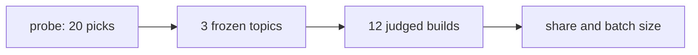

# Whole overhead pilot

> [!IMPORTANT]
> You decide: whether the batch size and the cost of one build below are a pace your subscription can carry.

## Question

How much of a build's weighted tokens does Compass add, how much does that share vary between and within topics, and how many builds per arm does a 10% relative drop in it take to see at 95% confidence and 80% power? Related: [[SPEC-032-whole-overhead-measured-on-real-projects]].

## Findings

### The pilot

- Topic form chosen: seeded.
- Probe, seeded: 10 picks in 9 distinct kind and language classes.
- Probe, unseeded: 10 picks in 1 distinct kind and language classes.
- Builds closed: 12; refused: 0.
- Failed builds, left out of the shares: 0; finished builds without a judged verdict, also left out: 0.
- Builds stopped by the wall-time or turn cap and counted up to it: 4 with Compass, 0 without; the shares below are lower bounds.

### Overhead share

Share = (Compass-arm tokens minus without-Compass tokens, summed over builds) over Compass-arm tokens summed.

| Topic | Weighted share | Raw share |
|---|---|---|
| A | 97.5% | 98.7% |
| B | 66.7% | 32.3% |
| C | 51.2% | 8.2% |
| All | 77.2% | 58.8% |

- Bootstrap interval of the weighted share over topics (95%): 51.2% to 97.5%.
- Spread between topics (standard deviation of topic shares): 0.2354.
- Spread within a topic, between its runs (pooled standard deviation of pair shares, 3 degrees of freedom): 1.7199.

### Batch size

Builds per arm to see a 10% relative drop in the weighted share at 95% confidence and 80% power:

- From the point estimate of the within-topic spread: 7801.
- From its upper 80% chi-square bound: 23282.
- Windows of 5 hours for the point batch (both arms): 5201.
- Windows of 5 hours for the upper batch (both arms): 15522.

### Cost and time of one build

- Mean wall time: 5256 seconds; mean turns: 17.9.
- Builds that fit one 5-hour window: 3.
- Mean weighted tokens, compass arm: 10148381; mean raw tokens: 59411932.
- Mean weighted tokens, baseline arm: 2318289; mean raw tokens: 24457332.

### Where the tokens go

Mean weighted tokens per build, read from every session transcript of the build's project (setup, build, subagents, capture workers); see `bench/overhead/token_profile.py` for the counting and the split by source.

- Builds profiled: compass 6, baseline 6.
- Overhead share over whole projects (weighted): 78.4%.

#### Compass arm: 10722193 weighted tokens per build

Largest gap between counted tokens and a session's own totals: 2.1%.

| Session kind | Weighted per build | Share |
|---|---|---|
| subagent:tester | 3160394 | 29.5% |
| subagent:builder | 2993752 | 27.9% |
| subagent:researcher | 1468626 | 13.7% |
| build | 1294141 | 12.1% |
| subagent:planner | 832894 | 7.8% |
| capture-worker | 332641 | 3.1% |
| subagent:reviewer | 232865 | 2.2% |
| subagent:validator | 217997 | 2.0% |
| subagent:general-purpose | 127114 | 1.2% |
| setup | 61770 | 0.6% |

| Source family | Weighted per build | Share |
|---|---|---|
| output | 4125432 | 38.5% |
| tool result | 2215051 | 20.7% |
| skill body | 1304534 | 12.2% |
| tool call | 1061689 | 9.9% |
| attachment | 812090 | 7.6% |
| prefix:tool definitions | 550608 | 5.1% |
| prefix | 401114 | 3.7% |
| user | 181362 | 1.7% |
| assistant | 70313 | 0.7% |

| Source | Weighted per build | Share |
|---|---|---|
| output:subagent:tester | 1544286 | 14.4% |
| skill body:preloaded | 1291425 | 12.0% |
| output:subagent:builder | 1049242 | 9.8% |
| tool result:Bash | 810556 | 7.6% |
| tool call:Write | 579997 | 5.4% |
| output:subagent:researcher | 558527 | 5.2% |
| tool result:Read project | 422803 | 3.9% |
| prefix:system prompt | 401114 | 3.7% |
| output:subagent:planner | 369661 | 3.4% |
| tool result:Read .compass/plans/ | 271707 | 2.5% |
| tool call:Bash | 267548 | 2.5% |
| attachment:instructions | 265882 | 2.5% |
| attachment:agent_listing_delta | 177526 | 1.7% |
| attachment:skill_listing | 148771 | 1.4% |
| prefix:tool Agent | 131003 | 1.2% |

| Phase | Weighted per build | Share |
|---|---|---|
| subagent:tester | 3160394 | 29.5% |
| subagent:builder | 2993752 | 27.9% |
| subagent:researcher | 1468626 | 13.7% |
| subagent:planner | 832894 | 7.8% |
| build | 548386 | 5.1% |
| vision | 429065 | 4.0% |
| capture-worker | 332641 | 3.1% |
| subagent:reviewer | 232865 | 2.2% |
| subagent:validator | 217997 | 2.0% |
| research | 156994 | 1.5% |
| none | 136264 | 1.3% |
| subagent:general-purpose | 127114 | 1.2% |
| compass:setup | 61770 | 0.6% |
| spec | 23432 | 0.2% |

#### Baseline arm: 2318289 weighted tokens per build

Largest gap between counted tokens and a session's own totals: 0.0%.

| Session kind | Weighted per build | Share |
|---|---|---|
| build | 2224185 | 95.9% |
| subagent:general-purpose | 94104 | 4.1% |

| Source family | Weighted per build | Share |
|---|---|---|
| output | 813465 | 35.1% |
| tool call | 762414 | 32.9% |
| tool result | 405820 | 17.5% |
| prefix:tool definitions | 135142 | 5.8% |
| attachment | 104761 | 4.5% |
| assistant | 64249 | 2.8% |
| prefix | 21012 | 0.9% |
| user | 7447 | 0.3% |
| skill body | 3979 | 0.2% |

| Source | Weighted per build | Share |
|---|---|---|
| output:none | 598636 | 25.8% |
| tool call:Write | 550686 | 23.8% |
| tool result:Read project | 214543 | 9.3% |
| output:(other) | 172198 | 7.4% |
| tool result:Bash | 135493 | 5.8% |
| tool call:Bash | 126070 | 5.4% |
| tool call:Edit | 74385 | 3.2% |
| assistant:text | 50839 | 2.2% |
| output:subagent:general-purpose | 42631 | 1.8% |
| attachment:budget_usd | 32154 | 1.4% |
| attachment:edited_text_file | 30114 | 1.3% |
| prefix:tool PowerShell | 28234 | 1.2% |
| prefix:system prompt | 21012 | 0.9% |
| attachment:skill_listing | 20006 | 0.9% |
| prefix:tool Agent | 17123 | 0.7% |

| Phase | Weighted per build | Share |
|---|---|---|
| none | 1373138 | 59.2% |
| (other) | 851048 | 36.7% |
| subagent:general-purpose | 94104 | 4.1% |

### Weighted tokens per launched agent (before PLAN-029)

The "before" figures of [[PLAN-029-crafted-agent-context]]: every subagent session of the six Compass-arm builds, plugin at commit e331edd, counted by `token_profile.py --by-agent`. Four of the six builds stopped at the wall-time cap, so these are launches up to the cap.

| Agent type | Launches | Mean weighted per launch | Median |
|---|---|---|---|
| tester | 51 | 371811 | 266575 |
| builder | 48 | 374219 | 299116 |
| researcher | 24 | 367156 | 371687 |
| planner | 10 | 499736 | 416916 |
| reviewer | 4 | 349298 | 356789 |
| validator | 4 | 326995 | 295470 |
| general-purpose | 19 | 40141 | 0 |

### Judge

- Goal items, compass arm: met 27, not met 17, partly met 18.
- Goal items, baseline arm: met 41, not met 8, partly met 13.

### Headless checks

Read from the session transcripts after the run; the pilot's run log does not hold them. Builds are named by topic (A, B, C) and run (1, 2): A1 is the first Compass-arm build of topic A.

- Compass's hooks ran under the flags in all six Compass-arm builds. Each end of turn ran one Stop capture-check (5 to 58 per build session). Every vault write in the build session and its subagents ran `compass sync`. `compass guard` checked subagent calls and denied deletes in 5 builds; C1, whose only subagent was a validator, had no denial. The hooks' state files are under `.compass/tmp/` (high).
- Every build reached a review gate and ran `compass review` from the build session. Each call that got past argument checks answered `not configured`: no Obsidian vault, and no VS Code or Cursor on the PATH, so no window opened. `AskUserQuestion` is not among the 16 or 17 tools of a headless session, so every gate was asked as numbered plain text and the simulated human typed the answer. Wasted calls: in A1 and A2, `--why` with a single file was rejected ("needs several files"), and A2 once called a bare `compass`, which is not on the PATH (high).
- Compass loaded once in all six builds. By the `system/init` counts, the setup session, started with `--plugin-dir`, had 53 skills: 19 built-in and 34 `compass:*`. The build session, started without it, had 53: 19 built-in and the 34 project copies, with no `compass:*` skill. Agents went from 6 to 19: the 13 project copies, since the plugin ships none. Every Stop ran one capture-check and every vault write ran one sync (high).
- No other plugin loaded in a setup, build or baseline session: 14 built-in skills, the 6 built-in agents, no MCP tools. Two build sessions later listed extra skill sets. A1 listed 10 from a third-party repository that its research step cloned under `.compass/tmp/` (init count 63). A2 listed the project skills again from three agent worktrees under `.claude/worktrees/` (init count 152). Capture workers run outside the flags, and they loaded 13 account skills and 4 claude.ai connectors (58 deferred MCP tools) (high).
- Self-update left `.claude/` unchanged. In all six builds, the skills, agents, rules and CLI match the plugin at the pinned commit e331edd byte for byte, line endings aside. Each build has the check stamp, no update log and no update call. The only additions are untracked: agent worktrees (A2), a planner's agent memory (B2) and test caches under the CLI (high).
- Capture workers are counted by the profile and not by the run log. The six builds started 19 extract-lessons sessions, one per capture opportunity: A1 5, A2 7, B1 2, B2 2, C1 1, C2 2. They come to 3.1% of the Compass arm's profiled weighted tokens. The shares under "Overhead share" come from the run log and so leave them out; the whole-project share that counts them is 78.4% against 77.2% (high).
- Frozen goal items the Compass arm's own specs dropped, judged against each spec's text. Four items name a toolchain, a build command or the test suite; a spec carries no technology, so they are not counted. Left out entirely: A1 1, B2 1, all others 0. Contradicted: A1 1 (an input format dropped by a spec decision), A2 2 (a different default size for a top list, and unreadable lines skipped where the goal asks for a nonzero exit), B1 1 (actor speed in place of one player action, then every monster). Stated without the goal's number or detail (counts of floors, weapons, monster types, the end-of-run summary's fields): A1 1, B1 5, B2 5, C1 2, C2 3. Every build wrote all the specs it planned (medium).

### Reconciliation and the split by source

Every build's token records, set side by side (a build killed at a cap wrote no `cost-state`, shown as n/a): the run log (the counting rule), the sessions' own `cost-state` totals and the deduplicated sum of assistant records over the build session, its subagent files and its setup session. Capture workers are listed apart. Builds are named by topic letter and run.

#### What the gaps are

- After the named causes, 12 of 12 builds agree in all three totals (within 0.5% of the logged total).
- Unfinished turn: 4 builds stopped at a cap; the transcript holds 304404 to 485833 weighted tokens that the run log lacks (2.3% to 4.8% of the logged total).
- Auxiliary requests: 4 builds carry raw tokens in the run log (and, where the session wrote it, in `cost-state`) that no transcript record holds, 11273 to 15546 per web call; they weigh nothing because their model has no list price in the table.

#### Weighted tokens per build

| Build | Arm | End | Logged | Cost-state | Records | Records minus logged | Capture workers | Unattributed | Agrees |
|---|---|---|---|---|---|---|---|---|---|
| A1 | baseline | human-done | 393607 | 393607 | 393607 | 0 (0.0%) | 0 | 0 | yes |
| A1 | compass | human-done | 12891589 | 12891589 | 12891589 | 0 (0.0%) | 600900 | 0 | yes |
| A2 | baseline | human-done | 272716 | 272716 | 272716 | 0 (0.0%) | 0 | 0 | yes |
| A2 | compass | wall-time | 13465094 | n/a | 13753033 | 287939 (2.1%) | 702934 | -16465 | yes |
| B1 | baseline | human-done | 1124850 | 1124850 | 1124850 | 0 (0.0%) | 0 | 0 | yes |
| B1 | compass | wall-time | 12179224 | n/a | 12505341 | 326117 (2.7%) | 227238 | 0 | yes |
| B2 | baseline | human-done | 6591838 | 6591838 | 6591838 | 0 (0.0%) | 0 | 0 | yes |
| B2 | compass | wall-time | 11023124 | n/a | 11370263 | 347138 (3.1%) | 173994 | 0 | yes |
| C1 | baseline | human-done | 4918986 | 4918986 | 4918986 | 0 (0.0%) | 0 | 0 | yes |
| C1 | compass | human-done | 1159524 | 1159524 | 1159524 | 0 (0.0%) | 75395 | 0 | yes |
| C2 | baseline | human-done | 607737 | 607737 | 607737 | 0 (0.0%) | 0 | 0 | yes |
| C2 | compass | wall-time | 10171728 | n/a | 10657561 | 485833 (4.8%) | 215386 | 0 | yes |

#### Raw tokens per build

| Build | Arm | Logged | Cost-state | Records | Records minus logged | Capture workers | Web calls | Unattributed |
|---|---|---|---|---|---|---|---|---|
| A1 | baseline | 1338304 | 1338304 | 1338304 | 0 (0.0%) | 0 | 0 | 0 |
| A1 | compass | 82557498 | 82557498 | 80831940 | -1725558 (-2.1%) | 3892793 | 111 | 0 |
| A2 | baseline | 883920 | 883920 | 883920 | 0 (0.0%) | 0 | 0 | 0 |
| A2 | compass | 83402930 | n/a | 82594811 | -808119 (-1.0%) | 3647261 | 171 | 0 |
| B1 | baseline | 6618784 | 6618784 | 6618784 | 0 (0.0%) | 0 | 0 | 0 |
| B1 | compass | 63149682 | n/a | 65549397 | 2399715 (3.8%) | 1265629 | 0 | 0 |
| B2 | baseline | 78497650 | 78497650 | 78497650 | 0 (0.0%) | 0 | 0 | 0 |
| B2 | compass | 62669046 | n/a | 62828613 | 159567 (0.3%) | 1007418 | 135 | 0 |
| C1 | baseline | 57267025 | 57267025 | 57267025 | 0 (0.0%) | 0 | 0 | 0 |
| C1 | compass | 5073967 | 5073967 | 5073967 | 0 (0.0%) | 393479 | 0 | 0 |
| C2 | baseline | 2138308 | 2138308 | 2138308 | 0 (0.0%) | 0 | 0 | 0 |
| C2 | compass | 59618466 | n/a | 60179764 | 561298 (0.9%) | 1325615 | 132 | 0 |

#### Causes of the gaps

- Unfinished turn: a session killed at a cap writes no `cost-state`, and its last turn is in the transcript but never reached a `result` event; counted from the last end-of-turn marker.
- Auxiliary request: a model's input and output tokens in `cost-state` that no assistant record carries, while its cache tokens match. Inferred when the build wrote no `cost-state` and made web calls.
- Compaction and resume: named when a `compact_boundary` record, or records of a second session id, sit beside the gap.

| Build | Arm | Cause | Models | Weighted | Raw | Raw per web call |
|---|---|---|---|---|---|---|
| A1 | compass | auxiliary request | claude-haiku-5-5 | 0 | 1725558 | 15546 |
| A2 | compass | unfinished turn | n/a | 304404 | 1497240 | n/a |
| A2 | compass | auxiliary request (inferred) | n/a | 0 | 2305359 | 13482 |
| B1 | compass | unfinished turn | n/a | 326117 | 2399715 | n/a |
| B2 | compass | unfinished turn | n/a | 347138 | 1681456 | n/a |
| B2 | compass | auxiliary request (inferred) | n/a | 0 | 1521889 | 11273 |
| C2 | compass | unfinished turn | n/a | 485833 | 2400375 | n/a |
| C2 | compass | auxiliary request (inferred) | n/a | 0 | 1839077 | 13932 |

#### Attachment kinds that reached the model

| Kind | baseline reached | baseline chars | baseline empty | compass reached | compass chars | compass empty |
|---|---|---|---|---|---|---|
| agent_listing_delta | 7 | 25543 | 0 | 187 | 1328533 | 0 |
| budget_usd | 609 | 57602 | 0 | 3328 | 328325 | 0 |
| command_permissions | 0 | 0 | 2 | 0 | 0 | 6 |
| credential_org | 0 | 0 | 7 | 0 | 0 | 191 |
| date | 8 | 604 | 0 | 191 | 12224 | 0 |
| deferred_tools_delta | 7 | 2995 | 0 | 50 | 67643 | 0 |
| deferred_tools_record | 0 | 0 | 370 | 0 | 0 | 1477 |
| edited_text_file | 68 | 50921 | 0 | 156 | 147409 | 0 |
| environment | 15 | 7361 | 0 | 246 | 190294 | 0 |
| hook_additional_context | 0 | 0 | 0 | 23 | 11025 | 0 |
| hook_success | 0 | 0 | 727 | 0 | 0 | 3922 |
| instructions | 0 | 0 | 0 | 185 | 2170235 | 0 |
| mcp_instructions_delta | 0 | 0 | 0 | 19 | 39007 | 0 |
| model | 7 | 1127 | 0 | 191 | 31373 | 0 |
| nested_memory | 0 | 0 | 0 | 53 | 81249 | 0 |
| prompt_snapshot | 0 | 0 | 14 | 0 | 0 | 382 |
| queued_command | 3 | 2933 | 0 | 15 | 18144 | 0 |
| remote_session_change | 7 | 4053 | 0 | 187 | 108584 | 0 |
| session_context | 7 | 7086 | 0 | 191 | 261978 | 0 |
| silent_turn_reminder | 3 | 399 | 0 | 45 | 5985 | 0 |
| skill_listing | 7 | 48664 | 0 | 54 | 1357737 | 0 |

- Recorded but never rendered into a request: command_permissions, credential_org, deferred_tools_record, hook_success, prompt_snapshot.

#### Request text against the API's input count

One Compass-arm session, 173 requests rebuilt from the transcript; ratio = API input tokens over the request's UTF-8 bytes divided by 4.

- Pooled ratio: 1.65; first request: 1.40; median 1.64, lowest 1.40, highest 1.71.
- Requests left out: none.
- Attachments with rendered text found inside a rebuilt request: 214 of 214.

#### Ablation calls

An isolated `claude -p "hi"` in a bare project and in a project holding one file; real first-request tokens beside the file's bytes divided by 4. The added-bytes column is the growth of the rebuilt request text.

| File | File bytes | Tokens without | Tokens with | Added tokens | Added request bytes | Tokens over file bytes/4 | Tokens over added bytes/4 |
|---|---|---|---|---|---|---|---|
| rules file | 9612 | 23616 | 26835 | 3219 | 9962 | 1.34 | 1.29 |
| skill | 20852 | 23616 | 23686 | 70 | 213 | 0.01 | 1.31 |
| agent definition | 6670 | 23616 | 23716 | 100 | 286 | 0.06 | 1.40 |

- Cost of the 4 calls: 98007 raw tokens, 41239 weighted.

#### Console exporter

OpenTelemetry console exporter, tried on a session that loaded one skill and one agent.

- Output written: no; prompt echoed into it: no.
- Event names seen: none.
- The skill appears by name: no; the agent appears by name: no.
- Runs: 2. The first kept only the output lines that are not stream events; the next kept the whole standard output.
- Calls the session made, read from its transcript: 1 Skill, 1 Agent.
- Cost of the call: 187345 raw tokens, 72750 weighted.

- Pilot projects discarded: pending.

### Validity of this run

- **The shares are lower bounds.** Four Compass builds (A2, B1, B2, C2) stopped at the 150-minute cap and are counted up to it. The baseline builds all finished. Beyond capture workers, the profile finds 0.29M to 0.49M more weighted tokens than the run log in each capped build; in the two finished builds the two counts match exactly.
- **One pair drives the spread and the batch size.** Weighted share per pair, (compass minus baseline) over compass: A1 96.9%, A2 98.0%, B1 90.8%, B2 40.2%, C1 -324.2%, C2 94.0%. C1's Compass build ended after 6 turns with 1.16M weighted. Its main session did the work itself and launched only a validator, where the other five launched 19 to 48 subagents. Its baseline pair ran 17 turns with 4.92M. C1 gives 98.6% of the within-topic sum of squares behind the 1.7199 spread.
- **The batch size formula does not fit these pairs.** A pair share is bounded above by 1 and unbounded below, so a small Compass build sends it far below zero. The formula assumes pair shares that spread evenly around their mean, and it has 3 degrees of freedom here. The runs of the two arms are independent and pair by run number only. Pairing them the other way within each topic gives a spread of 0.1801 and batches of 86 (point) and 256 (upper). Leaving topic C out gives 0.2529 and batches of 169 and 756. 7801 and 23282 describe the C1 pair, not the noise of the share.
- **The share and the spread weigh builds differently.** The share is a ratio of sums, so C1 counts by its size: 1.16M of 60.9M Compass-arm tokens. The spread comes from per-pair ratios, which weigh every pair equally.
- **The baseline arm varies more than the Compass arm.** Four of the six baseline builds ended after 1 or 2 turns, when the simulated human said it was done. Baseline totals range from 0.27M to 6.59M (24 times), Compass totals from 1.16M to 13.47M (12 times). B2 and C1 hold 83% of the baseline arm's weighted tokens.
- **The judge's counts compare finished work with cut-off work.** Goals met: baseline 41, Compass 27. Per Compass build: A1 2, A2 0, B1 8, B2 1, C1 8, C2 8; per baseline build: 5, 5, 7, 7, 8, 9. Four Compass projects were judged as they stood at the cap. The two finished Compass builds met 2 and 8 goals; their baseline pairs met 5 and 8.
- **Web research is a Compass-only cost here.** Search and fetch were allowed in both arms. Compass subagents in four builds (A1, A2, B2, C2) made 474 fetches and 75 searches; no baseline build made any. Their results count in the Compass arm's tokens.
- **Capture workers are outside the shares.** Their 3.1% is left out of "Overhead share". They run outside the harness's flags and loaded account skills and claude.ai connectors that the build sessions did not.
- **Three topics bound the between-topic figures.** Every bootstrap resample of three topics lies between the lowest and highest topic share, so the interval is those two shares. Mean wall time and turns are also cut off by the cap in four of the six Compass builds.
