# Review: what a launched agent needs in its context

```mermaid
flowchart LR
  subgraph T["Today: builder first request, about 39k tokens (axis 3 medians)"]
    T1["Preloaded skills 60%<br/>obsidian 36.6k, methodology 20.4k, lessons 7.6k chars"]
    T2["System prompt 19%<br/>agent body plus a 14.3k-char memory section"]
    T3["Tool definitions 17%<br/>8 tools, Agent among them, 1 Agent call in 95 sessions"]
    T4["Brief 2%"]
    T5["Harness attachments 2%"]
    T6["initialPrompt start-here read: does not run"]
  end
  subgraph C["Crafted launch (axis 5 designs A plus B; size unmeasured)"]
    C1["Agent body"]
    C2["Preloads cut to the skills the role acts on"]
    C3["Task packet from the compass CLI:<br/>task line, files, cited decisions, top 3 lessons, start-here excerpt"]
    C4["On demand: skill side files, spec, plan and lesson bodies"]
    C5["Report capped, full text spilled to a file (Hermes, axis 2)"]
  end
  T --> C
```

> [!IMPORTANT]
> You decide:
> 1. Which launch design goes into a plan first: A, slim agent files and split skills, no hook (Recommended); B, a task packet built by the `compass` CLI and passed in the brief; C, the same packet injected by a hook.
> 2. Whether builder, tester and validator keep the `obsidian` skill: split it so the preloaded part holds only the link and properties rules (Recommended); drop it from those three (they lose the link rule, which builders use in 7 of 20 sessions); keep it whole.
> 3. Whether tester, reviewer, validator and researcher keep the `lessons` skill, which none of them followed with `compass lessons`: keep it until a paired run with equal outcome shows it can go (Recommended); drop it now.
> 4. The start-here read that never runs: run the one-launch check (E1), then deliver the start-here files through the brief or a hook (Recommended); delete the `initialPrompt` lines; leave them.

## Inputs

5 agents | Question, in the human's words: "I also want research on memory management on hermes, on how to minimize the memory the agent needs and I want to go a step further and carefully craft the context that an agent will need to do its work when launching from compass"

- Axis 1: [[research/hermes/RESEARCH-hermes-memory-today]] (Hermes memory, caps, what loads every turn)
- Axis 2: [[research/hermes/RESEARCH-hermes-launched-agent-context]] (how Hermes builds a launched agent's context)
- Axis 3: [[research/whole-overhead/RESEARCH-compass-agent-context-measured]] (what Compass agents load and use, measured on 95 subagent sessions)
- Axis 4: [[research/whole-overhead/RESEARCH-agent-context-prior-art]] (published practice on minimal agent context)
- Axis 5: [[research/whole-overhead/RESEARCH-compass-context-launcher-options]] (launch mechanisms and three designs, profiles of 271 subagent sessions)

Axes 3 and 5 measure different session sets from the same first pilot run, whose harness faults inflate the Compass arm ([[RESEARCH-whole-overhead-pilot-run-1]]); both treat the shares as rough.

## Where the sources agree

Cells: Y agrees, N disagrees, - not addressed; confidence in brackets (h, m, l).

| # | Claim | 1 | 2 | 3 | 4 | 5 | Agreement |
|---|---|---|---|---|---|---|---|
| 1 | Preloaded skill bodies are the largest start input of a Compass subagent | - | - | Y (h) | Y (h) | Y (h) | 3/3 |
| 2 | Skills are 11% to 22% of a subagent's weighted tokens | - | - | Y (m) | - | Y (m) | 2/2 |
| 3 | `obsidian` is the largest single preload, 36.9k chars | - | - | Y (h) | - | Y (h) | 2/2 |
| 4 | Output is the largest weighted block, 33% to 48% | - | - | Y (m) | - | Y (m) | 2/2 |
| 5 | `initialPrompt` does not run for a spawned subagent | - | assumes it runs, untested | Y (h) | - | Y (m) | 2/2 with evidence |
| 6 | Subagents rarely read the start-here files (0.0% to 0.6%) | - | - | Y (m) | - | Y (m) | 2/2 |
| 7 | CLAUDE.md and project rules reach a subagent's first request | - | - | N (m) | Y (h) | Y (h) | 2/3 |
| 8 | `memory: project` loads a memory section into the agent | - | not checked | Y (h) | Y (h) | - | 2/2 |
| 9 | A Hermes child gets no memory and no conversation history | - | Y (h) | - | - | Y (h) | 2/2 |
| 10 | A Hermes child inherits nothing beyond goal and context | - | N (h) | - | - | Y (h) | 1/2 |
| 11 | Always-on text holds only what every session needs; the rest loads on demand | Y (h) | Y (m) | - | Y (h) | Y (m) | 4/4 |
| 12 | Returned reports should be small or capped, the full text kept in a file | - | Y (h) | - | Y (h) | - | 2/2 |
| 13 | Fixed launch text stays byte-identical so the prompt cache holds it | Y (h) | Y (h) | - | - | Y (m) | 3/3 |
| 14 | A `SubagentStart` hook adds context at the subagent's start but sees no task text | - | - | - | Y (h) | Y (h) | 2/2 |
| 15 | `omitClaudeMd: true` drops CLAUDE.md levels from a subagent | - | - | - | Y (h) | Y (m) | 2/2 |
| 16 | A preloaded skill costs about 16k tokens per 64.6k chars | - | - | N (h, 2.74 to 2.84 chars per token, ~23k) | - | Y (4 chars per token, estimate) | 1/2 |
| 17 | `PreToolUse` on Agent can rewrite the delegation prompt | - | - | - | sees the prompt (h) | Y (m, inferred) | 1/1 |
| 18 | Builder, tester and validator write no vault-document formats | - | - | Y (m) | - | - | single |
| 19 | No subagent called the Skill tool in 95 sessions | - | - | Y (h) | - | - | single |
| 20 | Only planner and builder follow the `lessons` skill with `compass lessons` | - | - | Y (m) | - | - | single |
| 21 | `research-methods` and `test-design` are acted on | - | - | Y (m) | - | - | single |
| 22 | Agent tool plus agent listing cost 2.6% to 3.7%; one Agent call in 95 sessions | - | - | Y (h) | - | - | single |
| 23 | Hermes always-on memory is capped at 3,575 chars, over-cap writes refused | Y (h) | - | - | - | - | single |
| 24 | Compass has no harness cap on a subagent report | - | Y (m) | - | - | - | single |
| 25 | The start-here set is over its cap, 5,112 of 5,000 tokens | - | - | - | - | Y (h) | single |

| Category | Count | Claims |
|---|---|---|
| Converged (80% or more) | 13 | 1, 2, 3, 4, 5, 6, 8, 9, 11, 12, 13, 14, 15 |
| Partial (50% to 79%) | 1 | 7 |
| Divergent (under 50%) | 2 | 10, 16 |
| Single source, uncontested | 9 | 17 to 25 |

## Converged (high confidence)

1. **Preloaded skill bodies are most of a Compass subagent's start context** - 3/3
   - 57% to 69% of start chars; first request 37k to 43k tokens (axis 3, findings 7, 8; high).
   - 8 agents preload `obsidian, methodology, lessons`, researcher adds `research-methods`, tester `test-design`; 5 finders preload nothing (axis 5, finding 2).
   - Preload injects the whole SKILL.md body, sibling files excluded (axis 4, finding 12; axis 5, finding 13).
2. **Over a session, skills are 11% to 22% of weighted tokens** - 2/2
   - Axis 3: 12.8% (reviewer) to 22.1% (researcher), 95 sessions. Axis 5: 11.1% to 20.3%, 271 sessions. Per type within 2.4 points.
   - Excluding output, 22.6% to 34.5% of input-side weighted tokens (axis 3, finding 12).
3. **`obsidian` is the biggest piece: 44% to 57% of skill tokens** - 2/2
   - About 8.7% of builder, 9.7% of researcher, 11.4% of validator weighted tokens (axis 3, finding 13, derived by proportion).
4. **Output is the largest weighted block** - 2/2
   - 36% to 46% (axis 3, finding 11); 33% to 48% (axis 5, finding 3); output weighs 5.0 (`bench/overhead/records.py:51-53`).
5. **`initialPrompt` does not run for a spawned subagent** - 2/2 with evidence
   - Docs: auto-submitted only as main session agent, "Ignored for plugin subagents"; in 95 sessions the first user turn is the brief (axis 3, finding 6; high).
   - Axis 5, finding 4 (medium): same docs, start-here reads absent above 0.2% in profiles.
   - Axis 2 (finding 32, table) describes it as a first-turn read list from the agent files, without a run. See Conflicts.
6. **Subagents rarely read the start-here files** - 2/2
   - Reads cost 0.0% to 0.6% per type; vault index read by 12 of 36 researchers, 4 of 7 reviewers, 0 elsewhere (axis 3, finding 20).
7. **`memory: project` puts a memory section in seven agents' system prompts** - 2/2
   - 14,300 to 14,343 chars, 55% (validator) to 74% (reviewer) of the system prompt (axis 3, finding 5; high).
   - Docs: read/write instructions plus first 200 lines or 25KB of MEMORY.md (axis 4, finding 17).
8. **Hermes hands a delegated child no memory and no history** - 2/2
   - `skip_memory=True`, `memory` tool blocked; only `goal` and `context` strings cross (axis 2, findings 4, 6; axis 5, finding 14).
9. **Always-on text holds only what every session needs; everything else is fetched** - 4/4
   - Hermes memory admits only "facts that apply to EVERY session"; task knowledge goes to skills, index in prompt, body on demand (axis 1, findings 7, 11).
   - Prior art: smallest high-signal token set; identifiers up front, data just in time; path-scoped rules (axis 4, findings 1, 4, 27).
   - Context rot measured in 18 models; focused ~300-token prompts beat ~113k-token prompts on LongMemEval (axis 4, finding 5a).
10. **Reports returned to a parent are kept small or capped** - 2/2
    - Hermes: cap min(24,000 chars, 50% of parent headroom), head 75% plus tail 25%, full text spilled with a read offset (axis 2, finding 10).
    - Prior art: 1,000 to 2,000-token summaries; hook output over 10,000 chars spills to a file (axis 4, findings 16, 17).
11. **Fixed launch text is kept byte-identical for the prompt cache** - 3/3
    - Hermes prompt tiers stable, context, volatile, "never re-rendered mid-session" (axis 1, finding 10; axis 2, finding 31).
    - A static preload can be a cache read; a per-task packet is a cache write each launch (axis 5, finding 15; medium).
12. **`SubagentStart` can inject context before the first prompt, keyed on agent type only** - 2/2
    - Input carries `agent_id`, `agent_type`; cannot block; re-run injects only if no copy is present (axis 4, finding 25; axis 5, finding 8).
13. **`omitClaudeMd: true` drops CLAUDE.md levels; managed policy still loads** - 2/2
    - Axis 4, finding 10; axis 5, finding 7 (from v2.1.271).

## Partial (needs attention)

1. **CLAUDE.md and project rules reach a subagent's first request** - 2/3
   - Majority (axes 4, 5; high): docs list the CLAUDE.md hierarchy and project rules among a subagent's inputs; axis 5's profiler shows instruction attachments at 1.2% to 1.8% of subagent weighted tokens.
   - Minority (axis 3; medium): regression over 95 first requests (0.356 tokens per char plus 387) leaves no room for 13.5k chars of rules; rule headings appear in no subagent transcript.
   - What could explain it: transcripts do not store injected reminders (axis 3); different session sets (95 against 271); the regression is fitted across types, not per type.

## Divergent (human decision)

1. **Does a Hermes delegated child inherit anything beyond goal and context?** - split 1/1
   - Position A (axis 2; high): project context files (AGENTS.md, CLAUDE.md, .cursorrules) are re-injected on purpose; SOUL.md is not (`tools/delegate_tool_progress.py:199-210`).
   - Position B (axis 5; high): child built with `skip_context_files=True`, cited as precedent for "nothing inherited" (`tools/delegate_tool.py:295-298`).
2. **How many tokens a 64.6k-char preload costs** - split 1/1
   - Position A (axis 3; high): measured 2.74 to 2.84 chars per token, about 23k tokens.
   - Position B (axis 5): 4 chars per token, about 16.4k tokens, stated as an estimate.

## Conflicts

- **Agent files against observed behavior (`initialPrompt`).** Eight agent files declare the start-here read (`plugin/templates/agents/builder.md:12`); docs and transcripts show it does not run for subagents (axes 3, 5). Axis 2's comparison table and finding 37 (start-here files bound a launched agent) rest on the declared read. Open: whether the locally installed `.claude/agents` copies count as plugin agents (axis 5, finding 6); the same doubt covers `permissionMode: bypassPermissions`.
- **Rules reach** (Partial 1).
- **Hermes inheritance** (Divergent 1).
- **Token conversion** (Divergent 2).
- **Prior art, internal (axis 4).** Short briefs because "the agents already know" (reference repo) against vague briefs causing duplicated work (Anthropic); smaller context (Anthropic, Chroma) against token use explaining 80% of variance on breadth research (Anthropic). Axis 4 records both, untested together.

## Gaps

- Size of a Compass subagent's returned report: never measured; no Compass cap exists (axis 2, finding 36); Claude Code's own limit unchecked.
- How much of the 14.3k-char memory section is MEMORY.md content and how much is fixed harness text; whether subagents ever read or write their memory store (axis 3 gaps).
- Per-section use of the `methodology` skill (axis 3 gap).
- Whether an agent without a preloaded skill fetches it through the Skill tool when needed (axis 5, gap 6); no Skill call was seen in 95 sessions (axis 3, finding 15).
- Cache-read share of preloads against the write cost of a per-task packet (axis 5, gap 4).
- Total size of a real Hermes system prompt (axis 1 gap).
- Whether trimmed agents keep outcome: link, properties and lesson rules still followed (axis 5, gap 5).

## Experiments that settle each unknown

| Id | Unknown | Experiment | Named by |
|---|---|---|---|
| E1 | Does `initialPrompt` run for an installed subagent | Launch one builder; read its first transcript turns for the three Reads | axis 5, gap 1 |
| E2 | Do CLAUDE.md and rules reach a subagent | `InstructionsLoaded` hook logging each file per subagent launch | axis 4, finding 30 |
| E3 | Does `updatedInput` on Agent rewrite the prompt, in bypass and auto modes | Logging `PreToolUse` hook appends a marker; read the subagent's first user turn | axis 5, gap 2 |
| E4 | Does `SubagentStart` fire for installed agents and show in the transcript | Hook injects a marker; read the transcript | axis 5, gap 3 |
| E5 | Equal outcome with trimmed preloads | Paired builds, full against trimmed, same topic, judged on end state | axis 5, gap 5; axis 4, findings 28, 29 |
| E6 | Cache economics of preload against packet | Profiler row per source split by cache kind | axis 5, gap 4 |
| E7 | Memory store use and content share | Count memory file reads and writes in sandbox agent-memory folders; size MEMORY.md against the section | axis 3 gaps |
| E8 | Report size | Tokens of each subagent report against the 1,000 to 2,000 band | axis 4, testable practices |
| E9 | Skill fallback | Remove `obsidian` from one type; count Skill calls and link-rule misses | axis 5, gap 6 |
| E10 | Hermes child inheritance (Divergent 1) | One-prompt trace of a delegated child's first request | axis 2, gap on finding 5 |

## Candidate Compass changes, ranked

Order: accuracy fixes with measured evidence first, then measured token share times evidence strength, then cost. Goals: 1 accuracy, 2 perfect memory, 3 almost zero cache misses, 4 low token usage. Cost: S one file edit, M a few files or a new script, L a new command plus skill changes.

| # | Change | Goals | Measured share targeted | Cost | What the agent loses | Gate |
|---|---|---|---|---|---|---|
| 1 | Make the start-here read real: deliver start-here content by brief or `SubagentStart`, or remove the dead `initialPrompt` | 1, 2 | start-here reads 0.0% to 0.6% today; delivering adds up to 5.1k tokens per launch (axis 5, finding 5) | S to remove, M by hook | Removing: nothing that runs today | E1, E4 |
| 2 | Split `obsidian`: preloaded part keeps link and properties rules; templates and plain-words table move to side files | 4 | 44% to 57% of skill tokens in 8 agents | M | Templates not in context at start; planner, researcher, reviewer (who write them) need a Read | E5, E9 |
| 3 | Drop `obsidian` from builder, tester, validator | 4 | 8.7% builder, ~7.5% tester, 11.4% validator weighted | S | The link rule (builder 7 of 20, validator 3 of 6 write links), properties schema, templates | E5, E9 |
| 4 | Drop `lessons` from tester, reviewer, validator, researcher | 4 | 9.2% to 11.8% of skill tokens | S | Lesson search, `capture-note` rule and lesson-coverage text in those types (validators run `lesson-coverage` 6 of 6) | E5 |
| 5 | Remove the Agent tool from types that do not delegate | 4 | 2.6% to 3.7% weighted; 1 Agent call in 95 sessions | S | Spawning helpers (one builder did) | E5 |
| 6 | Measure `methodology` per section, then trim or split | 4 | 24.5% to 31.6% of skill tokens | S to measure, M to split | Pipeline, testing and parallel-build rules the section holds | methodology gap |
| 7 | Cap and admit agent memory like Hermes: every-session facts only, fixed char cap, over-cap writes refused; or drop `memory: project` where unused | 2, 4 | section is 55% to 74% of a system prompt worth 3.8% to 8.1% weighted | M | Dropping: cross-session notes for that type; capping: entries over the cap | E7 |
| 8 | Task packet built by the `compass` CLI, passed in the brief (design B) | 1, 2, 4 | brief 1% to 2% grows; self-fetched reads inside tool results 17% to 25% | L | Nothing; adds a cache write per launch | E5, E6 |
| 9 | Report cap with spill file and a read offset | 1, 4 | parent-side share unmeasured | M | Middle of an oversized report needs a Read | E8 |
| 10 | `omitClaudeMd: true` with needed rules restated in the brief | 4 | instruction attachments 1.2% to 1.8% (if they load) | S | Pipeline rules, which reach agents only through CLAUDE.md loading | E2 |
| 11 | Per-role context by `SubagentStart` hook (design C, static half) | 1, 4 | as row 8 | M | Nothing; a silent hook failure leaves the brief unchanged | E4 |
| 12 | Bring the start-here set under its 5,000-token cap | 3 | 112 tokens over | S | Nothing if moved colder | none |

## Raw notes

- Count drift, not substantive: axis 3, finding 1 says "seven agents preload skills" and four agents declare none; its own finding 2 and axis 5 count eight and five.
- Hermes memory caps for reference: MEMORY.md 2,200 chars, USER.md 1,375; batches atomic; 3 failed consolidation tries end the attempt; background review may only add (axis 1, findings 2, 4, 5). Claude Code: over-limit memory writes succeed and return an error (axis 4, finding 17).
