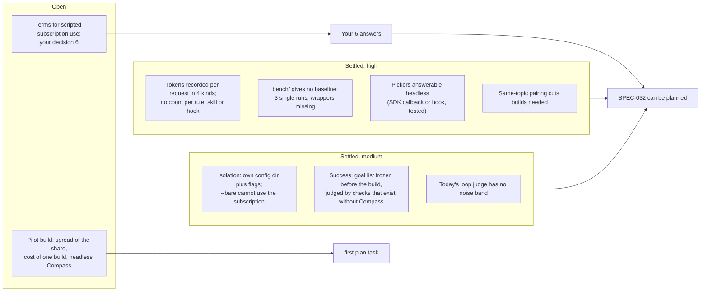

# Review: Compass's Whole Overhead, Seven Axes Consolidated

> [!IMPORTANT]
> You decide: is this enough to plan from, with the six answers under "What only you decide"? Approving makes the settled findings and the recommended answers (or the ones your notes give) binding on the plan, with a pilot build as its first task.

## Inputs

Seven research axes for [[specs/tooling/SPEC-027-compass-uses-fewer-tokens/SPEC-032-whole-overhead-measured-on-real-projects|SPEC-032]], the spec (what we need), questions from [[research/whole-overhead/RESEARCH-whole-overhead-axes|the axes document]]:

| | Axis | Document |
|---|---|---|
| A1 | What a session records | [[research/whole-overhead/RESEARCH-axis-1-session-records\|axis 1]] |
| A2 | Which tokens are Compass's | [[research/whole-overhead/RESEARCH-axis-2-attribution\|axis 2]] |
| A3 | Agents acting as humans | [[research/whole-overhead/RESEARCH-axis-3-simulated-human\|axis 3]] |
| A4 | Topics and how many builds | [[research/whole-overhead/RESEARCH-axis-4-topics-and-sample-size\|axis 4]] |
| A5 | Throwaway projects, kept private | [[research/whole-overhead/RESEARCH-axis-5-sandbox-and-privacy\|axis 5]] |
| A6 | Did the build still succeed | [[research/whole-overhead/RESEARCH-axis-6-build-success\|axis 6]] |
| A7 | Biggest area first, as a loop | [[research/whole-overhead/RESEARCH-axis-7-optimization-loop\|axis 7]] |

## Where the axes agree

Agreement counts only the axes that took a position; a dash means the axis did not address the claim. h, m, l are each axis's own confidence.

| # | Claim | A1 | A2 | A3 | A4 | A5 | A6 | A7 | Agree |
|---|---|---|---|---|---|---|---|---|---|
| 1 | Each request records input, output, cache read, cache write; nothing counts tokens per rule, skill, hook or tool result | h | h | - | - | h | - | - | 3/3 |
| 2 | Hooks get no token attribution in any record | m | h | - | - | - | - | - | 2/2 |
| 3 | Dollar figures are list-price estimates, not what the subscription bills | m | h | - | - | h | - | - | 3/3 |
| 4 | `bench/` has no runnable arms; its 3 runs are single, measured Compass as pasted text, +4% to +39% tokens | - | h | - | h | h | - | m | 4/4 |
| 5 | The LOOP-003 sensor counts shipped text by load share; Compass's real first-request cost was 12,095 against 9,117 sensed | - | h | - | m | - | - | h | 3/3 |
| 6 | The fixed cost before any work is measurable and depends heavily on what the session loads | l | m | - | - | m | - | h | 4/4 |
| 7 | Tokens for one task vary widely between runs (about 2x typical, up to 30x) | - | m | - | m | - | - | - | 2/2 |
| 8 | Pairing arms on the same items cuts variance; resampling one item has a ceiling; grouped items inflate error up to 3x | - | - | - | h | - | - | h | 2/2 |
| 9 | No source measures how much an overhead share varies between builds; the first baseline must | - | - | - | h | - | - | m | 2/2 |
| 10 | No full Compass build has been run headless or measured for cost and time | - | - | m | - | m | - | h | 3/3 |
| 11 | `--bare` is unusable here: API key only, and it drops Compass's own hooks | - | m | m | - | h | - | - | 3/3 |
| 12 | Headless pickers need a permission host; an SDK callback or a PreToolUse hook answers them (tested) | - | - | h | - | h | - | - | 2/2 |
| 13 | Compass-driven extra work (verification, spawned agents, validator on opus) adds real tokens | - | m | - | - | - | h | m | 3/3 |
| 14 | Compass's own quality signals exist only with Compass and move when the tuned part moves | - | - | - | - | - | h | h | 2/2 |
| 15 | OpenTelemetry tags requests by skill, agent and plugin (works locally) | l | m | - | - | - | - | - | partial |

Single-axis findings carried into the plan are listed under "What research settled" with their axis.

## What research settled

High confidence:

1. **Token counts come from the records, the split must be derived.** Read `modelUsage` from `claude -p --output-format json` (whole tree, subagents included, checked to the token) or the transcript's `cost-state`; count each message id once. [[research/whole-overhead/RESEARCH-axis-1-session-records|A1]] findings 1 to 4, 7, 8.
2. **The existing benchmark is no baseline.** Three single runs, Compass loaded as text, wrappers missing on disk; the first real baseline comes from new builds. Matrix row 4.
3. **The loop sensor undercounts.** It sees shipped text only, not command output, vault reads, hook output or spawned agents' work. Matrix row 5.
4. **Pickers can be answered by a script.** A PreToolUse hook returning `updatedInput` with answers plays the human with no SDK code in the loop, once a permission host exists. Subagents never ask. [[research/whole-overhead/RESEARCH-axis-3-simulated-human|A3]] findings 1 to 5.
5. **Review gates fall back to pickers** when no editor surface is configured, so a headless build sees one kind of question. A3 findings 7, 8.
6. **Pairing reduces builds needed.** At a correlation of 0.5 a paired design needs about half the builds; the count then depends on the share's spread, still unmeasured. [[research/whole-overhead/RESEARCH-axis-4-topics-and-sample-size|A4]] findings 13 to 15.
7. **Today's loop machinery cannot judge a noisy sensor.** Its judge compares by sign with no noise band, 1-token gains reset the no-progress halt, and sensor spend sits outside the budget. [[research/whole-overhead/RESEARCH-axis-7-optimization-loop|A7]] findings 3 to 5.
8. **Biggest-first has a measured precedent and a ceiling.** In LOOP-003 the two largest sources gave 78% of the cut and yield fell off a cliff after about 30 runs. A7 findings 9, 10, 29.

Medium confidence:

9. **Isolation.** `--setting-sources project,local --strict-mcp-config` drops most of the user's loadout on the subscription (tested); the user's own CLAUDE.md still loads; a separate `CLAUDE_CONFIG_DIR` is the documented way to leave it, its settings and its transcripts behind, but needs its own login. [[research/whole-overhead/RESEARCH-axis-5-sandbox-and-privacy|A5]] findings 8 to 16.
10. **A project-free record** can be built from the result event's counts, following `usage-scan`'s allowlist, hashed machine and refusal to write inside a repository. A5 findings 6, 24, 28.
11. **Simulated humans are too cooperative.** They front-load information and inflate success; the fence is a hidden goal, progressive disclosure, a specificity rule and a question budget. A3 findings 12 to 18.
12. **Topics collapse** when models choose freely; diversity comes from attributes sampled in code and put in the prompt. A4 findings 1 to 4.
13. **Success needs a goal list frozen before the build**, checked by deterministic checks and a judge that inspects the workspace (88% to 90% agreement with humans on DevAI), never by the builder's own tests alone. [[research/whole-overhead/RESEARCH-axis-6-build-success|A6]] findings 1, 2, 6 to 8, 15.

## Where the axes disagree

1. **OpenTelemetry as an attribution source** (matrix row 15). A2 rates the documented tags moderate; A1 ran the console exporter in `claude -p` and saw nothing, and third-party plugin names are masked by default. Explains: A2 read docs, A1 tried it.
2. **How the Compass arm is installed.** `bench/README.md` copies templates into `.claude/`; `bench/configs/arm-compass.yaml` uses `--plugin-dir`; no script settles it, and whether `--plugin-dir plugin` brings the agents is untested. A5 findings 2, 3; A2 finding 17.
3. **Transcripts: privacy against attribution.** A5 wants sandbox transcripts out of the real `~/.claude` (Compass's own scanner would count them) and notes `--no-session-persistence` also deletes the per-subagent files A1 and A2 need. A5's own table names a separate config dir as meeting both, untested. A5 finding 17.
4. **Extra verification: value or waste.** The bench note calls Compass's added checks work the benchmark did not reward; Dong et al. class the same pattern as an efficiency regression. A2 contradictions. This feeds decision 1 below.
5. **Builder-written tests as success evidence.** Literature says weak (A6 finding 6); the vault's own probe caught 15 of 15 seeded defects, non-blinded, one run (A6 finding 9); LOOP-003's "quality held" rests on tests with no outcome measure (A7 finding 7).
6. **Subagents save or cost.** Docs advise delegating verbose work to subagents; Anthropic's own post says each added agent multiplies total tokens. A7 findings 14, 16.

## What only you decide

1. **Does Compass-driven extra work count as overhead?** Tests, research, review rounds, validator runs, spawned agents. Yes means the measure needs a without-Compass arm, since only paired runs capture changed behavior (A2 findings 28, 29); no means attribution by source is enough. **Recommendation: yes, measured as its own area.** The spec's Problem already defines overhead as including "the agents and commands it runs, and the work they do"; a separate area keeps a cut there visible against success.
2. **Topics: replayed across before and after, or picked fresh each time?** Under decision D-01 (a numbered ruling: agents pick the topic). Replay pairs the arms and halves the builds needed; fresh picks keep genericity but widen intervals, and a changed topic moves results far more than a rerun does (A4 findings 11, 13 to 15; A2 and A7 raise the same question). **Recommendation: agents pick topics into a recorded pool; before and after runs replay that pool; a fresh batch at intervals checks the pool has not gone stale.** Whether code-sampled seeds (kind, size, language) still count as "agents pick" is part of this answer.
3. **Which unit does the KPI count?** Raw tokens, or tokens weighted by price (cache reads at 0.05x to 0.1x of fresh input). Cache reads dominate raw counts in agentic coding (A2 finding 20); how the subscription weighs them is unpublished (A2 finding 18, A5 finding 21). **Recommendation: list-price weighted share as the KPI, raw share reported beside it.**
4. **Which success signals count?** **Recommendation: only signals that exist the same way with and without Compass** (frozen goal list, held-out checks, workspace-inspecting judge); the validator verdict and plan checkboxes are recorded but do not count, since they exist in one arm only and change when Compass changes (A6 findings 5, 23 to 25).
5. **How much the simulated human knows.** **Recommendation: a hidden goal it reveals only to specific questions, no solution knowledge, a fixed question budget, answers through a PreToolUse hook; its own tokens kept outside the build's count** (A3 findings 3, 12 to 18; A3 gap on simulator cost).

6. **Run the builds on your subscription, given the terms above?** The docs invite `setup-token` for scripts; the consumer terms reserve the right to rule otherwise and name no limit. **Recommendation: yes, at a modest pace (a pilot of a few builds, then batches sized by the pilot), stopping at any usage-limit event, with the API as the fallback if Anthropic objects.**

## Gaps

### Closed by the gap pass

The follow-up pass ([[research/whole-overhead/RESEARCH-axis-8-gap-pass|axis 8]]) took the four gaps that needed research before a plan:

- **What `-p` does at a usage limit: closed.** It exits 1 with `is_error: true` and `api_error: "usage_limit_reached"` while `subtype` still reads `success`, so a script keys on `api_error`; a `rate_limit_event` carrying `resetsAt` comes first. One edge stays for the pilot: a long run once exited 1 with nothing on stdout.
- **Statistics of the share: interval closed, stopping rule partial.** A ratio-of-sums interval (delta method, Fieller when the denominator is noisy, or a bootstrap over builds) is standard; no source proves a sequential stopping rule for such a ratio at small sample sizes, so the plan uses a fixed batch size set from the pilot's spread.
- **Drift between baseline and re-measure: closed for pinning.** Pin the full model id and the Claude Code version and read the real model from `modelUsage`; re-running the baseline arm next to each later measure is the plan's choice, no source covers it.
- **Terms for automated subscription use: not closable by research.** Anthropic's consumer terms bar script access "except ... via an Anthropic API Key or where we otherwise explicitly permit it"; the Claude Code docs document `setup-token` for "CI pipelines, scripts" and say limits "assume ordinary, individual usage", with no number of builds stated. This is decision 6 below.

### Closable by a pilot build (the plan's first task)

- **Spread of the overhead share** between builds and within one topic, which sets how many builds the plan needs. A4, A7.
- **Cost and time of one full build**, and how many fit a five-hour window. A5, A7.
- **Compass running headless:** its own hooks under the chosen flags, whether a review gate ending its turn ends the run, whether an editor on PATH opens a window, whether `--plugin-dir` brings the agents, the three built-in plugins that still load. A3, A5.
- **Sandbox login:** you run `claude setup-token` or `/login` once under a fresh config dir; one tiny call confirms the subscription is billed. A5.
- **Record reliability:** the 15% of old transcripts whose totals do not reconcile (resume and compaction suspected), auxiliary requests, background and nested subagents. A1.
- **Per-source split:** whether rebuilding each request's text and tokenizing it offline reproduces the API's counts, which attachment kinds reach the model, and whether OpenTelemetry names Compass's parts. A1, A2.
- **Topic collapse:** record topics from several headless sessions and cluster them. A4.
- **Judge calibration:** you hand-grade a few finished builds once, giving the judge's agreement rate and showing whether builders shrink their own goal lists. A6.

## Methodology

Convergence review over the seven axis documents, each read in full before analysis; claims extracted with each axis's confidence and grade, matched across axes, and classed as converged (80% or more of the axes that addressed them), partial, or divergent. No follow-up researcher was spawned: every gap above is named by at least one axis, so none is a hole all seven missed.
