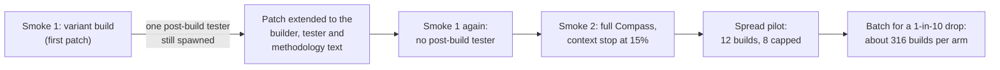

# Checking-cost pilot

> [!question] You decide
> TASK-353, the station ablation, cannot run as written: at this spread, a drop of one goal item in ten needs about 316 builds per arm. What should it measure instead?
> 1. (Recommended) Plant defects and count which station's rows catch them; no large build batch.
> 2. A larger drop (0.3 needs about 36 builds per arm) on topics small enough to finish inside the cap.
> 3. Raise the wall cap and keep the goal-share design.
> 4. Drop the station ablation and set checking levels from escalation alone.
>
> Also: approving this page gives the go for TASK-354's re-run, 180 more tool-less sessions on the subscription, which tests whether the candidate rubric brings the planners' letters onto the raters' scale ([[RESEARCH-letter-repeatability]]).

Measured for [[PLAN-034-checking-cost-follows-task-and-model]] TASK-351 and TASK-352 with `bench/overhead/pilot.py` and `bench/overhead/spread.py`. Topics are pool topics with frozen goals, named by letter; no topic text, path or session id appears here.

## Smoke builds

### Smoke 1: one build in `compass-minus-post-tester`

The variant removes the post-build and post-merge tester from Compass. It ran twice on the same pool topic.

| Check | First run (patch on the build and autopilot skills) | Second run (patch also on the builder agent, the tester agent and the methodology skill) |
|---|---|---|
| The project's `.claude/` matches the variant after the start-of-session self-update | yes | yes |
| Post-build tester spawns | 1 (one tester in post-build mode for all eighteen tasks of the first stage) | 0 |
| Pre-build tester spawns | 7 | 6, and one tester asked to update tests pinned to numbers a balance task retuned |
| Station rows in the build's record | yes, 8 station and model keys | yes, 8 station and model keys |
| `build_model` in the record | the subagents' model (Sonnet), though the main session ran Opus | the main session's model (Opus) |
| How the build ended | wall-time cap (150 minutes), 31 turns | wall-time cap (150 minutes), 41 turns |
| Goal items met, partly met, not met | 6, 3, 1 | 7, 2, 1 |

What the first run showed, and what changed:

- **The first patch left cues for a post-build tester.** The builder agent's closing line ("The orchestrator spawns the `tester` agent in post-build mode against your diff"), the tester agent's description of two stations, and the methodology skill's flow ("tester auto-runs on each", "spawning the tester after each merge") still described one. The orchestrator spawned one post-build tester when the first stage ended. The patch now edits those five files, and `tests/test_variants.py` fails if any of seven cue phrases remains after the patch.
- **`build_model` named the subagents' model.** `modelUsage` counts subagent usage, and the builders and testers, on Sonnet, wrote more output than the Opus main session. `records.build_model` now reads the main session's model from the first `system/init` event and falls back to the most-output rule only when that event names no model.
- **Some tester reports are free-form.** Of the 7 tester spawns in the second run, 5 left a station row: 1 `tester-pre` and 4 `unparsed`, whose reports skip the template's `### Mode` section. One spawn was still running at the cap and one ended with no final report. The spawn prompts all name their station, so the spawn counts above are read from the prompts, not from the station log.

### Smoke 2: one full Compass build with an early context stop

`COMPASS_CONTEXT_THRESHOLD` moves the context stop of `compass context-check` from 80% of the window. The main session of these builds runs on Opus with a 1,000,000-token window and peaked at 20% (smoke 1, first run) and 25% (second run), so a stop at 50% would never fire; the build ran at 15%, then at 10%.

| Check | Threshold 15% | Threshold 10% |
|---|---|---|
| Main session's peak context | 13% of the window | 17% of the window |
| The stop fired | no: the build ended before reaching 15% | yes, about half an hour in, at 10% |
| What the simulated human saw | nothing to answer | the turn's text only: in a headless session the stop's reason reaches the transcript as a hook attachment, not the turn text, and no human session held it |
| What the simulated human answered | none | a plain go-on, with no handoff |
| The build went on | not applicable | yes: 33 turns in all |
| How the build ended | the simulated human said done after 112 minutes, 13 turns | the simulated human said done after 140 minutes |
| Goal items met, partly met, not met | 9, 0, 1 | 8, 1, 1 |

The stop works in a headless build and does not end it: the main agent stops before its next step, the driver sends the human's next message, and the build continues. The simulated human never learns why the agent stopped, so a pilot build measures the cost of an unexplained pause, not of a handoff.

## Spread pilot

### Changes between builds

- **Step 7b's capture-check now gets an empty input.** The build skill ran `compass capture-check --hook` from Bash at the phase pause, and that command waits on stdin. The pilot's first build, a full Compass build, sat idle on it for about 12 minutes until the process was ended by hand; the build then went on. The fix (`< /dev/null` in step 7b) reached both arms while that build ran: the full arm through a merge into the branch whose `plugin/` the builds install, the variant through the same one-line change committed in its worktree. Every build after the first, in both arms, runs the fixed text.
- **The first build was interrupted.** The machine restarted about 25 minutes after the hang, during that first full Compass build; it had logged no event, so it is not counted, and the resumed pilot built its slot again from the start. On resume the pilot made the variant worktree afresh from the branch head, which carries the step-7b fix, so every counted build in both arms runs the fixed skill.
- **Hang check over every build.** The four smoke builds made no hand-run capture-check call. Each pilot build's main transcript is checked the same way below.

### The twelve builds

Three pool topics (A, B, C), each built twice in full Compass and twice in `compass-minus-post-tester`, one build at a time, judged against their frozen goals. Every build closed; none hit a usage limit. The record holds one build row per build, twelve in all, each with the main session's model (Opus).

| Topic | Run | Full Compass: end, minutes, goals met | Variant: end, minutes, goals met |
|---|---|---|---|
| A | 1 | cap, 150, 1 of 11 | cap, 150, 2 of 11 |
| A | 2 | simulated human done, 45, 5 of 11 | cap, 150, 3 of 11 |
| B | 1 | cap, 150, 3 of 10 | cap, 150, 0 of 10 |
| B | 2 | simulated human done, 113, 0 of 10 | simulated human done, 139, 4 of 10 |
| C | 1 | cap, 150, 9 of 10 | cap, 150, 4 of 10 |
| C | 2 | cap, 150, 6 of 10 | simulated human done, 33, 9 of 10 |

Eight of twelve builds ran to the 150-minute cap. Only one pair (B run 2) ended by the simulated human on both sides, and three pairs (A, B and C run 1) hit the cap on both sides.

### What the pilot measures

| Measure | Pairs | Mean goal share difference (variant minus full) | Verdict at a 5% margin |
|---|---|---|---|
| Both builds ended by the simulated human | 1 | +0.40 | none (fewer than two pairs) |
| Both builds stopped by the cap (same wall time) | 3 | -0.24 | worse (lower bound -0.43) |
| All six pairs, however they ended | 6 | -0.03 | worse (lower bound -0.26) |

No topic has two pairs of the same kind, so the planned spread, within a topic over counted pairs, cannot be computed. Over all six pairs, however they ended, the within-topic standard deviation of the goal share difference is 0.45 (3 degrees of freedom; upper 80% bound 0.77). That figure mixes capped and finished builds, so it is indicative only, and it gives:

| Drop in goal share to detect | Builds per arm at the estimate | At the upper 80% bound |
|---|---|---|
| 0.1 (one goal item in ten) | 316 | 941 |
| 0.2 | 79 | |
| 0.3 | 36 | |

At about two and a half hours a build and three builds per five-hour window, 316 builds per arm is several months of the subscription. The goal share of one build is too noisy a measure of what one checking station buys.

### Tokens and stations

- **The variant did not save tokens.** Its weighted tokens were 33% above the full arm on the one finished pair and 8.5% above on the three equal-time pairs. Without the post-build tester, the variant spawned more builders and more pre-build testers in the same time (per equal-time pair, 14 builder and 14 tester station rows in the variant against 6 and 5 in the full arm).
- **The full arm rarely ran its post-build tester.** Read from the spawn prompts: 3, 3 and 2 post-build tester spawns in three full Compass builds, none in the other three; one variant build (topic B run 1) spawned one even with every cue removed from its install.
- **Most tester rows are `unparsed`.** Testers often reply without the template's `### Mode` section, so the station log's `tester-pre` and `tester-post` counts undercount; the counts above come from the spawn prompts.
- **The builders' review takes 13% of builder tokens** (12.6% on the finished pair, 13.1% on the equal-time pairs), in line with the gap pass's 10%.
- **Hang check.** Four pilot builds ran `compass capture-check` from Bash, each returning within a second; no pilot build after the first hung on it.

### What follows for the ablation

TASK-353 was to run the station ablation at the batch size this pilot sets. At a one-in-ten drop that batch is out of reach, and capped builds, the most common end, measure speed as much as checking. The ablation needs a different measure of what a station catches before it runs: the station rows read beside a planted defect, or a larger drop to detect on smaller topics that finish inside the cap.

