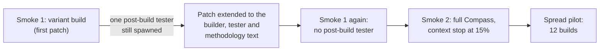

# Checking-cost pilot

Measured for [[PLAN-034-checking-cost-follows-task-and-model]] TASK-351 and TASK-352 with `bench/overhead/pilot.py` and `bench/overhead/spread.py`. Topics are pool topics with frozen goals, named by letter; no topic text, path or session id appears here.

## Smoke builds

### Smoke 1: one build in `compass-minus-post-tester`

The variant removes the post-build and post-merge tester from Compass. It ran twice on the same pool topic.

| Check | First run (patch on the build and autopilot skills) | Second run (patch also on the builder agent, the tester agent and the methodology skill) |
|---|---|---|
| The project's `.claude/` matches the variant after the start-of-session self-update | yes | yes |
| Post-build tester spawns | 1 (one tester in post-build mode for all eighteen tasks of the first stage) | 0 |
| Pre-build tester spawns | 7 | 6, and one tester asked to update tests pinned to numbers a balance task retuned |
| Station rows in the build's record | yes, 8 station and model keys | yes, 8 station and model keys |
| `build_model` in the record | the subagents' model (Sonnet), though the main session ran Opus | the main session's model (Opus) |
| How the build ended | wall-time cap (150 minutes), 31 turns | wall-time cap (150 minutes), 41 turns |
| Goal items met, partly met, not met | 6, 3, 1 | 7, 2, 1 |

What the first run showed, and what changed:

- **The first patch left cues for a post-build tester.** The builder agent's closing line ("The orchestrator spawns the `tester` agent in post-build mode against your diff"), the tester agent's description of two stations, and the methodology skill's flow ("tester auto-runs on each", "spawning the tester after each merge") still described one. The orchestrator spawned one post-build tester when the first stage ended. The patch now edits those five files, and `tests/test_variants.py` fails if any of seven cue phrases remains after the patch.
- **`build_model` named the subagents' model.** `modelUsage` counts subagent usage, and the builders and testers, on Sonnet, wrote more output than the Opus main session. `records.build_model` now reads the main session's model from the first `system/init` event and falls back to the most-output rule only when that event names no model.
- **Some tester reports are free-form.** Of the 7 tester spawns in the second run, 5 left a station row: 1 `tester-pre` and 4 `unparsed`, whose reports skip the template's `### Mode` section. One spawn was still running at the cap and one ended with no final report. The spawn prompts all name their station, so the spawn counts above are read from the prompts, not from the station log.

### Smoke 2: one full Compass build with an early context stop

`COMPASS_CONTEXT_THRESHOLD` moves the context stop of `compass context-check` from 80% of the window. The main session of these builds runs on Opus with a 1,000,000-token window and peaked at 20% (smoke 1, first run) and 25% (second run), so a stop at 50% would never fire; the build ran at 15%, then at 10%.

| Check | Threshold 15% | Threshold 10% |
|---|---|---|
| Main session's peak context | 13% of the window | 17% of the window |
| The stop fired | no: the build ended before reaching 15% | yes, about half an hour in, at 10% |
| What the simulated human saw | nothing to answer | the turn's text only: in a headless session the stop's reason reaches the transcript as a hook attachment, not the turn text, and no human session held it |
| What the simulated human answered | none | a plain go-on, with no handoff |
| The build went on | not applicable | yes: 33 turns in all |
| How the build ended | the simulated human said done after 112 minutes, 13 turns | the simulated human said done after 140 minutes |
| Goal items met, partly met, not met | 9, 0, 1 | 8, 1, 1 |

The stop works in a headless build and does not end it: the main agent stops before its next step, the driver sends the human's next message, and the build continues. The simulated human never learns why the agent stopped, so a pilot build measures the cost of an unexplained pause, not of a handoff.

## Spread pilot

### Changes between builds

- **Step 7b's capture-check now gets an empty input.** The build skill ran `compass capture-check --hook` from Bash at the phase pause, and that command waits on stdin. The pilot's first build, a full Compass build, sat idle on it for about 12 minutes until the process was ended by hand; the build then went on. The fix (`< /dev/null` in step 7b) reached both arms while that build ran: the full arm through a merge into the branch whose `plugin/` the builds install, the variant through the same one-line change committed in its worktree. Every build after the first, in both arms, runs the fixed text.
- **Hang check over every build.** The four smoke builds made no hand-run capture-check call. Each pilot build's main transcript is checked the same way below.

