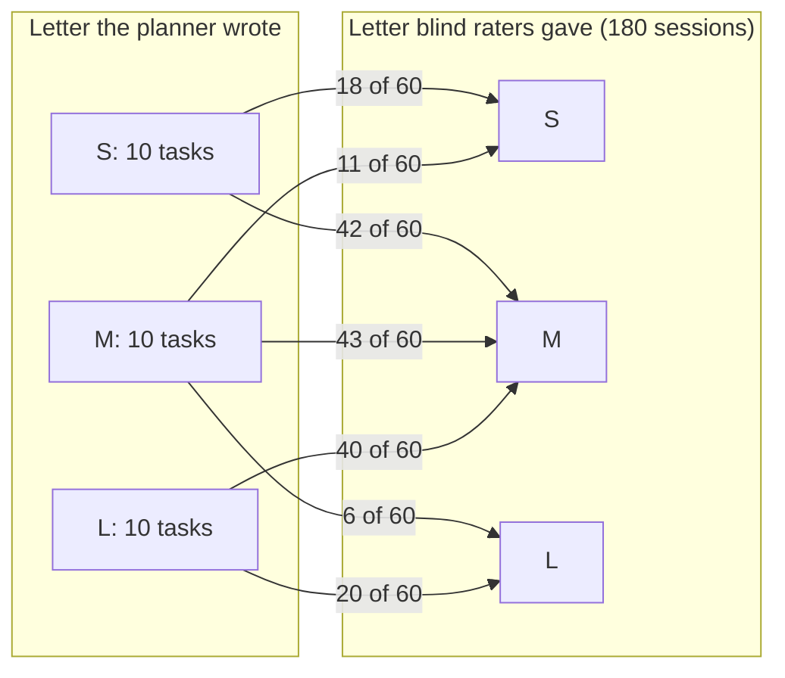

# Letter repeatability

> [!question] You decide
> Is the letter steady enough to key checking on? The raters agree with each other (kappa 0.70 to 0.88), so a letter assigned from the rubric is repeatable. They do not reproduce the letters already in the plans (43% and 47% of sessions), so the letters written so far are a different scale from the rubric's. The recommendation: key checking on a letter only after TASK-354 makes the rubric and the planners' practice the same scale, and re-measure then.

Measured by `bench/overhead/letters.py` for [[PLAN-034-checking-cost-follows-task-and-model]] TASK-350, to learn whether the `complexity:` letter is steady enough to set a task's checking level ([[ADR-024-difficulty-class-is-judged-not-scored]] allows a judged class).

## How it ran

- 30 detailed task lines drawn from this vault's plans, 10 per letter (seed 0), from a pool of 124 S, 149 M and 36 L lines.
- Each line went to six isolated sessions with its `complexity:` field removed: three on the strong-tier model (`opus`) and three on the balanced-tier model (`sonnet`). A session saw only the planner's sizing rubric table, the plan's Goal paragraph and the task line. It had no tools, ran from an empty folder outside any git work tree and saw neither the vault nor the original letter.
- Each session answered with a letter and the rubric words it relied on.

## Agreement within a model

| Model | Tasks where all three sessions agree | Fleiss' kappa |
|---|---|---|
| opus | 28 of 30 (0.93) | 0.884 |
| sonnet | 26 of 30 (0.87) | 0.836 |

## Agreement between the two models

- Session pairs, one from each model, giving the same letter: 219 of 270 (0.81).
- Fleiss' kappa over all six sessions of each task: 0.703.
- 8 of 30 tasks drew more than one letter across the six sessions. On 2 of them the two models split cleanly: all three `opus` sessions gave M and all three `sonnet` sessions L. On the other 6, the sessions of at least one model disagreed among themselves.

## Agreement with the planner's letter

| Model | Sessions giving the planner's letter |
|---|---|
| opus | 39 of 90 (0.43) |
| sonnet | 42 of 90 (0.47) |

Sessions by the letter they gave, against the planner's letter:

| Planner's letter | opus S | opus M | opus L | sonnet S | sonnet M | sonnet L |
|---|---|---|---|---|---|---|
| S | 9 | 21 | 0 | 9 | 21 | 0 |
| M | 5 | 24 | 1 | 6 | 19 | 5 |
| L | 0 | 24 | 6 | 0 | 16 | 14 |

No session ever moved a task two letters (S to L or L to S).

## Where the raters and the planners part

The rubric sizes by file count first ("Single file", "2-5 files", "5+ files"), and the raters cite exactly those words with their letter: every "single file" citation came with S, every "2-5 files" with M, every "5+ files" with L. The planners' letters follow a different line:

- **Planner S, raters M (7 of 10 S tasks, every session or nearly).** Each of these lists 2 to 5 files, almost always a source file and its test file. The planner counted the change as one file plus its test; the rubric counts both.
- **Planner L, raters M (5 of 10 L tasks drew M from every session, 3 more drew M from `opus` and mostly L from `sonnet`).** These list 1 to 4 files. The planner judged the work significant; the rubric's "5+ files" was not met, and "significant complexity" alone did not move the raters.
- **Both agree on L only when the line lists 10 files** (2 of 10 L tasks).
- **Planner M, raters S (2 of 10 M tasks).** Both list a single file.

The rubric words cited where sessions disagreed:

| Rubric phrase | Cited with S | Cited with M | Cited with L |
|---|---|---|---|
| single file | 11 | 0 | 0 |
| straightforward | 11 | 0 | 0 |
| 2-5 files | 0 | 22 | 0 |
| some complexity | 0 | 23 | 0 |
| 5+ files | 0 | 0 | 12 |
| significant complexity | 0 | 0 | 14 |

## What this means for keying checking on the letter

- A letter assigned under the written rubric is repeatable: the same model gives the same letter to the same task nine times in ten, and two models agree four times in five.
- The letters already in the plans are not that letter. A checking level keyed on them would follow each planner's private sense of size, which a blind rater reproduces less than half the time.
- The two boundaries to settle are whether a task's own test file counts toward its file count (S against M) and what "significant complexity" means when fewer than five files change (M against L). TASK-354 tightens those two rows and runs this measurement again.

## Per task

The planner's letter, then the letters of the three `opus` sessions, then of the three `sonnet` sessions, and the files the task line lists.

| Task | Planner | opus | sonnet | Files listed |
|---|---|---|---|---|
| PLAN-033/TASK-437 | S | M M M | M M M | 3 |
| PLAN-021/TASK-162 | S | M M M | S S M | 2 |
| PLAN-032/TASK-304 | S | M M M | M M M | 2 |
| PLAN-034/TASK-349 | S | M M M | M M M | 3 |
| PLAN-022/TASK-186 | S | M M M | M M M | 3 |
| PLAN-001/TASK-010 | S | M M M | M M M | 5 |
| PLAN-017/TASK-007 | S | S S S | M M S | 2 |
| PLAN-036/TASK-411 | S | S S S | S S S | 1 |
| PLAN-025/TASK-212 | S | S S S | S S S | 1 |
| PLAN-024/TASK-228 | S | M M M | M M M | 3 |
| PLAN-025/TASK-217 | M | M M M | M M M | 3 |
| PLAN-022/TASK-165 | M | L M M | L L L | 5 |
| PLAN-032/TASK-306 | M | M M M | M M M | 4 |
| PLAN-024/TASK-200 | M | M M M | M M M | 4 |
| PLAN-017/TASK-011 | M | M M M | M M M | 2 |
| PLAN-033/TASK-337 | M | M M M | M M M | 3 |
| PLAN-008/TASK-073 | M | S S S | S S S | 1 |
| PLAN-021/TASK-152 | M | M M M | M M M | 4 |
| PLAN-006/TASK-048 | M | M M M | M L L | 5 |
| PLAN-018/TASK-126 | M | M S S | S S S | 1 |
| PLAN-036/TASK-402 | L | M M M | L L L | 4 |
| PLAN-006/TASK-038 | L | M M M | M M M | 3 |
| PLAN-017/TASK-008 | L | M M M | M L L | 3 |
| PLAN-004/TASK-026 | L | M M M | M M M | 3 |
| PLAN-003/TASK-019 | L | M M M | M M M | 4 |
| PLAN-028/TASK-245 | L | L L L | L L L | 10 |
| PLAN-025/TASK-223 | L | L L L | L L L | 10 |
| PLAN-021/TASK-154 | L | M M M | L L L | 3 |
| PLAN-006/TASK-049 | L | M M M | M M M | 4 |
| PLAN-009/TASK-083 | L | M M M | M M M | 1 |

## Limits

- 30 tasks, 10 per letter: the kappas are point estimates with no interval.
- A rater saw the task line and the plan's Goal, not the research behind the plan; a planner who read the research may have had reasons the line does not carry.
- Model aliases (`opus`, `sonnet`) name whatever the host resolved on 2026-11-24.
