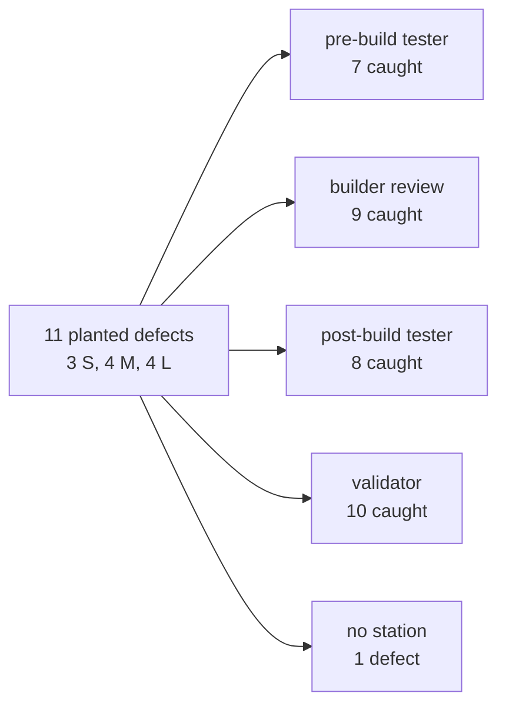

# Station ablation by planted defects

> [!question] You decide
> Is the batch that would earn lighter checking a spend to approve? On these 11 defects no station caught anything the others missed, so the rule marks every station lighter-eligible on every letter. Eleven defects cannot carry that: a station that alone catches one defect in ten would show no lone catch in a batch this size about a third of the time. Bounding that share below one in ten takes about 30 caught defects per letter, about 100 defects in all, about 350 more sessions on the subscription.
> 1. (Recommended) Approve the full batch across S, M and L: about 100 defects, about 350 sessions, about 1.7 million output tokens, 4 to 5 hours at three sessions at once.
> 2. Run only L tasks, about 33 defects and 90 sessions, since L is where the stations differed.
> 3. Stop here and keep full checking everywhere.

Measured for [[PLAN-034-checking-cost-follows-task-and-model]] TASK-353, which replaced a goal-share ablation after [[RESEARCH-checking-cost-pilot]] put that at about 316 builds per arm.

## How it ran

- **The tasks.** Finished tasks of the kept Compass-arm pilot builds, in Python and Go projects: each has a pre-build tester commit and exactly one builder commit, and its plan line carries a letter. The pool holds 23 S, 54 M and 13 L tasks. Two batches of two tasks per letter were drawn with seeds 0 and 1.
- **The defect.** One single-token mutation on a source line the builder's commit added: an integer constant raised by one (7 defects), `==` and `!=` swapped (4). The draw also allows comparison and `and`/`or` swaps; none came up. The builder's commit was rewritten to carry it, and a mutant that did not compile was dropped for the next site.
- **The stations,** each on its own copy so none saw another's work:
  - pre-build tester: its commit's tests, run on the clean and the planted state, mechanically;
  - builder review: the style and the correctness reviewer of the builder agent, one session each on the builder's model;
  - post-build tester: a `tester` session in post-build mode;
  - validator: a `validator` session on the task.
- **Caught** means: a test failing only on the planted state (testers), or a report pointing at the planted line within three lines, or at its file together with its enclosing function (review, the tester's Bugs Found list, and a validator report whose verdict is a failure).
- **The rule.** For a letter, a station is lighter-eligible when every defect it caught was caught by another station too.

## Results

| Letter | Defects | Pre-build tester | Builder review | Post-build tester | Validator | No station |
|---|---|---|---|---|---|---|
| S | 3 | 3 | 3 | 3 | 3 | 0 |
| M | 4 | 3 | 3 | 4 | 4 | 0 |
| L | 4 | 1 | 3 | 1 | 3 | 1 |
| All | 11 | 7 | 9 | 8 | 10 | 1 |

No station caught a defect alone, on any letter. By the rule, every station is lighter-eligible on every letter of this batch.

| Defect | Letter | Language | Class | Pre-build tester | Builder review | Post-build tester | Validator |
|---|---|---|---|---|---|---|---|
| D1 | S | Go | equality | caught | caught | caught | caught |
| D2 | S | Go | equality | caught | caught | caught | caught |
| D3 | S | Python | constant | caught | caught | caught | caught |
| D4 | M | Go | constant | caught | missed | caught | caught |
| D5 | M | Python | constant | caught | caught | caught | caught |
| D6 | M | Python | equality | missed | caught | caught | caught |
| D7 | M | Python | equality | caught | caught | caught | caught |
| D8 | L | Python | constant | missed | missed | missed | missed |
| D9 | L | Python | constant | missed | caught | missed | caught |
| D10 | L | Python | constant | missed | caught | missed | caught |
| D11 | L | Python | constant | caught | caught | caught | caught |

D1 and D2 sit in the same task at two different lines.

### What the batch shows

- **The validator caught every defect any station caught** (10 of 10). Each time its report named the planted file and line, or the file and the function, and described the planted change.
- **On L tasks the testers fell behind.** Both testers caught 1 of 4 L defects, while review and the validator caught 3. The two L defects that only review and the validator caught each changed a bound in game input handling (a movement step and a cursor edge). The pre-build tests did not cover the first; for the second, the pre-build test file meant to catch it failed to load on the clean code as well. The post-build tester did not name either.
- **Review missed one defect the tests caught at once:** a field width raised by one in a timestamp parser (D4), where 44 pre-build tests failed.
- **D8, caught by no station,** raised a default value from 0 to 1 on a data class field. No test, review or validator check looked at that default; it may change no behaviour the task asks for.
- **No false credit was found by hand.** Every credited catch was read against its report: each names the planted line and describes the planted change.

### What it cost

- About 19,000 output tokens per defect over its four sessions. The validator wrote about half (it runs on `opus`), each tester session about a quarter, the two review sessions together about a quarter.
- About 3 minutes of wall time per defect with three sessions at once; the pre-build tester is a test run and spends no session.

## The batch a lighter-checking claim needs

A station is dropped for a letter only if it almost never catches a defect alone. With zero lone catches among n caught defects, the 95% upper bound on a station's lone-catch share is about 3/n (the rule of three). Bounding it below one in ten needs n of about 30 caught defects per letter. One defect in eleven was caught by no station, so that is about 33 planted per letter, about 100 in all, 88 more than this batch: about 350 sessions and about 1.7 million output tokens. The pool holds only 13 L tasks, so the L defects would include two or three sites per task. Defects in one task are not independent, so the bound would be optimistic for L.

## Limits

- **The stations were replayed, not run inside builds.** In a real build the builder fixes what its review finds before any tester runs, so the testers never meet those defects. The replay counts what each station would catch alone, which is the question the rule asks, not what each station catches in sequence.
- **The defects are single-token mutations** of two classes. Planted bugs of the kinds builders really make (a missed case, a wrong rule) may split the stations differently.
- **The letters are the planners' letters,** which [[RESEARCH-letter-repeatability]] found blind raters reproduce less than half the time. A per-letter result here is per planner letter, not per rubric letter.
- **A report is credited when it points at the planted line or at its file and function.** A report that describes the defect in words without naming either is not credited, so the counts are a floor.
- **Two defects of the first batch landed inside docstrings.** They were set aside, kept with the batch's private records, and the same two tasks were planted again with lines inside multi-line strings and comments excluded.
- **11 defects, 10 tasks and 2 languages.** The results are indicative only.
