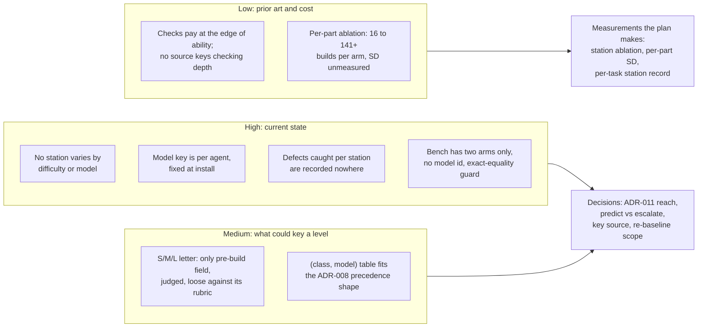

# Review: checking cost follows task and model

> [!IMPORTANT]
> You decide: the four questions under "Decisions for the human", starting with whether [[ADR-011-sizing-is-a-procedure-not-a-score]] D-01 reaches a task-difficulty class. Your answers bind what the plan for [[SPEC-034-checking-cost-follows-task-and-model]] may build.

## Inputs

4 researcher axes | Question: how Compass sizes tasks, what its checking stations cost, how a part-by-part re-baseline would run, and what rule and record could key checking depth on difficulty and model.

- Axis 1: [[RESEARCH-axis-1-task-difficulty-signal]]
- Axis 2: [[RESEARCH-axis-2-checking-station-cost]]
- Axis 3: [[RESEARCH-axis-3-part-by-part-rebaseline]]
- Axis 4: [[RESEARCH-axis-4-difficulty-keyed-checking-rule]]
- Prior survey: [[research/llm-research/REVIEW-llm-research-for-compass]] (A4, A5, C4)

The axes split the question by design, so most claims come from one or two axes. Agreement is counted over the axes that spoke to a claim; `-` means the axis did not address it.

## Convergence matrix

| # | Claim | Ax1 | Ax2 | Ax3 | Ax4 | Agreement |
|---|---|---|---|---|---|---|
| 1 | No checking station varies by difficulty or model; each runs in full | YES (h) | - | YES (h) | YES (h) | 3/3 |
| 2 | Model and effort are per agent, bound at install by `apply-models` | YES (h) | - | YES (h) | YES (h) | 3/3 |
| 3 | No per-spawn model choice is wired; `resolve-model` has no caller | YES (h) | - | - | YES (h) | 2/2 |
| 4 | `complexity: S/M/L` is the only pre-build per-task difficulty field, judged, read by no code | YES (h) | - | - | YES (m) | 2/2 |
| 5 | A planner-assigned letter is not shown to be repeatable across runs | YES (m) | - | - | YES (m) | 2/2 |
| 6 | Defects caught per station are recorded nowhere | YES (h) | YES (h) | YES (h) | - | 3/3 |
| 7 | Fix-loop cycles exist only as an after-the-fact signal, not a pre-build key | YES (h) | YES (m) | - | YES (m) | 3/3 |
| 8 | The tester is the costly station; the validator is small | - | YES (m) | YES (m) | - | 2/2 on direction, figures differ |
| 9 | Builder self-review tokens cannot be separated from the builder's | NO (h) | YES (m) | - | - | 1/2 |
| 10 | A (class, model) table with ADR-008 precedence gives a deterministic answer | YES (m) | - | - | YES (m) | 2/2 |
| 11 | Env-var parts (thresholds, model/effort) vary with no plugin edit; text parts need a committed variant clone | YES (h, precedence) | - | YES (h) | - | 2/2 |
| 12 | Compass's own measurement must precede any table values | - | YES (m) | YES (m) | YES (m) | 3/3 |
| 13 | Bench has only `compass`/`baseline` arms, no part label, no build model id, no model-change trigger | - | - | YES (h) | - | 1/1 |
| 14 | `compare.py` outcome guard is exact equality, not a noninferiority margin | - | - | YES (h) | - | 1/1 |
| 15 | Per-part ablation costs 16 to 141+ builds per arm per part; per-part SD is unmeasured | - | - | YES (l) | - | 1/1 |
| 16 | Prior art: checks pay at the edge of ability, overhead inside it | - | - | - | YES (m) | 1/1 + survey 4/4 |
| 17 | Ex-ante difficulty prediction works only partly out of distribution; calibration is weak | - | - | - | YES (m) | 1/1 |
| 18 | No source keys post-build checking depth (not model choice) on difficulty for coding agents | - | - | - | YES (m) | 1/1 |
| 19 | ADR-011 D-01 forbids a numeric difficulty score; its reach to a judged class is open | - | - | - | YES (h) | 1/1 |

## Convergence summary

| Category | Count | Claims |
|---|---|---|
| Converged (≥80%) | 17 | 1-7, 10-19 |
| Partial (50-79%) | 1 | 8 (direction agrees, figures differ) |
| Divergent (<50%) | 1 | 9 |

Claims 13 to 19 rest on one axis each. They count as converged because no axis contradicts them, not because several confirmed them.

## Converged findings

1. **No checking station varies by difficulty or model today** (confidence: high, 3/3)
   - Pre-build tester gates on executable source only; post-build tester after every builder and merge; builder review on every diff; validator mandatory probes once run (`plugin/skills/build/SKILL.md:28-34,39,48`; `plugin/templates/agents/validator.md:114-116`).
   - Autopilot: "Skipping the tester because 'this is small.' It always runs" (`plugin/skills/autopilot/SKILL.md:120`). Spot-checked.
   - The only size gate is autopilot refusing L or larger, which narrows entry, not checking.

2. **The model key exists but is per agent and static** (confidence: high, 3/3)
   - Roster strong/balanced/cheap, precedence built-in, then `.compass/meta/models.yaml`, then `COMPASS_MODEL_<AGENT>` env (`plugin/cli/modelslib.py:1-12,43-59`; [[ADR-008-model-resolution-table]] D-01 to D-05).
   - `resolve-model` takes no task argument and has no caller; ADR-008 D-02 rejects a spawn-time query, and per-spawn overrides are "untested in this repo" (ADR-008 lines 44-47).

3. **The only pre-build difficulty field is the planner's `complexity:` letter, and it is loose** (confidence: high for existence, medium for looseness)
   - Rubric: S single file, M 2-5 files, L 5+ files or "significant complexity" (`plugin/templates/agents/planner.md:149-153`). Spot-checked.
   - No code parses it: `TASK_LINE` captures the id only (`plugin/cli/planlib.py:53`). Spot-checked.
   - Across 250 vault task lines: 59 of 96 S tasks list more than 1 file, 20 of 31 L tasks fewer than 5; XS used twice, absent from the rubric (Axis 1 finding 10).
   - Reading the letter back is deterministic; assigning it is judgment, and repeatability is untested (Axis 1 finding 11; ADR-011 line 59 names the same open risk for sizing).

4. **Defects caught per station are recorded nowhere** (confidence: high, 3/3)
   - Run rows hold tokens, plugin sha, CLI version, outcome; no part label or defect field (`bench/overhead/records.py:194-233`).
   - Judge stores `builder_tests` and `validator_verdict` outside the counts; no seeded-defect step in `bench/overhead/` (`bench/overhead/judge.py:252-294`).
   - `phase-summary.yaml` defines `fix_loop_cycles` per task (`plugin/skills/build/SKILL.md:60`), but 0 of 173 capture opportunities carry a fix-loop trigger (Axis 2 finding 7). Spot-check: the string appears in one archived opportunity log in the vault.

5. **A (difficulty class, model) table has a deterministic shape precedent** (confidence: medium, 2/2)
   - `modelslib.resolve` returns `(model, effort, source)` purely from table plus override plus env (`plugin/cli/modelslib.py:207-280`).
   - Determinism holds once the class is written into the plan; the class assignment is the non-deterministic step (claim 5).
   - Prior art recorded learned scores, never a rule table; only the timeout cascade is a fixed rule (Axis 4 finding 19).

6. **The bench harness cannot run a part-removed arm today** (confidence: high, Axis 3 only)
   - `ARMS = ("compass", "baseline")` is a constant checked at record and drive time (`bench/overhead/records.py:41`). Spot-checked.
   - A variant needs a committed clone passed as `repo_root`, with an `origin` the plugin pin can read (`bench/overhead/launch.py:192-213`; `bench/overhead/drive.py:224-243`).
   - `compare.py` prints "outcome differs, so no token verdict" on any goal-count difference (`bench/overhead/compare.py:165-190`); the spec's "defects caught do not fall" has no tolerance to test against.
   - No build model id is recorded and no trigger fires on a model or host change (`.compass/meta/plugin.yaml`; `bench/overhead/launch.py:54-66` strips model env, `drive.py` passes no `--model`). TASK-256 of [[PLAN-028-whole-overhead-on-real-projects]] is the unbuilt trigger.

7. **Cheap parts first: env-var parts need no plugin edit** (confidence: high, 2/2)
   - `COMPASS_CONTEXT_THRESHOLD`/`_FINAL_THRESHOLD` and `COMPASS_MODEL_<AGENT>`/`COMPASS_EFFORT_<AGENT>` reach the build; `session_environment` drops no `COMPASS_*` (`plugin/cli/commands/context_check.py:47-48`; `bench/overhead/launch.py:142-151`).
   - Model env must be set before the setup session to reach installed agent files (Axis 3 finding 7, inferred).
   - Stations, validator cadence, rules and emphasis markers are prose; no flag turns a station off (Axis 3 finding 8).

8. **Per-part ablation is expensive and unsized** (confidence: low, Axis 3 only)
   - One Compass build about 10.1M weighted, 5256 s, 3 builds per 5-hour window; builds hit caps, so these are lower bounds.
   - n = 15.7 x (SD/delta)^2: 16 builds per arm at ratio 1 (about 55 hours per part), 141 at ratio 3; arms are 1 + 6, not 12 (Axis 3 finding 17).
   - The pilot SD (1.72 on 3 df) is unusable; no per-part SD exists anywhere (Axis 3 finding 16).

9. **Prior art supports the spec's premise but not its mechanism** (confidence: medium for premise, low for transfer)
   - Checks pay at the edge of ability: survey claim 8, 4 of 4 axes, 3 families ([[research/llm-research/REVIEW-llm-research-for-compass]] A4, lines 138-144). Spot-checked.
   - Ex-ante difficulty prediction: AUROC 0.841 in distribution (Agent Psychometrics, arXiv 2604.00594); clear in/out-of-distribution divide and weak calibration across 17 benchmarks (arXiv 2608.05797).
   - Every routing or cascade source chooses the generating model; the verification-depth sources are math, QA and finance answer verifiers. Transfer to tester, validator and builder review is untested (Axis 4 gap 1).
   - Router savings are GPU-hours or cache-unaware dollars, not Compass tokens (Axis 4 finding 10; ties to [[SPEC-033-prompt-cache-is-a-design-input]]).
   - Most 2026 numbers are abstract or search-summary level (Axis 4 methodology).

10. **ADR-011 D-01 reaches a numeric score; its reach to a judged class is open** (confidence: high for the text, open for the reach)
    - D-01: "No numeric threshold, no computed sizing metric ... Any future proposal of one is labeled an unvalidated invention" (`.compass/decisions/vault-structure/ADR-011-sizing-is-a-procedure-not-a-score.md:25`). Spot-checked.
    - D-03 (harness owns trigger and record, agent owns judgment) and D-08 (record every decision and correction) fit a judged class the harness records (Axis 4 finding 16).
    - ADR-011 covers spec shape, not task difficulty for checking depth.

## Partial

1. **Station cost share: direction agrees, figures differ by source** - 2/2 on direction
   - Axis 2: this repo's 233 dev sessions, both tester stations 17.2% of all session-family tokens, builder 25.4%, validator 0.1% (1 spawn). Heuristic station split by spawn description; denominator includes non-build work.
   - Axis 3: second pilot, 6 Compass builds, tester 29.5%, builder 27.9%, validator 2.0% of a build (`.compass/research/whole-overhead/RESEARCH-whole-overhead-pilot.md:85-92`). Spot-checked.
   - Axis 2 finding 3 states the tester or validator share of a build "is not in the document"; it read [[RESEARCH-whole-overhead-pilot-run-1]] and [[RESEARCH-compass-agent-context-measured]], not the second pilot Axis 3 cites. What may explain the gap: different denominators (dev sessions versus benchmark builds) and a validator that is optional in `/compass:build` (`plugin/skills/build/SKILL.md:87`).

## Divergent

1. **Where the builder's self-review spends its tokens** - split 1/1
   - Position A (Axis 1): step 8 spawns a separate code-review sub-agent on every diff (`plugin/templates/agents/builder.md:63-65`). Spot-checked: "Spawn a sub-agent with the diff".
   - Position B (Axis 2): review runs inside the builder session; the profiler files it under `subagent:builder` and it cannot be separated (`bench/overhead/token_profile.py:28-31`).
   - The two can both hold if the builder's spawn does not occur or lands in the builder transcript; neither axis read a builder transcript for a nested spawn.

## Contradictions inside single axes

- Axis 2: 62 pre-build and 56 post-build tester spawns against 102 builder spawns, about 1.2 tester spawns per builder where the methodology states two stations per code task. Unresolved.
- Axis 3: `bench/configs/arm-*.yaml` and `bench/README.md` describe a model-pinned harness (`claude-opus-4-7`, 2 USD); the live `bench/overhead/` reads neither and defaults the build model implicitly with a 50 USD cap.
- Axis 4: a timeout cascade nearly matched an oracle router (arXiv 2611.24324) while a binary cascade wasted cost on medium-difficulty problems where the strong model was no better (arXiv 2607.19338, search summary only). Different model pairs, no shared test.
- Axis 4: SWE-Router finds a partial trajectory beats task text for routing; Scrouting finds the handoff, not the router, carried the result.

## Decisions for the human

1. **Does [[ADR-011-sizing-is-a-procedure-not-a-score]] D-01 reach a task-difficulty class?**
   1. (Recommended) D-01 bans numeric scores only; a judged class under a written rubric, recorded by the harness per D-03 and D-08, is allowed.
   2. D-01 reaches any difficulty key; checking depth follows only observed failure, never a predicted class.
   3. D-01 reaches computed keys such as `files:` count too, and a new ADR states this before planning.

2. **Does the rule predict difficulty before the run, or escalate on what the run shows?**
   1. (Recommended) Both: the recorded class sets the starting check level, a failing test or fix cycle escalates it.
   2. Predict only: a (class, model) table fixes the level before the build.
   3. Escalate only: light checks first, full stations on a failure signal (Axis 4 candidate 2; finding 9 caveat on medium tasks).

3. **Which field carries the difficulty class?**
   1. (Recommended) The existing `complexity:` letter with a tightened rubric and parsed by `planlib`.
   2. A new dedicated task field, leaving `complexity:` as sizing prose.
   3. The mechanical `files:`/executable-source signal, subject to the answer to decision 1.

4. **What does a part-by-part re-baseline cover on a model or host change?**
   1. (Recommended) The checking stations first (survey C4), then env-var parts, then text parts as harness support lands.
   2. All six named parts each time, accepting about 55+ hours of builds per part.
   3. Env-var parts only, with text parts measured once and not on every change.

## Gaps

Research could close each of these without a bench run, and planning depends on each.

- **Where builder review tokens land.** Read builder subagent transcripts for a nested review spawn. Settles the divergent claim and whether builder review can be measured as its own station.
- **Whether defects caught can be read from existing build records.** Check whether validator verdicts and tester failure reports in pilot transcripts are structured enough to count, or whether a seeded-defect step is required (Axis 3 gap 4). Decides the shape of the defect measure the plan builds.

## Measurements the plan must make

- **Station ablation (survey C4).** Post-build tester and validator removed against full Compass on a task sample, defects caught per station, with a noninferiority margin replacing the exact-equality guard.
- **Per-part SD pilot.** One removed part, K repeats on a few topics, fed to `stats.batch_size` before sizing any batch.
- **Per-task station record.** Task id, station name, verdict and fix-cycle count on each spawn, so station share over the task total becomes computable.
- **Letter repeatability.** Re-plan a sample of existing tasks and compare the assigned class.
- **Variant clone dry run.** One throwaway build confirming self-update does not overwrite a variant commit through the pin.
- **Headless threshold effect.** Whether a context-threshold variant changes anything when no human reads the stop suggestion.
- **Per-(class, model) outcome counts.** Pass and defect rates per cell, so table values are earned by measurement as the spec's constraint requires.

CONVERGENCE: HIGH

## Gap pass results

[[RESEARCH-axis-5-gap-pass]] closes both gaps:

- **Builder self-review.** The review step spawns its own sub-agent, whose transcript names the builder as its parent and carries tokens the builder's transcript does not. Attributing it needs a join on that parent link, not a new spawn. Across sampled builds it was about a tenth of builder-plus-review weighted tokens (confidence low: one model's weights assumed for every row).
- **Defects caught per station.** No existing record yields it: bench runs have no stations, judge verdicts hold goal counts with empty station slots, few tester reports name bugs, and fix-loop cycles count rounds, not defects. Ground truth needs a new measurement: per-spawn station records, ablation arms scored against frozen goals, or seeded defects. This moves to "Measurements the plan must make".
