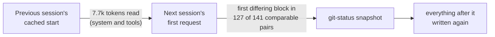

# Prompt-cache baseline, recorded by compass cache

> [!question] You decide
> Gate 2 of [[PLAN-035-prompt-cache-is-a-design-input]]: turn the git snapshot off in the projects Compass installs into. The measured case for it is Finding 3: the snapshot is the first block that differs in 90% of comparable next-session pairs here and 69% across Compass projects, and in 33-53% of same-type builder, tester and general-purpose siblings.

Baseline for [[SPEC-033-prompt-cache-is-a-design-input]], recorded by TASK-423 of [[PLAN-035-prompt-cache-is-a-design-input]] with the `compass cache` report, set against the numbers in [[REVIEW-prompt-cache]].

### Question

What are the first values of the spec's KPI (the share of repeated input read from the cache) per kind of agent and across sequential sessions, measured by the shipped report, and how wide a `--compare` band does their spread allow?

### Methodology

Repository mining of the host's local transcripts through `compass cache`. Two runs on 2026-11-22: this repo over 70 days, and every project whose working directory sits in a Compass vault over 90 days (`--all-compass`, 42 projects, this repo included). Both were saved as aggregates under `~/.compass/cache/`, outside any work tree. The weekly spread came from the same readers run over ten consecutive 7-day windows by a scratch script. Every number is measured; hit = read / (read + creation + input), tokens-weighted. Subagent rows are keyed by shipped Compass agent types and host built-ins; any other `agentType` value (teammate names) is pooled as `other`.

### Findings

1. **Main session: the whole-session hit hides a low first request** (confidence: high)

| Measure | This repo (70 d) | Compass projects (90 d) | Review | Difference |
|---|---|---|---|---|
| Whole-session hit | 95.0% (n=238) | 96.4% (n=1,590) | 96.4% / 97.5% | within 3 points |
| First-request hit | 23.3% (n=238) | 17.1% (n=1,590) | 23.5% / 17.1% | within 3 points |
| First-request read, median tokens | 7,702 | 7,498 | 7,702 / 5,777-7,706 | equal here |
| Next session 5-60 min later reading 60%+ | 0.0% (n=60) | 1.4% (n=557) | 0% / 2% | within 3 points |
| Modeled main cost after gaps over 1 hour | 12.8% | 12.8% | 10.0% | 2.8 points |
| 1-hour share of main cache writes | 98.1% | 99.1% | 99.3% | within 3 points |

The review's "other Compass projects" column excluded this repo and the report's `--all-compass` includes it; the two agree anyway.

2. **Subagents: a first request reads about a tenth of its input, by tokens** (confidence: high for types with n of 20 or more)

| Type (this repo) | n | First-request hit, tokens-weighted (KPI) | Any-read share (diagnostic) | Whole hit | Compass projects KPI (n) |
|---|---|---|---|---|---|
| builder | 122 | 9.4% | 54.1% | 93.1% | 9.3% (645) |
| tester | 148 | 15.4% | 68.9% | 91.4% | 16.1% (632) |
| general-purpose | 120 | 6.0% | 28.3% | 90.9% | 8.3% (1,010) |
| researcher | 86 | 15.5% | 69.8% | 92.4% | 14.4% (455) |
| other (teammate names) | 42 | 47.9% | 90.5% | 91.0% | 22.1% (1,500) |

Across Compass projects, planner (3.4%, n=62), reviewer (4.2%, n=79), pattern-finder (1.2%, n=21) and Explore (12.6%, n=37) also pass n=20. Every subagent cache write is 5-minute (0 of 95.4M tokens at 1 hour), matching the review.

Against the review: builder's binary share, 54.1%, equals axis 3's 54%, and its tokens-weighted value, 9.4%, is 3.3 points above axis 1's 6.1%. The difference is unexplained; the likeliest cause is the window, which holds builder waves the review's window did not. The review's pooled 12.9% has no single counterpart, since the report gives per-type rows only.

3. **The git snapshot is the block that breaks reuse first** (confidence: high for sessions, medium for siblings)

- Next-session pairs, this repo: 141 of 237 pairs comparable (equal model, parameters and request shape); first differing block `git-snapshot` 127 (90%), `instruction-files` 9, `other` 4, `environment` 1. The plan's 89% holds.
- Next-session pairs, Compass projects: 469 of 1,548 comparable; `git-snapshot` 322 (69%), `instruction-files` 88 (19%), `other` 47, `none` 7, `environment` 5.
- Same-type subagent siblings, this repo (the review's subagent-snapshot gap): `git-snapshot` first in tester 54 of 104 (52%), general-purpose 25 of 47 (53%), builder 13 of 39 (33%), reviewer 5 of 10, planner 3 of 8, researcher 8 of 64 (13%). The rest are mostly `other`, the block after the snapshot where each sibling's own task text begins. A sibling pair that differs first at `other` already shares everything up to its task, so the snapshot sits in the way for the remainder.

4. **Loops** (confidence: medium)

LOOP-001 78.5% (52 runs) and LOOP-003 91.6% (42 runs), whole-run hit from their ledgers. The review's 88.2% pooled 85 runs over 3 loops; the report found 2 loops with ledgers in this repo, so the counts differ by method (ledgers present at run time), not by a change in reuse.

5. **The --compare band** (confidence: medium)

Weekly first-request hit, this repo, for the five 7-day windows with n of 10 or more: 18.6%, 34.6%, 12.1%, 20.0%, 17.3% (mean 20.5%, standard deviation about 8.5 points). The next-session 60%-read share was 0% in every week with data. So:
- Keep the 5-point band for windows of 30 days or more, where n passes 200 sessions; between weekly windows it would fire on noise alone.
- A weekly comparison needs about 17 points (two standard deviations).
- The next-session guard cannot fire while the baseline is 0%; it becomes live once reuse rises after Gate 2.

An immediate `compass cache --compare` re-run against the saved this-repo file exits 0 (every measure unchanged except `other` subagents, -0.7 points).

### Confidence

Medium overall: main-session and first-difference numbers rest on hundreds of sessions and match the review within 3 points; per-type subagent rows below n=20 and loop rows are thin.
