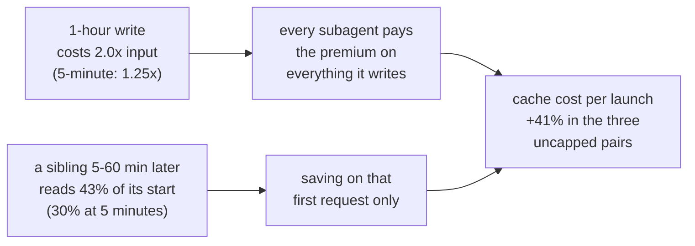

# A/B of a 1-hour cache lifetime for subagents

> [!question] You decide
> Gate 3 of [[PLAN-035-prompt-cache-is-a-design-input]]: adopt a 1-hour cache lifetime for subagents. Finding 3 is the case against: subagent cache cost per launch rose in all three pairs where both builds finished, and in 5 of the 6 pairs overall.

Task TASK-428 of [[PLAN-035-prompt-cache-is-a-design-input]]. It tests the open question in [[RESEARCH-cache-ttl-subagents-loops]] (recommendation 1, findings 4, 9 and 13): whether reuse across subagents of one type, 5 to 60 minutes apart, repays the 1-hour write premium.

### Question

On a real Compass build, does setting `subagentPromptCacheTtl: 1h` lower the list-price weighted cost of subagents at an equal judged outcome?

### Methodology

Controlled experiment on the bench's overhead pilot, 2026-11-24, host 2.1.331, on the subscription within plan usage.

- **Arms.** Full Compass, and the variant `compass-minus-subagent-ttl-5m`, whose patch in the bench's variants folder makes the settings merge also write `subagentPromptCacheTtl: 1h`. Both arms ran with the git snapshot off, the switch of TASK-424. Before the builds, a single headless check showed the setting takes effect on this subscription: a subagent's cache writes were all 1-hour.
- **Builds.** The pilot's three frozen topics (A, B, C), each built twice per arm, 12 builds, judged against the frozen goal lists. One pilot per topic ran at a time, three in parallel, each in its own private folder.
- **Measures.** Per build, `compass cache --json` and the `cachelib` readers over the build's transcripts. First-request hit = read / (read + write + input) of a subagent's first request, tokens-weighted. Cross-agent reuse is the same over subagents started 5 to 60 minutes after the previous subagent of their type. Subagent cache cost is input + 0.1 read + 1.25 5-minute write + 2.0 1-hour write, summed over every subagent request; output tokens do not depend on the lifetime and are left out. Judged outcome is met + half of partly met over all goal items.
- **Capped builds.** Five builds hit the pilot's 150-minute wall-time cap (Finding 5). The comparison is stated over the three pairs where both builds finished, and over all six pairs beside it.

### Findings

1. **The setting reaches every subagent, and nothing else changes** (confidence: high)
   In the variant arm 100% of subagent cache writes were 1-hour (0 tokens at 5 minutes, 9.6M at 1 hour). In the Compass arm 100% were 5-minute (17.2M), matching the baseline in [[RESEARCH-cache-baseline-measured]]. Main-session writes were 1-hour in both arms, as the subscription sets them.

2. **Cross-agent reuse rises, as the research predicted** (confidence: medium)
   | Pairs | Arm | Subagents 5-60 min after a sibling | Their first-request hit | All first requests |
   |---|---|---|---|---|
   | 3 uncapped | Compass | 38 | 29.7% | 30.9% |
   | 3 uncapped | 1-hour | 14 | 42.5% | 32.9% |
   | all 6 | Compass | 85 | 27.4% | 29.4% |
   | all 6 | 1-hour | 41 | 41.0% | 33.4% |
   The gain is 13 to 14 points on the requests the 1-hour lifetime can help, and 2 to 4 points over all first requests.

3. **The premium outweighs the reuse: each subagent launch costs more** (confidence: medium)
   | Pair | Compass, cost per launch | 1-hour, cost per launch | Change |
   |---|---|---|---|
   | A run 1 | 204k | 330k | +62% |
   | A run 2 | 254k | 338k | +33% |
   | C run 2 | 217k | 297k | +37% |
   | uncapped pooled | 224k (91 launches) | 315k (49 launches) | +41% |
   | B run 1 (capped) | 302k | 283k | -6% |
   | B run 2 (capped) | 178k | 367k | +106% |
   | C run 1 (capped) | 164k | 193k | +18% |
   Per request the pooled rise is 30% (uncapped) and 29% (all). A subagent writes most of its cache across its own requests, and inside one subagent almost no request follows a gap over 5 minutes (2 to 6 requests per arm in the whole experiment), so the 2.0x write is paid on nearly every token while the extra reads come only from the first request of a later sibling.

4. **Judged outcome is equal; whole-build totals do not measure the lifetime** (confidence: medium)
   Over the uncapped pairs the goal score is 70.0% (Compass) and 71.7% (1-hour); over all pairs 55.6% and 54.8%. The 1-hour arm's builds were shorter (85 against 119 minutes, uncapped) and launched fewer subagents (49 against 91), so its weighted total per build is lower (7.6M against 10.3M). That difference follows the number of launches, which varies from 1 to 56 between builds of one topic; a cache lifetime cannot change which subagents a build starts, so the totals are read as build-to-build spread, not as an effect of the setting.

5. **The capped builds were long builds, not contention** (confidence: medium)
   Checked on the three first builds (two capped, one that finished at 145 minutes): no API error, rate-limit or overload record and no retry in any transcript; every gap of over 5 minutes in the main session (43 to 93 minutes per build) had a subagent working through it; a median of 1 other bench session wrote a record per minute (peaks of 20, while another plan's sizing sessions ran on the same subscription). The 2026-11-05 pilot, run alone, capped 4 of its 6 Compass builds at the same 150 minutes. The caps come from the length of Compass builds on these topics, not from the two leads sharing the subscription.

### Answer

No. On these builds the 1-hour lifetime raises the cache read of a subagent started 5-60 minutes after a sibling by about 13 points, but it raises the cache cost of every subagent launch by about 40%, at an equal judged outcome. Recommendation 1 of [[RESEARCH-cache-ttl-subagents-loops]] does not pay as tested. The pooled sample is 3 uncapped pairs (6 with the capped ones), and the direction holds in 5 of the 6.

### Gaps

- Three uncapped pairs. A per-type split (builder, tester) has 5 to 21 launches per build and is not read here.
- The cost weights are list prices; on a subscription the real cost is a share of plan usage.
- Subagents of a type that runs in waves more than 5 minutes apart, with long shared prefixes, are the case most favourable to the 1-hour lifetime; these builds did not isolate one.
