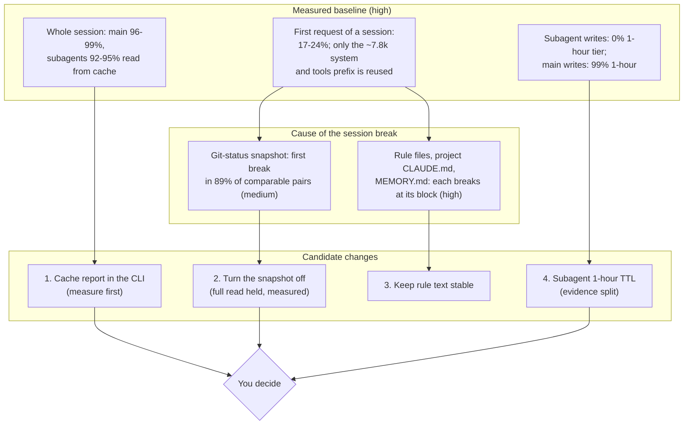

# Review: prompt cache reuse in Compass

> [!IMPORTANT]
> You decide: which metric the KPI uses for a subagent's first request (Divergent 1), whether Compass turns the git snapshot off in the projects it installs into (candidate 2, losses listed), and whether the subagent 1-hour TTL is tried before or after an A/B (Divergent 2).

Consolidates the four research files of [[research/whole-overhead/prompt-cache/index]] for [[SPEC-033-prompt-cache-is-a-design-input]]: A1 = axis 1 [[RESEARCH-cache-hit-baseline]], A2 = axis 2 [[RESEARCH-session-start-prefix]], A3 = axis 3 [[RESEARCH-cache-ttl-subagents-loops]], A4 = gap pass [[RESEARCH-prefix-break-isolated]]. "F7" means finding 7 of that file; "cand. 5" its candidate change 5. The cache hit rate and the `paths: ["**"]` behavior are also open items C1 and C2 of [[research/llm-research/REVIEW-llm-research-for-compass]]. All telemetry is one user's machine on a subscription, host 2.1.330; aggregates only.

## Question

How much of Compass's repeated input is read from the provider prompt cache today, what in the session-start prefix breaks reuse, how cache lifetime meets subagents and loops, and which changes would raise reuse while every fact stays in the vault.

## Measured baseline (first values of the spec's KPI, the share of repeated input read from cache)

Hit = `cache_read / (cache_read + cache_creation + input)`, tokens-weighted unless marked "binary".

| Measure | This repo | Other Compass projects | Non-Compass | Source |
|---|---|---|---|---|
| Main session, whole | 96.4% | 97.5% | 98.7% | axis 1 F1; axis 3 F11 pooled 97.3% |
| Main session, first request | 23.5% (n=233) | 17.1% (n=1,441) | 21.9% (n=169) | axis 1 F2 |
| First request, typical read | 7,702 / 7,825 tokens of 32k-40k | 5,777 / 7,706 | 631 / 5,581 | axis 1 F4 |
| Next session 5-60 min later: share reading 60%+ | 0% (n=55) | 2% (n=470) | 18-20% | axis 1 F5 |
| Subagents, whole | 91.9% | 93.7% | 94.5% | axis 1 F7; axis 3 pooled 93.4% |
| Subagent first request, tokens-weighted | 12.9% | 13.7% | 9.7% | axis 1 F7 |
| Subagent first request, binary (any read), pooled | 52% with no earlier sibling; 82-95% within 5 min of one; 42% at 5-60 min; 13% past 1 h | | | axis 3 F9 |
| Looprunner runs, whole | 88.2% (85 runs, 3 loops) | | | axis 1 F9 |
| Cache-write tier | main 99.3% 1-hour; subagents 0% 1-hour (0 of 4,445) | | | axis 3 F10, F11, F23 |
| Main gaps over 1 hour | 0.9% of gaps, 10.0% of modeled main cost | | | axis 3 F21 |

Controlled launches (scratch repos, 24k-42k-token prefixes): an unchanged prefix reads in full (14.5k-42.0k, write 0); one changed block cuts the read to the blocks before it (axis 4 F1, F2, F6, F11).

## Convergence matrix

"-" = not addressed; h/m = the axis's own confidence. Agreement = YES over agents that addressed the claim.

| # | Claim | A1 | A2 | A3 | A4 | Agreement |
|---|---|---|---|---|---|---|
| 1 | Whole-session main hit is 96-99%, so it cannot see a prefix break | YES (h) | - | YES (h) | - | 2/2 |
| 2 | Across sessions only the system and tools prefix (~5.5k-7.8k) is reused | YES (h) | YES (m) | - | YES (h) | 3/3 |
| 3 | A change at any block rewrites every block after it; blocks before it are read | - | YES (h) | YES (h, doc) | YES (h, trial) | 3/3 |
| 4 | The git-status snapshot is the dominant cross-session breaker | unknown (m) | MIXED (7a yes, 7 no) | YES (doc) | YES (h/m) | 2/4 yes, 1 mixed |
| 5 | Project CLAUDE.md, rule files and MEMORY.md each break at their block | - | YES (doc) | - | YES (h, trial) | 2/2 |
| 6 | A skill added does not break the prefix | - | YES (doc) | - | YES (m, trial) | 2/2 |
| 7 | `includeGitInstructions: false` / `CLAUDE_CODE_DISABLE_GIT_INSTRUCTIONS=1` removes snapshot and host commit/PR text, and holds the read | - | YES (doc, untrialled) | - | YES (h, trial) | 2/2 |
| 8 | The snapshot lists path set and status letters, so re-editing a listed file does not break it | - | - | - | YES (h) | 1/1 |
| 9 | `--exclude-dynamic-system-prompt-sections` does not protect the prefix | - | - | - | YES (m) | 1/1 |
| 10 | `paths: ["**"]` rules load at launch like unscoped rules | - | YES (h) | - | - | 1/1 |
| 11 | Hot-path vault files enter as tool results behind the cached layers | - | YES (h) | - | - | 1/1 |
| 12 | A subagent's first request reads a small share of its input (~13-19%) | YES (h) | - | YES (m) | - | 2/2 |
| 13 | Per-type subagent first-request hit (builder 6% vs 54%) | 6.1% (h) | - | 54% (m) | - | 0/2 same number |
| 14 | A subagent shares no prefix with its parent; a fork does | inferred | YES (doc) | YES (doc) | - | 3/3 |
| 15 | Subagent writes are 5-minute, main writes 1-hour (subscription) | main only (h) | YES (doc+rec) | YES (h) | - | 3/3 after reconciling |
| 16 | Compass sets no TTL, no git switch, no `omitClaudeMd` | YES (h) | YES (grep) | YES (grep) | - | 3/3 |
| 17 | A 1-hour subagent TTL pays | - | YES (cand.) | SPLIT (F19/F22 yes, F13 no) | - | divergent |
| 18 | Loop TTL or spacing change has low value at the default daily cron | YES (spacing barely shows) | - | YES (h, code) | - | 2/2 |
| 19 | No Compass tool computes a hit rate or reads TTL fields | YES (h) | YES (h) | YES (h) | - | 3/3 |
| 20 | Axis 2 trial 7a's extra 3,023 tokens were the project CLAUDE.md block | - | YES (m) | - | NO (h, host log) | 1/2 |
| 21 | Worktree siblings hit 95% despite the docs' directory scope | - | - | YES, unexplained (m) | - | 1/1, contradicts doc |

## Converged (high confidence)

1. **The whole-session hit rate hides the problem; the first request and the next-session pairing show it** (A1, A3)
   - Excluding first requests moves the whole-session rate under 1 point (A1 F1, F12); first requests are 6-13% of cache writes (A1 F3).
2. **A new session reuses only the system and tools prefix and rewrites the 27k-35k tokens after it** (A1, A2, A4)
   - First-request reads cluster at 5,6xx, 7,7xx, 7,8xx; writes median 27k-34k (A1 F4, A2 F7, A4 F2).
3. **The request is a prefix chain: system, tools, user block 0 (all instruction files and MEMORY.md), block 1 (git snapshot), attribution, prompt, then listings** (A2, A3, A4)
   - Block-level diff, breakpoints on both system blocks and the prompt block, 1-hour TTL (A2 F2, F3; A4 F1).
4. **Each Compass-owned instruction text breaks reuse at its position when it changes** (A2, A4)
   - CLAUDE.md edit, rule added, rule edited: read 24.0k to 8.8k, repeat reads full (A4 F6); `self-update` rewrites rules at SessionStart (A2 F14).
5. **Turning the snapshot off removes the dependency on repository state** (A2, A4)
   - Env switch, two new untracked files in turn: read held 23,407, write 0; one-time 23.4k rewrite at the switch (A4 F8).
6. **Skills listing changes do not break the prefix** (A2, A4)
   - Skill added: read 14.46k, write 0 (A4 F4); docs: skills append as conversation messages (A2 F15).
7. **A subagent starts cold relative to its parent and reads only its own small agent prefix** (A1, A2, A3)
   - Median first request reads 2.8k-5.3k of 38k-45k (A1 F7, A3 F9); docs: no parent sharing, forks share (A2 F11, A3 F7).
8. **Subagents write 5-minute cache only; main sessions 1-hour on a subscription** (A1, A2, A3)
   - 0 of 116,513 subagent requests wrote 1-hour (A3 F10); A1 F10's "99% 1-hour" counted main sessions only (A3 F23).
9. **Compass sets none of the cache controls and measures none of the cache** (A1, A2, A3)
   - No `includeGitInstructions`, `CLAUDE_CODE_DISABLE_GIT_INSTRUCTIONS`, `cacheTtl`, `PromptCacheTtl` or `omitClaudeMd` anywhere in `plugin/` (A3 F14).
10. **Loop TTL changes buy little as loops are scheduled** (A1, A3)
    - Default cron `0 6 * * *` expires both TTLs (`plugin/cli/commands/loop.py:110-111`); spacing barely moves the 88% (A1 F9).

Single-axis claims uncontested by the others: snapshot changes on path set only (A4 F7); `--exclude-dynamic-system-prompt-sections` does not help (A4 F9); `**` rules load at launch, closing C2 for the main session (A2 F9); hot-path files are tool results, not prefix (A2 F13); waits over 1 hour cost 10% of modeled main cost (A3 F21).

## Partial (needs attention)

1. **Is the git snapshot the dominant cross-session breaker?** 2 yes, 1 mixed, 1 unknown
   - Majority (A3 doc, A4): first differing block is the snapshot in 123 of 138 comparable pairs here, 113 of 193 elsewhere (A4 F12).
   - Minority (A2 F7): 10 same-snapshot pairs read the same ~7.8k as 162 differing pairs; A1 F5 sees the same stop in non-Compass projects.
   - Possible explanation: 35% of this repo's consecutive pairs change model or request parameters, which also cuts reuse to the system prefix (A4 F13). A2 rated its own minority result low.
2. **What axis 2 trial 7a measured** 1/2
   - A2 F7a: the extra 3,023 tokens read were the project CLAUDE.md block, read past a snapshot change.
   - A4 F5: the trial ran in a session scratchpad, where the host loads no project CLAUDE.md or rules (host debug log); the block was user-level files. A4 F6 repeats the trial outside a scratchpad with the same shape of result.

## Divergent (human decision)

1. **Which number is a subagent's first-request hit** split 1/1
   - Position A (A1 F7, F8): tokens-weighted read share; builder 6.1%, tester 13.5%, researcher 15.7%, planner 2.2% (this repo).
   - Position B (A3 F9, F19): binary share of first requests that read anything; builder 54%, tester 69%, researcher 65%, planner 6%.
   - Both report a 14-19% read share of first-request tokens, so the split is the metric definition, not the data. The KPI must name one.
2. **Does a 1-hour TTL for long-running subagents pay?** split within A3, A2 for
   - For (A2 cand. 5; A3 F19, F22): builders run a median 17 min, 82% past 5 min; after a 5+ min gap a subagent reads 16.5% vs 88.5% for main.
   - Against (A3 F13, low): modeled all-1-hour switch raises subagent cost 15%, since only 1.3% of in-agent gaps exceed 5 min.
   - Unmodeled: reuse across same-type agents 5-60 min apart (42% binary hit today). Settling it needs an A/B on builder waves.

## Candidate changes, ranked by north star

Ranked by Compass's four ranked goals (north stars): accuracy, then perfect memory (the vault as single source of truth), then near-zero cache misses, then low token usage. Grade is the evidence grade the axes gave.

| # | Change | North star | Evidence (grade) | Touches in `plugin/` | Lost | Vault single source |
|---|---|---|---|---|---|---|
| 1 | CLI cache report: per-session first-request read and hit, pairing with the previous session in the project and its first differing block, per-agent-type rate from the subagent `agentType` meta file, TTL split from `usage.cache_creation` | accuracy (and SPEC-033's measure-first constraint) | A1 F11, F12 (high); A4 F12 (medium); A3 cand. 7 | reuse `plugin/cli/sessionslib.py:134,146,154,185,193`, `plugin/cli/commands/context_check.py:140-155`; new command | nothing | yes; the report writes aggregates, no vault fact moves |
| 2 | Turn the git snapshot off: `includeGitInstructions: false` in the project `.claude/settings.json` Compass merges, `CLAUDE_CODE_DISABLE_GIT_INSTRUCTIONS=1` for loop workers | cache misses, tokens | A4 F2, F7, F8, F12 (high, trial); A2 F5 (high, doc) | `plugin/cli/commands/self_update.py:196-255` (`merge_settings`), `plugin/skills/setup/SKILL.md:163-173`, `plugin/skills/update/SKILL.md:131-143`, `plugin/cli/looprunner.py:759-761` | the startup branch, status and recent-commits orientation in the main session and every subagent; the host's built-in commit and PR instructions in the Bash tool description; one full rewrite on the first launch after the switch | yes; no Compass agent, skill or rule reads the snapshot or relies on host commit/PR text (handoff, pr-describe, validator and debug run git themselves; commit rules in `plugin/skills/methodology/SKILL.md:166-174`, `plugin/templates/agents/builder.md:92-93`) |
| 3 | Keep Compass-owned prefix text stable: rule files and CLAUDE.md change only on a landed update; no SessionStart hook prints churning vault text | cache misses | A4 F6 (high), A4 F12 rule file first in 7/138 (medium), A2 F13, F14 | `plugin/cli/commands/self_update.py:32-36` (already sha-gated), `plugin/templates/rules/*.md`, `plugin/hooks/hooks.json` | nothing | yes; hot-path files stay tool results ([[SPEC-003-hierarchical-vault-organization]] already covers this) |
| 4 | 1-hour TTL for long-running subagents: `experimental:` `cacheTtl: 1h` in builder (then tester, researcher, planner), or project-wide `subagentPromptCacheTtl` | cache misses, tokens | A3 F19, F22 (medium) vs F13 (low); see Divergent 2 | `plugin/templates/agents/builder.md:1-13` and peers, or the settings merge of row 2 | nothing functional; risk of about 15% higher subagent cost; the setting is ignored while a subscription draws usage credits (A3 F2) | yes |
| 5 | Drop the `paths: ["**"]` header from the three always-loaded rules, after one compaction run confirms behavior | tokens, accuracy | A2 F9 (high, launch), compaction unobserved | `plugin/templates/rules/compass-pipeline.md:1-4`, `session-start.md:1-4`, `wikilinks.md:1-4` | nothing at load; compaction behavior changes (docs: a `paths:` rule is summarized away, an unscoped one re-injected) | yes |
| 6 | `omitClaudeMd: true` for subagent types that need no project rules | tokens | A2 F11 (high, doc), cand. 5 | `plugin/templates/agents/*.md` frontmatter | the pipeline rules and CLAUDE.md in those subagents, an accuracy trade | yes, but agents stop seeing the rules that point them at the vault |
| 7 | Loop workers: `CLAUDE_CODE_PROMPT_CACHE_TTL=1h` under API-key billing; judge sessions kept inside the first one's TTL | tokens | A3 F16, F17 (medium); judge hit unmeasured | `plugin/cli/looprunner.py:759-761`, `:773-774`, `plugin/cli/loop_templates/github-workflow.yml` | nothing | yes |
| 8 | Human gates over 1 hour: compact or resume rule for long waits | tokens | A3 F21 (medium-high) | review gate flow in the pipeline rule | depends on the mechanism chosen | yes |
| 9 | Stage parallel builders so the first writes before the rest start | cache misses | A3 F18, F20 (medium); the shared prefix is only 14-19% of first-request input, so that is the most it can save | `plugin/skills/build/SKILL.md:36-39` | some wall-clock time per wave | yes |
| 10 | Gitignore regenerated vault files to shrink the snapshot | cache misses | A2 cand. 6 | `.gitignore` template | version history of `meta/*.yaml`, archive logs, lesson indexes | no: moves files out of version history; row 2 removes the listing with no vault change |

## Gaps

- **Effect of row 2 in a real Compass project.** Trials used 24k-42k scratch prefixes; break positions transfer, token counts do not (A4 Gaps). Does not block a plan: the before/after run is the plan's own verification, using row 1.
- **Subagent snapshot.** Each non-Explore, non-Plan subagent gets its own snapshot (A2 F5); its position in the subagent prefix and the gain from row 2 for subagents are unmeasured. Does not block; row 1's per-type report measures it.
- **`**` rule behavior at compaction and in subagents.** Unobserved (A2 F9). Blocks row 5 only.
- **Cross-agent reuse in the TTL cost model.** A3 F13 models in-agent gaps only. Blocks row 4 unless the plan makes it an A/B experiment.
- **Loop worker first request and judge sessions.** Not recorded per run (A1 F9) or measured (A3 Gaps). Blocks row 7 only.
- **API-key and cloud billing.** All telemetry is one subscription; there the main default is 5 minutes, so 5-60 minute gate waits rewrite too (A3 F21). Does not block; limits how far the baseline generalizes to other users.
- **Interactive versus `-p`, date line, beta headers.** Not isolated (A4 Gaps); interactive sessions are 7 in this repo (A1 Gaps). Does not block.
- **The 22,552-token read cluster and the 95% worktree-sibling hit against directory scope.** Unexplained (A1 F4, A2 F7, A3 F20). Do not block.
- **Snapshot reliance in shipped Compass text.** No shipped agent, skill, rule or hook in `plugin/` reads the snapshot or relies on host commit/PR text (row 2). Does not block.
