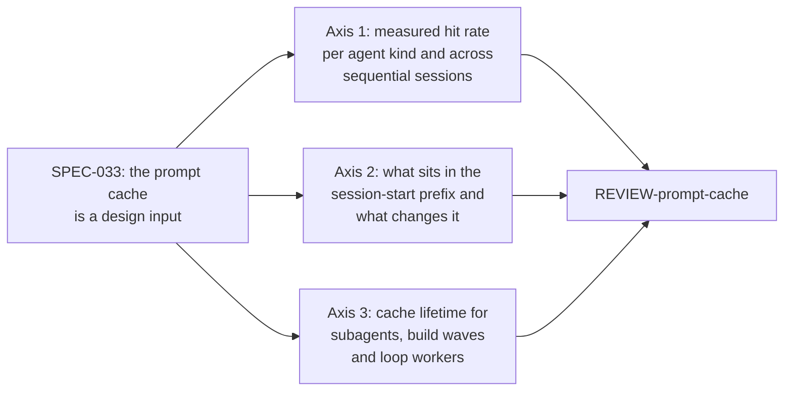

# Prompt cache research for SPEC-033

Research for [[SPEC-033-prompt-cache-is-a-design-input]]. It reuses [[research/llm-research/REVIEW-llm-research-for-compass]] item A1 and measures C1 and C2 that review left open. Grading: allowed.

## Axes

The spec's Desired Outcome splits into three reuse settings (sessions, subagents, loops) and one measure; its constraint puts the measure first.

1. **Measured hit rate (baseline).** How much of Compass's repeated input is read from the cache today, per kind of agent (main session, each subagent type, loop worker) and across two sequential sessions in one project, and how a Compass change that lowers it would be seen. Sought in local session transcripts' `usage` fields (`cache_read_input_tokens`, `cache_creation_input_tokens`, `input_tokens`), aggregate only and project-free, and in what `plugin/cli/` already reads (`context_check.py`, `compass usage`). Output: [[RESEARCH-cache-hit-baseline]].
2. **The session-start prefix.** What the host places in front of the first turn and in what order (system prompt, tools, CLAUDE.md, rule files, the git-status snapshot, hook output), which of those Compass's install makes change between sessions (vault files churned by `compass sync`, rule files with `paths: ["**"]`, SessionStart hook text), and which host settings stabilize or drop each part. Sought in host documentation, `plugin/hooks/`, `plugin/templates/rules/`, `plugin/cli/commands/sync.py`, and transcript diffs between consecutive sessions. Output: [[RESEARCH-session-start-prefix]].
3. **Cache lifetime for subagents and loops.** The TTL options the provider and host expose (5 minutes, 1 hour; env vars, settings, agent frontmatter), their price trade-off, whether subagents of one type share a cached start within a build wave, and how spacing of `looprunner` workers meets the TTL. Sought in provider and host documentation, `plugin/cli/looprunner.py`, `plugin/templates/agents/`, `plugin/skills/build/`, and transcript timestamps. Output: [[RESEARCH-cache-ttl-subagents-loops]].

Facet audit: functional (axes 2, 3), non-functional cost (all), interfaces with the host (axes 2, 3), constraints: measure first and the vault stays the source of truth (axis 1, and axis 2 checks that no proposed change moves a fact out of the vault), stakeholder context: usage data stays private, aggregates only (axis 1).

## Gap pass

Axes 1 and 2 both found that a new session reuses about 7.8K tokens of the previous session's cache, in Compass and non-Compass projects alike, with the cause not isolated. Controlled launch pairs that each change one factor of the session-start prefix: [[RESEARCH-prefix-break-isolated]].

## Results

Review: [[REVIEW-prompt-cache]].

Baseline recorded by `compass cache`: [[RESEARCH-cache-baseline-measured]].
