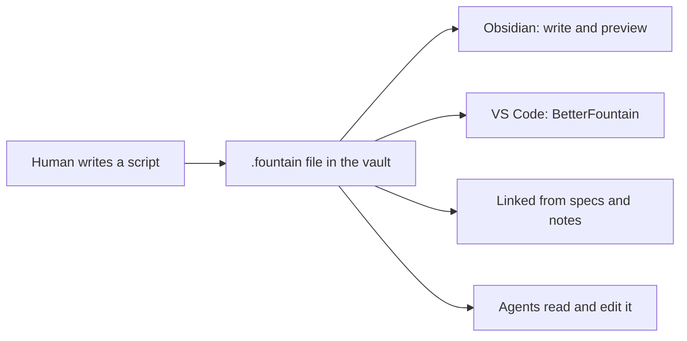

# Screenplays Live in the Vault

> [!important] You decide
> Is this the problem, in your words? Approving lets research find the Obsidian Fountain option and set it up.

## Problem

The human will write scripts inside the vault. Compass has no way to write or preview a screenplay in Obsidian, and the scripts he already writes in VS Code with BetterFountain (`.fountain` files) sit outside what the vault links and what agents work on.

**Motivating datum:** the Disrupted hub session, F:\Creative\Disrupted (vault at `.compass`), 2026-11-19, relayed by that session; the human wants this as a shared Compass feature usable in every project, never something local to Disrupted.

## Desired Outcome

- Write and preview Fountain in Obsidian.
- Interoperate with VS Code, where he already uses BetterFountain (`.fountain` files): the same file opens in both, with nothing converted between them.
- Scripts live in the vault and are linkable like any other document.
- Agents can read and edit them.
- It works in every project that has Compass, set up the way Compass sets up its other Obsidian pieces.

KPI: [guess: a `.fountain` file created in any Compass vault opens and previews in Obsidian, opens unchanged in VS Code with BetterFountain, resolves from a `[[wikilink]]`, and an agent edit to it shows in both editors.]

## Non-Goals

- A full screenwriting application (revision colours, production breakdowns, PDF layout beyond what the chosen option already gives). [guess]
- Replacing BetterFountain as his VS Code editor.

## Open Questions

- [guess: an existing Obsidian Fountain plugin is preferred over a Compass-built one when it meets every outcome above; building one is the fallback.]
