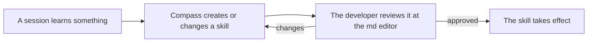

# Skills Created Automatically, Reviewed in the md Editor

## Problem

Ideally I like the thing about creating skills automatically. What a session learns becomes at most a lesson of five lines; Compass creates no skills. Hermes creates skills automatically (see [[research/hermes/REVIEW-hermes-skill-creation-2026-11]]).

## Desired Outcome

Creating skills automatically, and we should give the developer a review opportunity for the skill at the md editor. Every skill Compass creates or changes reaches the developer this way before it takes effect. Compass changes only the skills it created itself; shipped Compass skills and the developer's own skills stay as they are.
