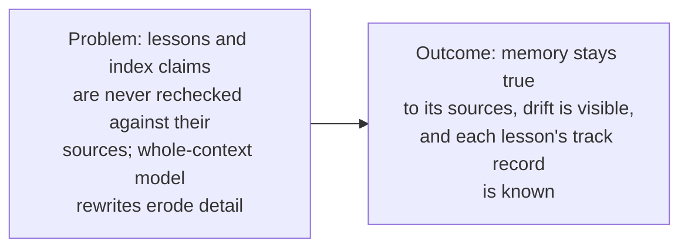

# Consolidation Is Grounded in Sources

> [!IMPORTANT]

## Problem

The vault's memory (lessons, index lines, `file:line` references) drifts from what it describes, and nothing notices ([[research/llm-research/REVIEW-llm-research-for-compass]]).

- **Nothing rechecks memory against its sources.** A lesson is written or revised when a capture fires, and consolidation runs only when a size cap is hit. After that, no step reads the transcript a lesson came from or the code a `file:line` reference points at to confirm it still holds. Stale instructions are followed and never repaired.
- **A whole-context model rewrite erodes detail.** Consolidation asks a model to rewrite verbose lesson bodies. A peer-reviewed study measured whole-context model rewrites of an agent's memory as harmful: accuracy fell below having no memory at all.
- **Lessons carry no outcome.** A lesson's score counts how often it recurs, never whether work that cited it then passed or failed, so a lesson that misleads looks the same as one that helps.

## Desired Outcome

Lessons, index lines and code references are rechecked against the transcripts and code they came from. What no longer holds is reported as drift with the evidence beside it, and every correction can be checked on its own before it takes effect. Whether the work that cited each lesson passed or failed is known.

KPI: [guess: on a sample of lessons and index lines where a known share was made stale on purpose, the recheck reports the stale ones and no fresh ones; [[SPEC-028-agent-memory-is-good-enough]] may supply the measure.]

## Constraints

- Nothing destroys information (the Data rule): drift is reported, and stale text moves colder; it is never deleted.
- Mechanical work stays off the agent token budget ([[compass-cli/specs/SPEC-004-mechanical-work-off-the-agent-budget]]).
