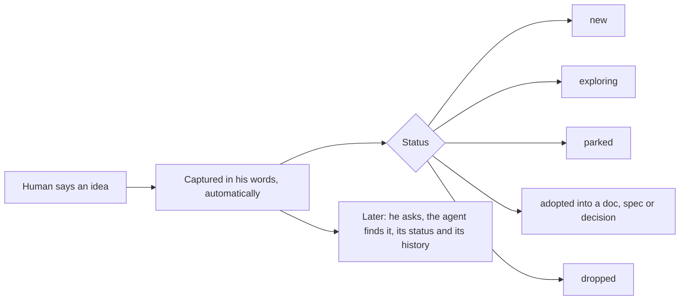

# Every Idea Is Kept, in the Human's Words, With Its Status

> [!important] You decide
> Is this the problem, in your words? Approving lets research design the idea record against how Compass already captures.

## Problem

The human gives many ideas in conversation. Compass captures lessons and specs, but nothing keeps an idea that has not yet become a spec: it lives only in the session that heard it. When he comes back and asks about one, no agent can find what he said, whether it went anywhere, or why it stopped.

**Motivating datum:** the Disrupted hub session, F:\Creative\Disrupted (vault at `.compass`), 2026-11-19, relayed by that session; that session holds ideas to backfill. The human wants this as a shared Compass feature usable in every project.

## Desired Outcome

- Every idea is captured in his own words ([[SPEC-021-capture-in-the-humans-words]]).
- Each idea has a status that stays current, for example new, exploring, parked, adopted into a doc or spec, dropped.
- Each idea records where it led: the doc, spec or decision.
- When he comes back and asks about anything, the agent can find the idea, its status and its history.
- Capture is automatic: he never has to ask for it.
- It fits how Compass already works: capture-note, lessons, specs, the review surface, Obsidian.
- Ideas already given in past sessions can be backfilled into the same record.

KPI: [guess: asked about an idea from an earlier session, an agent answers with his words, the current status and where it led, from the vault alone, without being told where to look.]

## Non-Goals

- Judging which ideas are good; status records what happened to an idea, never a ranking. [guess]
- Turning ideas into specs automatically; adoption into a spec stays the human's call.

## Open Questions

- [guess: a status change is recorded by the agent when the idea's fate changes in conversation or in the vault (a spec cites it, he drops it), never by asking him.]
