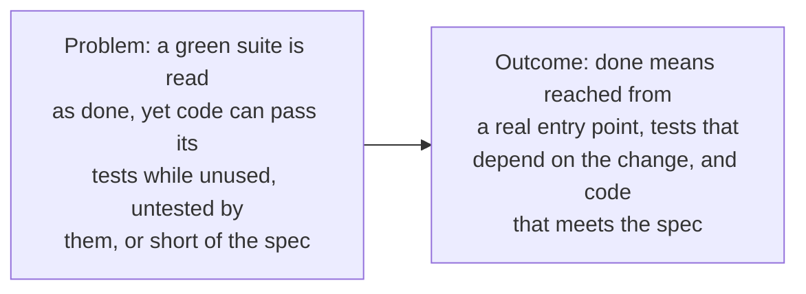

# Verification Goes Beyond Passing Tests

> [!IMPORTANT]

## Problem

Passing tests is a weak sign that a task is done ([[research/llm-research/REVIEW-llm-research-for-compass]]). Research found three ways code passes while the work is not done:

- **The code is never reached.** Agent-written code passes its tests while the program never calls it.
- **The tests do not depend on the change.** A suite can stay green whether or not the new behavior exists, so its passing says nothing about the change.
- **The code falls short of the spec.** Test-passing changes break constraints the spec states; in one study a third of them did.

Compass's validator compares the plan with the diff and runs adversarial probes, and the builder's review looks at style (unused imports, naming). Nothing confirms that new code is reached from a real entry point, that the tests would fail without the change, or that the code meets each requirement of the spec, and an unmet requirement does not come back as work.

## Desired Outcome

A task counts as done only when its new code is reached from a real entry point, its tests depend on the change, and the code meets each requirement of the spec it traces to. A requirement found unmet comes back as open work instead of passing silently.

KPI: [guess: on tasks with a planted instance of each failure (unreached code, tests independent of the change, an unmet spec requirement), the checks flag every planted instance, where a green suite alone flags none.]

## Constraints

- A claim that a task is done is checkable by rerunning its evidence.
