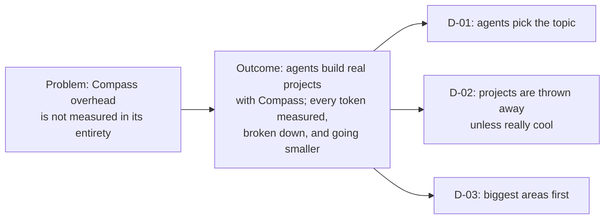

# Compass's Whole Overhead, Measured on Real Projects

## Problem

We would need to understand how to measure Compass overhead in its entirety and break that down.

Compass's overhead is every token a session spends because Compass is installed: the text it loads, the agents and commands it runs, and the work they do. The measure in [[SPEC-027-compass-uses-fewer-tokens]]'s loop counts only the text Compass ships, weighted by how often sessions load it, which is part of the overhead, not all of it.

## Desired Outcome

Have agents create projects with Compass and build something with Compass while you analyze EVERYTHING, like whole token usage, and you run things and make changes and see if Compass's token usage goes smaller.

Agents act as humans on projects and really build something.

KPI: across many builds, each from first setup to the result the agent set out to build, the share of tokens that is Compass overhead goes down from the first measured baseline, while the agents still finish what they set out to build.

## Decisions

> [!NOTE]
> - **D-01:** I would let them decide the topic, because we want this to be really generic and work with anything.
> - **D-02:** Temporary things we can throw away (or keep if they build something really cool).
> - **D-03:** Break that down and optimize the biggest areas first.
