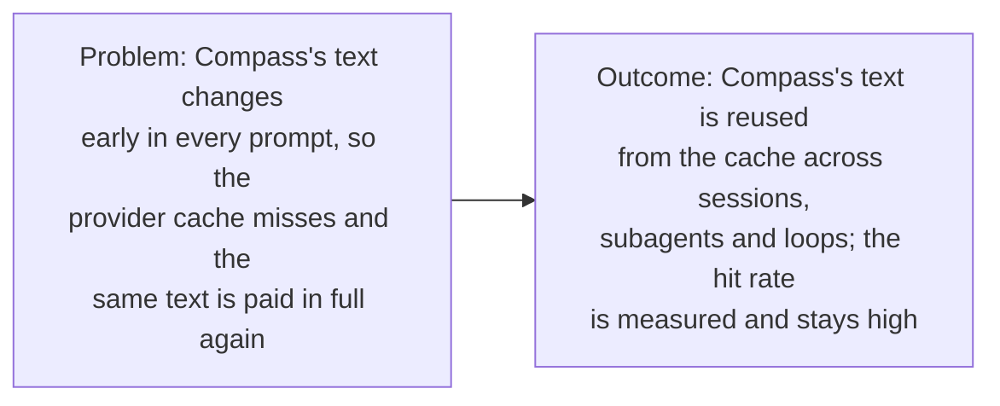

# The Prompt Cache Is a Design Input

> [!IMPORTANT]
> You decide: promote this spec to approved? Approving makes the cache hit rate a measure Compass is held to, alongside the token count of [[SPEC-027-compass-uses-fewer-tokens]], and lets research start on it.

## Problem

The model provider keeps a cache of the start of each prompt (the prompt cache). Text that matches a cached start is read back at a fraction of the price; a change anywhere invalidates the cache for everything after it ([[research/llm-research/REVIEW-llm-research-for-compass]], item A1).

Compass decides what text sits at the start of every session, subagent and loop run, and nothing in its design accounts for the cache:

- At session start the host places a snapshot of git status near the start of the prompt. It lists the vault files Compass rewrites on every write, so two sessions in a row in a Compass project likely share no cached start past that snapshot (inferred from the host's documentation, not measured).
- Subagents and loop workers start their own cache, which expires after 5 minutes by default; Compass does not extend that lifetime, so waves of builders and spaced loop runs can miss the cache they would otherwise reuse.
- No one knows how often Compass's text hits the cache, so a change that breaks reuse goes unseen.

Token counts alone hide this: two layouts with the same token count can cost very differently.

## Desired Outcome

The text Compass puts in front of the model is reused from the provider's cache wherever it can be: across sessions in the same project, across subagents in a build, and across loop iterations. The hit rate is measured per kind of agent and across sequential sessions, and a Compass change that lowers it is seen.

KPI: [guess: the share of Compass's repeated input read from the cache, per kind of agent and across sequential sessions, rises from its first measured baseline and stays there while the work's quality holds.]

## Constraints

- The hit rate is measured before any design change, so the size of the problem is known first.
- The vault stays the single source of truth: reuse of the cache never moves a fact out of the vault.
