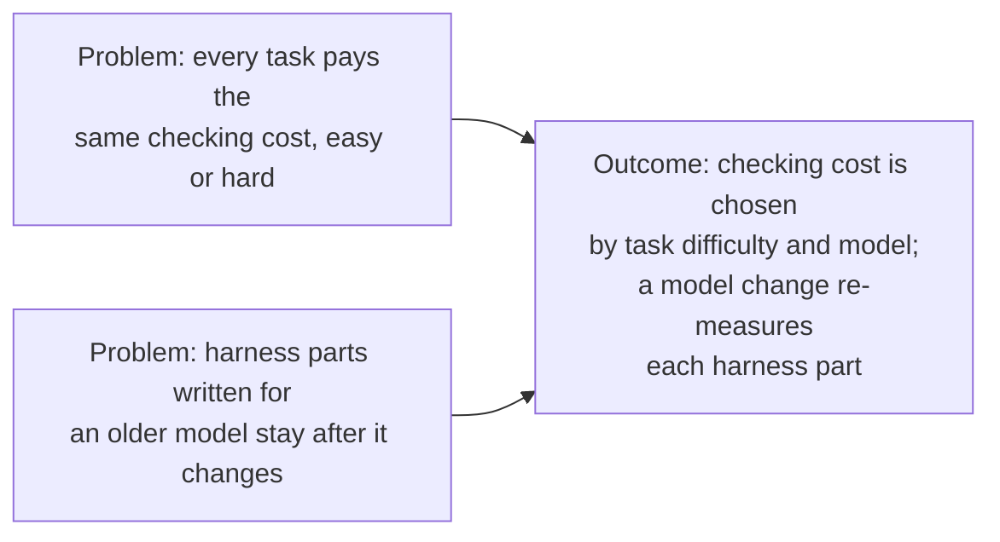

# The Cost of Checking Follows the Task and the Model

> [!IMPORTANT]

## Problem

The harness (the agents, checks and rules Compass wraps around the model) costs tokens on every task, and what that cost buys depends on the task and on the model ([[research/llm-research/REVIEW-llm-research-for-compass]]).

**Every task pays the same checking cost.** The post-build tester, the validator and the builder's own review (the checking stations) run in full on every task. Research found such checks pay off on tasks at the edge of the model's ability and are overhead on tasks well inside it. Compass has no rule that decides how much checking a task gets.

**Harness parts outlive the model they were written for.** Thresholds, phase splits, validator cadence, prompt rules and emphasis markers each compensate for a weakness of some model. When the model improves, some become dead weight or start to hurt, and research found the harmful ones only by testing each part on its own. Compass re-measures itself as a whole when the model or host changes, never part by part, so it cannot tell which parts still carry weight.

## Desired Outcome

How much checking a task gets is decided by a stated rule from the task's difficulty and the model doing it, and the choice is recorded, so the same task on the same model always gets the same answer. When the model or the host (the tool running the model, such as Claude Code) changes, the harness parts that no longer help are known.

KPI: [guess: on a benchmark task sample, tokens spent on the checking stations fall for tasks inside the model's ability while defects caught on hard tasks do not fall; after a model change, every harness part has a measured effect, with it against without it.]

## Constraints

- Accuracy outranks token savings ([[SPEC-001-compass-vision-and-architecture]] ranks correct outputs first and low token use last): lighter checking is earned by measurement showing defects caught do not fall.
- A harness part found unhelpful is reported and kept, its text moved to colder storage intact.
